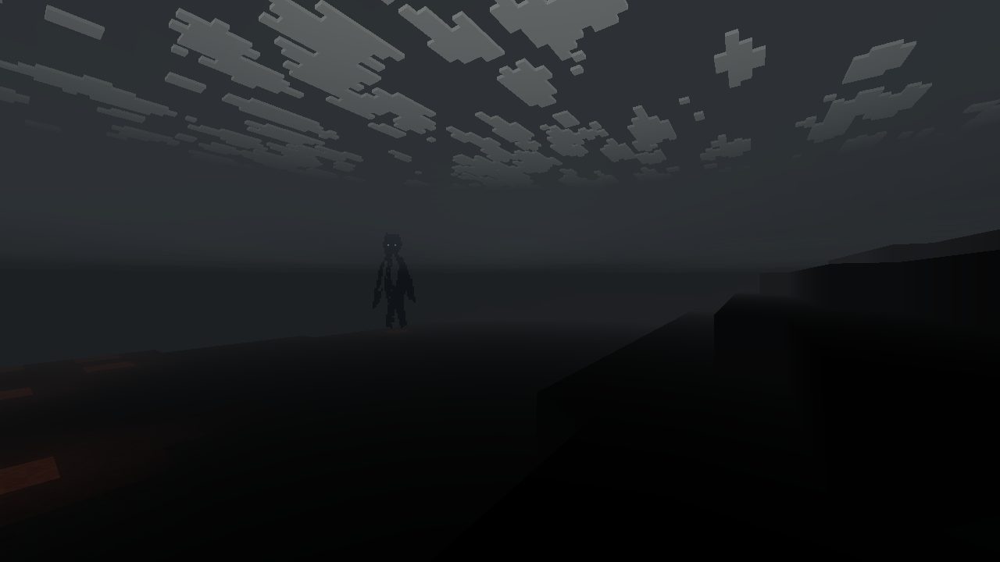
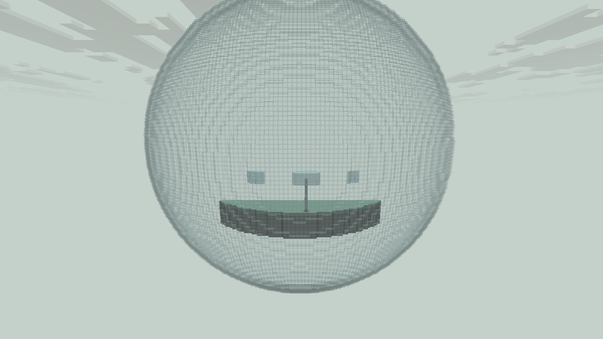
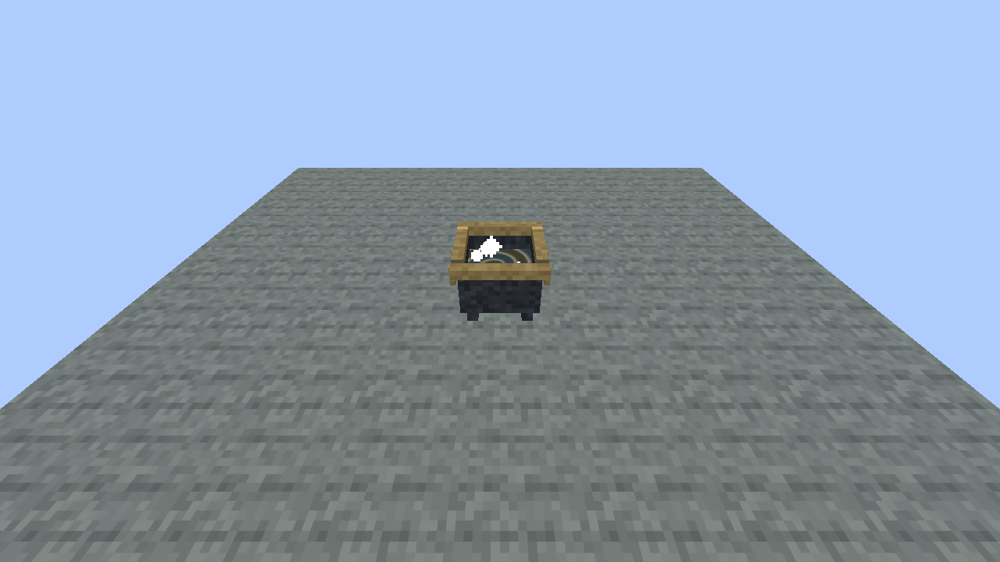

# 维度-咒械原

**Logos: Spellwrought Expanse** — 由咒术塑成的辽阔原野。

Logos 的独立新维度附属 Mod。工程名 `LogosDimensionAddon`，Mod ID `logos_dimension`。当前版本为可运行的 **0.1.0 原型**，适合逐步调整世界生成和美术。

新增第二维度 **天门云域**（`logos_dimension:cloudsea`）：24 个魔力地面群系、两个地下群系、厚云与剑开天门、天空魔鲸景象、异变植物及中世纪聚落。它使用独立的纯魔法美术和世界生成，不添加矿物或实体生物，也暂不设计进入方式。完整方向与本版边界见 [天门云域设计说明](docs/CLOUDSEA_DESIGN.md)。



## 世界方向

世界是一座仍在工作的巨大炼金釜。约 20,000 × 20,000 格的地貌单元向外重复；每个单元有一座直径约 2,400 格的中心空岛。地面由内向外依次是硫、汞、盐三条宽广区域，以太荒野占多数并穿插连通各区。不是有限大小的世界，也不会一次性预生成整个单元。

- 以太：灰绿地层、扇冠树、琥珀种穗、星形花与河谷。
- 硫：焦化岩、朱砂、附属 Mod 自有的炼金硫沉积、深裂谷与熔融玻璃。
- 汞：凝汞地壳、真实可流动的液态汞、少量悬浮金属岩台。
- 盐：盐壳台地、透明盐晶、白化时的天然盐晶生长。
- 环境巨物：倒悬玻璃蒸馏瓶生态岛、巨型透明液体导管、缓慢旋转的天空星盘。
- 时间：独立的黑化、白化、黄化、红化周期，每阶段 24,000 tick。天空、雾、天然材料随周期变化。



**中心空岛不生成建筑、植被或小怪，平整顶面预留给后续 Boss 宫殿。** 专属 `sanctum` 生物群系没有自然刷怪表，额外拦截自动刷怪和刷怪笼。脚本与命令召唤保留给后续 Boss。岛下面的地面仍可有正常生态。

## 空岛下方的影雾

击败对应空岛 Boss 前，岛下开放空间被灰黑雾笼罩。进入会看到边缘浮现的细长影子、短暂苍白眼点，并听到低沉回声；靠近或近距离直视时影子消散。影子属于视觉幻象，不攻击、不碰撞、没有掉落，也不会在存档中堆积。离开雾区后清除。

每个重复空岛都有独立、可持久保存的 Boss 完成状态。以后把 Boss 的实体 ID 加入 `logos_dimension:island_bosses` 实体类型标签，其在对应岛范围内死亡时便会解除该岛的雾与幻象。

搜索占位入口：**`LOGOS_DIMENSION_ISLAND_BOSS_HOOK`**。目前标签为空，宫殿及 Boss 尚未制作。管理员可用下面的命令验证完成与重置状态。

## 安装与进入

当前构建目标：Minecraft **26.1.2**、NeoForge **26.1.2.112**、Java **25**。与独立安装的 Logos 0.5.0+ 一起放入 `mods`；开发验证使用 Logos **0.5.1**，主仓库基线 `f196960`。Logos 自身所需的 LDLib2、Photon、KilaGraph、GeckoLib 也需按主模组要求安装。本附属不内嵌这些模组。

生存入口：8 块玻璃围住一个现有 `logos:tainted_mana_shard`，合成「炼金漩涡」；再与原版炼药锅合成「炼金釜」。釜内的金银漩涡缓慢旋转并发光，跳入釜内液面即可传送到咒械原。釜壁与釜沿有实际碰撞，碰外壁或站釜沿不会触发。返回位置保存在釜旁的安全地面，狭窄位置则落在实心釜沿；传送后有 4 秒冷却。在咒械原使用另一个炼金釜可返回。旧炼金漩涡的右键入口仍可使用。朱砂与盐晶的材料掉落同样复用这个 Logos 注册 ID，没有重复注册污染碎片。

管理员命令：



```text
/alchemy enter
/alchemy return
/alchemy island [grid_x grid_z]
/alchemy region aether|sulfur|mercury|salt
/alchemy phase nigredo|albedo|citrinitas|rubedo
/alchemy boss defeated
/alchemy boss reset
```

`boss` 命令只修改玩家所在单元的状态。普通玩家不能执行管理员命令。首次远距离传送需生成目的地区块。

**不引用 26.1 原版硫磺方块，不添加任何原版主世界矿物生成。** `logos_dimension:sulfur_deposit` 是独立方块，方便以后移植资源与地形逻辑；当前 Java API 和构建仍针对上述 Minecraft 版本，跨版本仍需适配。

## 开发和检查

```text
./gradlew test runGameTestServer build -PlogosJar=/absolute/path/logos.jar
./gradlew runClient -PlogosJar=/absolute/path/logos.jar -PldTest=group:logos_dimension -PldTestHeadless -PldTestWindow=1280x720
```

GameTest 的专用数据包仅在测试时加载，因为 26.1 的 GameTestServer 默认剔除数据包维度。它不进入发行 JAR。源码内的客户端场景由 LDLib2 的 DEV_ONLY 注册，仅在开发环境运行。

地理比例、重复坐标、种子变化、平台留空、禁刷怪、流体流动与收集、天然材料换相、维度往返、各岛 Boss 状态序列化均有检查。客户端输出在 `build/ldlib2-uitest/`。

天空和影雾的自定义几何写全顶点属性。当前 Logos 的 `ShaderPackOverlay` 可用时，共用其光影合成后收集器；早期 Logos 没有该 API 时使用普通渲染。光影包兼容结果请见 `VERIFICATION.md`。

## 原型边界

镜面汞目前采用动画金属贴图，没有真正的实时镜面反射。大型地貌、美术、流体和影雾已是可运行底层；移动元素风暴、完整物质转化链、区域独有生物、探索奖励、建筑、宫殿及 Boss 留待后续逐项制作。当前没有原版主世界矿物，不会把主模组本体改成新维度模组。
