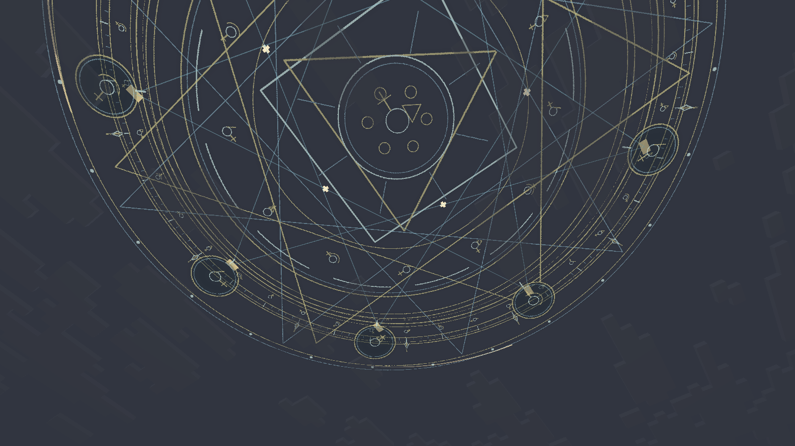
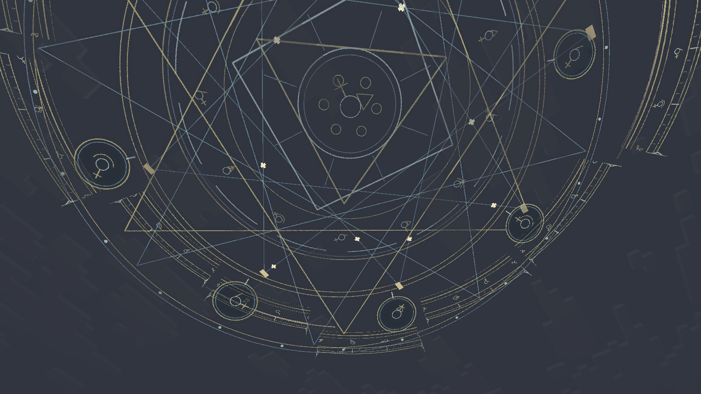
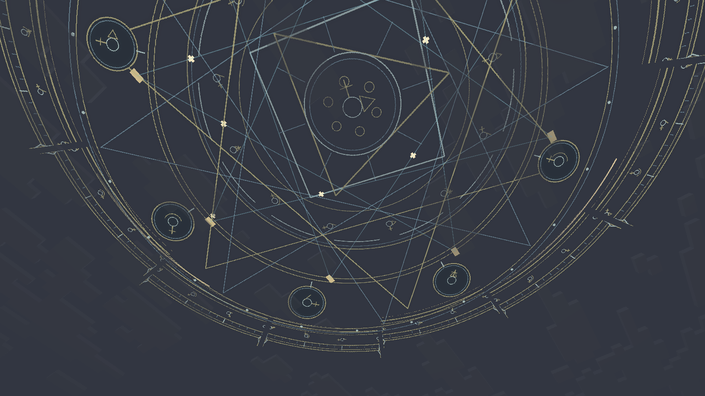

# 天空法阵的形态变化

原来的慢速整图旋转改为 36 秒连续编舞：十二块外环向外展开、上下错位并重新合拢；轨道反向旋转和倾转；中央纹章升降、缩放与呼吸发光。节点之间的星形连线改变连接方式，光点沿连线游走，外围有三道追逐的能量弧。

动画读取维度时钟及帧内插值，离开视野、重新进入游戏不会从头播放。外环约三分钟旋转一周，中层约两分钟；形态展开在数秒内即可看见。四阶段色调保留，不改变服务端炼金周期或玩家世界。

使用完整 UV、颜色、法线、光照、overlay 的自定义几何，与 Logos 的 ShaderPackOverlay 共用收集器。没有注册额外实体、逐帧生成纹理或加入大量粒子。开发场景 `group:arcane_animation` 连续截取真实游戏画面，用于检查实际运动。

## 2026-10-15 实机记录

下图均来自实际开发客户端。0.1.2 组合版本在普通渲染、Complementary Reimagined r5.9.3、Photon Shader v1.3b 下，各通过 8/8 场景、12/12 检查；每套保留 41 张原始截图。组合检查同时包含法阵、方块和云海，不能作为未运行场景的验证。

