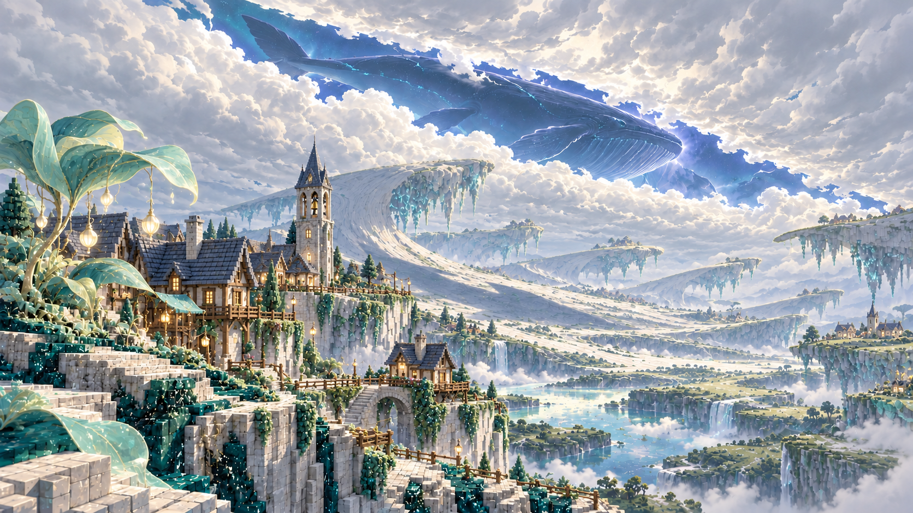
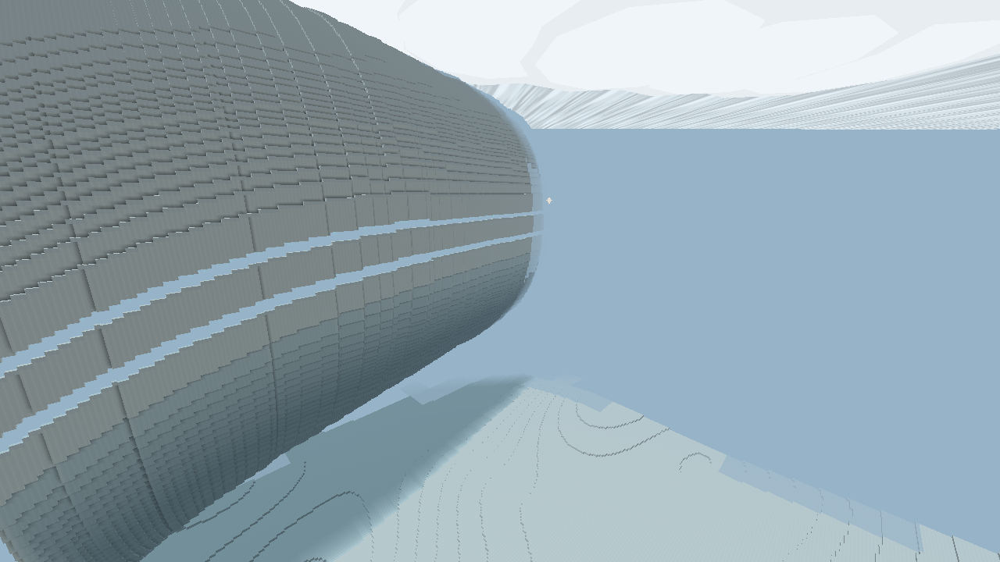
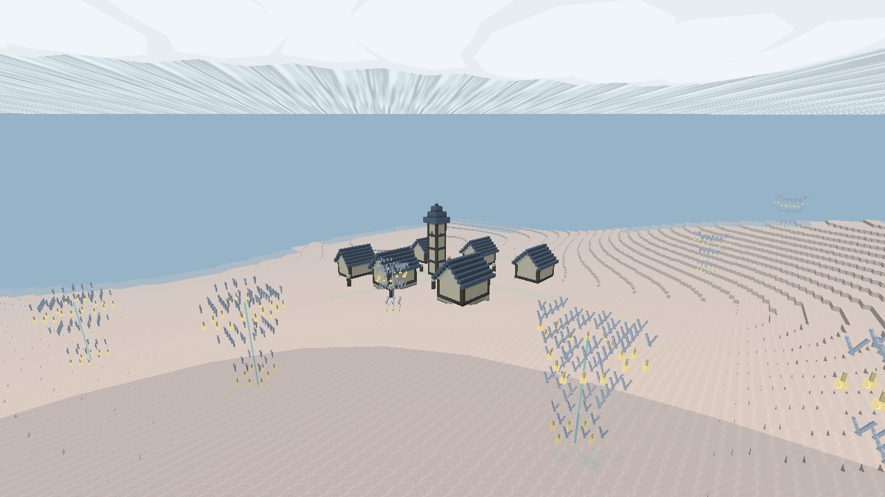

# 天门云域 · Cloudsea

**一句话主视觉：天被一剑劈开，魔力把大地掀成悬浮褶页。**

这是咒械原之外的第二个维度，注册 ID 为 `logos_dimension:cloudsea`。当前范围：自然环境、24 个地面群系、两个地下群系、天空景象和中世纪聚落。进入方式留空；不注册矿物、生物实体或 Boss。以下生态、矿物、Boss 与遗迹构想标注为后续设计，不能理解为本版已实现。

## 当前实机原型

以下为普通渲染的游戏截图，概念图仅表示后续美术方向。

## 第一眼与天空

首次观察点应在开阔台地，先看见可行走的辽阔地面，再抬头看厚云。无边云盖留出一条很长、边缘不规则的狭窄裂口，称为「剑开天门」。它是云层被劈开的缺口，不是建筑或实体剑。天门后的蓝色与白云形成清晰对比。

魔鲸约每三分钟掠过一次，可见窗口约 24 秒，进入与退出各有渐隐。鲸体保留宽额、腹褶、胸鳍、尾鳍和缓慢摆动；地面出现随其移动的柔和阴影，伴随低沉呼声。目前它是客户端天空几何景象，没有实体 AI、碰撞、伤害、掉落和存档负担。

上层使用中等亮度的漫射光和冷白环境光，没有刺眼太阳盘和突然变黑的昼夜。厚云由天空覆盖面、云沿和立体云团共同表现。主色采用瓷白、雾蓝、青玉，暖金只用于植物灯蕊与聚落窗光。局部粉、紫、琥珀颜色仍遵循低饱和度与大块留白。

## 空间逻辑与地面

地面保留连续底层，悬浮层增加垂直探索：卷起的岩层、花瓣状台地、浮起的长带、倒悬岩台和高脊。玩家能从地面看见下一层地形，先绕行、攀升，再穿过层间空隙。地形由种子确定，跨区块生成连续，负坐标也遵循同一逻辑。

24 个群系以八个形态家族组织，每个拥有独立地表、悬叶配色、基准高度、起伏和植物密度。它们是大区域，不把每个区块涂成一种颜色。边缘缓和高度变化。下表的生物是将来生态构想，本版所有刷怪表均为空；声音描述为美术目标，目前使用低音鲸鸣和音符盒音色占位。

| 群系 | 颜色（地表 / 叶） | 方块 | 地形与植物 | 生物预留 | 粒子 | 声音方向 |
| --- | --- | --- | --- | --- | --- | --- |
| 绸岩折原 | `#BCCCCC` / `#74AAA0` | `silk_folds_ground`、云瓷岩 | 卷起岩层、悬空洞口；折片悬叶 | 绸羽鳐（未制作） | 上升细光 | 长音与空谷回声 |
| 青玉旋庭 | `#83B4AA` / `#C2DCC0` | `jade_whirls_ground`、云瓷岩 | 花瓣盘地、缓缓升高的边缘；旋叶冠丛 | 花轮灵（未制作） | 下落孢光 | 轻碰铃音 |
| 珠光浅湾 | `#CED8CE` / `#8DAAC0` | `pearl_basins_ground`、云瓷岩 | 浅蓝水庭、连续低地；浮盘悬叶 | 珠蜓（未制作） | 水边微光 | 稀疏水音与泛音 |
| 倒生花园 | `#AAC6B1` / `#B6DCCB` | `reverse_gardens_ground`、云瓷岩 | 倒悬岩台、上下两层道路；垂叶与灯蕊果 | 逆悬蛾（未制作） | 缓慢下落 | 低风与细铃 |
| 星流长带 | `#A0B8CC` / `#76B8C3` | `star_ribbons_ground`、云瓷岩 | 浮起的长带、层间空隙；细长绸叶 | 星线游灵（未制作） | 横向流光 | 绵长风声 |
| 蓝铃阶地 | `#9DAEC4` / `#B1C3DF` | `blue_bell_steps_ground`、云瓷岩 | 高低分明的魔力阶地；开叉铃叶 | 铃角兽（未制作） | 短促符光 | 阶间铃音 |
| 欧泊潮丘 | `#DDCBC1` / `#B9C7DC` | `opal_dunes_ground`、云瓷岩 | 规律波面、柔和起伏；直立飘叶 | 欧泊小灵（未制作） | 地表低浮符光 | 轻细沙帘声 |
| 光冠峰林 | `#C8D1C1` / `#E1D6AA` | `halo_spires_ground`、云瓷岩 | 高脊与宽阔峰间谷；薄羽悬叶 | 光冠翼灵（未制作） | 偶发细火花 | 清亮高音 |
| 月纱褶谷 | `#B3BBCB` / `#CBC4DE` | `moon_folds_ground`、云瓷岩 | 卷起岩层、悬空洞口；折片悬叶 | 月纱蛾（未制作） | 上升细光 | 长音与空谷回声 |
| 翠羽盘原 | `#7EAA97` / `#A3C99B` | `verdant_whirls_ground`、云瓷岩 | 花瓣盘地、缓缓升高的边缘；旋叶冠丛 | 翠羽轻灵（未制作） | 下落孢光 | 轻碰铃音 |
| 静镜水庭 | `#91BBC7` / `#BAD9D7` | `glass_lagoons_ground`、云瓷岩 | 浅蓝水庭、连续低地；浮盘悬叶 | 镜水鳐（未制作） | 水边微光 | 稀疏水音与泛音 |
| 灯蕊悬台 | `#C5C7A4` / `#D7C998` | `lantern_shelves_ground`、云瓷岩 | 倒悬岩台、上下两层道路；垂叶与灯蕊果 | 灯蕊萤灵（未制作） | 缓慢下落 | 低风与细铃 |
| 曦光绸径 | `#CFC3AD` / `#D8C69D` | `dawn_ribbons_ground`、云瓷岩 | 浮起的长带、层间空隙；细长绸叶 | 曦羽游灵（未制作） | 横向流光 | 绵长风声 |
| 丁香叠界 | `#B8AFC3` / `#C8B6D4` | `lilac_steps_ground`、云瓷岩 | 高低分明的魔力阶地；开叉铃叶 | 丁香铃灵（未制作） | 短促符光 | 阶间铃音 |
| 玫辉波原 | `#CAAEB0` / `#D3B8AD` | `rose_dunes_ground`、云瓷岩 | 规律波面、柔和起伏；直立飘叶 | 玫辉薄翼（未制作） | 地表低浮符光 | 轻细沙帘声 |
| 霜羽高脊 | `#C1D5D6` / `#A8C9D5` | `frost_spires_ground`、云瓷岩 | 高脊与宽阔峰间谷；薄羽悬叶 | 霜羽兽（未制作） | 偶发细火花 | 清亮高音 |
| 回音悬谷 | `#A6B5B6` / `#9AC9C0` | `echo_folds_ground`、云瓷岩 | 卷起岩层、悬空洞口；折片悬叶 | 回音游灵（未制作） | 上升细光 | 长音与空谷回声 |
| 蜜光花盘 | `#CEC49F` / `#DECE9E` | `amber_whirls_ground`、云瓷岩 | 花瓣盘地、缓缓升高的边缘；旋叶冠丛 | 蜜光小灵（未制作） | 下落孢光 | 轻碰铃音 |
| 梦蓝浮泽 | `#96ABCB` / `#AABBDD` | `dream_basins_ground`、云瓷岩 | 浅蓝水庭、连续低地；浮盘悬叶 | 梦蓝水灵（未制作） | 水边微光 | 稀疏水音与泛音 |
| 云根垂野 | `#ACBCAF` / `#82B49E` | `cloudroot_shelves_ground`、云瓷岩 | 倒悬岩台、上下两层道路；垂叶与灯蕊果 | 云根步灵（未制作） | 缓慢下落 | 低风与细铃 |
| 听潮浮径 | `#8EAFC0` / `#A1C8D0` | `tide_ribbons_ground`、云瓷岩 | 浮起的长带、层间空隙；细长绸叶 | 听潮鳐（未制作） | 横向流光 | 绵长风声 |
| 象牙层园 | `#D8D4C4` / `#BCCCA3` | `ivory_steps_ground`、云瓷岩 | 高低分明的魔力阶地；开叉铃叶 | 象牙羽灵（未制作） | 短促符光 | 阶间铃音 |
| 极光砂幕 | `#B6C8CD` / `#AFD1CA` | `aurora_dunes_ground`、云瓷岩 | 规律波面、柔和起伏；直立飘叶 | 极光薄翼（未制作） | 地表低浮符光 | 轻细沙帘声 |
| 白羽天柱 | `#CFD4D0` / `#B6D2C4` | `pale_spires_ground`、云瓷岩 | 高脊与宽阔峰间谷；薄羽悬叶 | 白羽巨灵（未制作） | 偶发细火花 | 清亮高音 |

方块列省略公共前缀 `logos_dimension:cloudsea_`；对应的独立悬叶 ID 为同名 `_leaf`。

## 魔力覆盖与动态

所有地表采用自有魔力材料，贴图中的纹路以四帧慢动画呼吸，地表发出低强度光。悬叶不要求每片都贴在树干上，多个几何片之间保留间隙，灯蕊果悬挂在下方。群系按形态家族改变叶片模型和粒子：花盘与倒生区有缓慢飘落的孢光，长带区的微光横向流动，高脊区偶有火花，阶地和潮丘使用细小符光。粒子刻意稀疏，避免遮盖地貌。

魔力属于本维度的自然规则：发光脉线、反常重力和生长方向共同说明环境。当前不额外改变玩家魔力数值，不引入新的资源经济。

## 地下：逆生根窟

保留主世界易理解的地下层次：地表下的石层、狭长通道与开阔洞室。岩石和洞窟由本维度生成器生成，不调用主世界矿物特征。天花板生长逆生丝根，根须向下发光；地面有带空心开叉叶的瞳叶蕨。植物分布依赖真实洞壁与洞底，不随机悬在实心岩石中。

后续魔力矿物设计（本版不注册、不生成）：

| 矿物 | 美术与用途方向 | 将来生成规则 |
| --- | --- | --- |
| 折光晶 | 半透明晶片，折射细线 | 浅层洞壁低密度小簇，不铺满洞室 |
| 辉脉石 | 细白脉纹，基础魔法材料 | 中层沿岩层生成短脉，避开地表 |
| 回音核 | 有同心内腔的蓝灰核心 | 深层开阔洞室边缘，较稀有 |
| 幽焰晶 | 暗玫紫底与温暖发光内核 | 地心魔气层，后续接入风险与收益 |

原版煤、铁、铜、金、红石、青金石、钻石、绿宝石等矿物均不在本维度生成。当前地下只有地层、洞室和植物，没有矿物替代品。

## 地心：魔气地心

Y=-65 以下进入另一套环境：暗玫紫地岩、连通的大空腔、幽焰苇与低处魔气。这里应呈现另一种有生命的魔法生态，采用温暖亮点和可辨识轮廓，避免一片漆黑。

后续设定：魔族居住于地心层，魔界植物吸收魔气，魔物沿魔气流动迁移；石骨拱廊、垂冠城市和地下宫廷是建筑方向。Boss 可考虑「垂冠守门者」，战斗利用洞室的垂直层次和魔气潮汐。以上魔族、魔物、地心建筑与 Boss 当前均未制作。现阶段只有生态底层和气氛。

## 中世纪建筑

用户已确认本版生成中世纪聚落。使用象牙砖、深木骨架、蓝灰坡顶和暖光窗。房屋、钟塔、道路与灯柱按地形高度落位；基础支柱延伸到地面，房屋门口留通路，室内保持空腔。聚落稀疏分布，提供人类尺度的参照，大片地形继续留给野外。

当前采用跨区块一致的程序式建筑采样，不是模板化地牢系统；没有村民、商人、宝箱战利品、任务或结构定位标签。古图书塔、断裂观景廊、遗忘钟庭等探索遗迹保留为后续设计，不在本版生成。

## 生物、声音与动画的后续方向

魔鲸属于天空级景象；地面生物以薄翼、叶状骨架、透明腹腔为共性，地心生物用垂冠、分节外甲与幽焰内核。植物的变化围绕悬浮、倒生、开叉、折叠展开，避免普通树林变色。当前没有实体生物。

动画保持慢节奏：云体缓慢变化、魔鲸摆鳍与游动、地表纹路呼吸、少量横流或下落的微光。后续专属音频应区分高空低频鲸鸣、空谷风声、灯蕊清脆碰鸣、根窟近距离细响与地心温暖低鸣；本版不把占位音效描述为原创录音资产。

## 技术与性能

使用 Minecraft 26.1.2 / NeoForge 的独立 `BiomeSource`、`ChunkGenerator`、维度类型和世界时钟。天空以自定义几何提交，并使用 Logos 的 `ShaderPackOverlay`；每个顶点写全位置、UV、颜色、光照、法线与 overlay。普通渲染与光影分别检查，不能仅凭生成报告声称美术兼容。

- 按需要生成区块，不预生成整个维度。
- 自然生成没有实体 AI；天空鲸不增加实体数量。
- 地形噪声没有每个采样点的数组分配。
- 聚落规划缓存最多保留 128 个，不随探索无限增长。
- 天空几何规模固定，约两千个四边形；没有全屏体积云 raymarch。
- 客户端每 24 tick 最多主动添加一个环境粒子，不逐方块大量刷粒子。
- 透明大面积叶片采用 cutout 模型控制重叠成本。

这是可运行的首版底层，不等同于概念图级最终美术：云团、鲸体、植物和聚落还需要按实机效果继续精修。性能计数属于实现限制，不是对所有硬件帧率的承诺。

## 惊艳公式

**巨尺度天空事件 × 清晰的反常地形剪影 × 克制而可辨识的色板 × 地面—洞窟—地心的持续发现。**

第一眼由剑开天门和魔鲸建立尺度；深入探索由不同的空间规则、异变植被与人类尺度的聚落继续产生变化。
