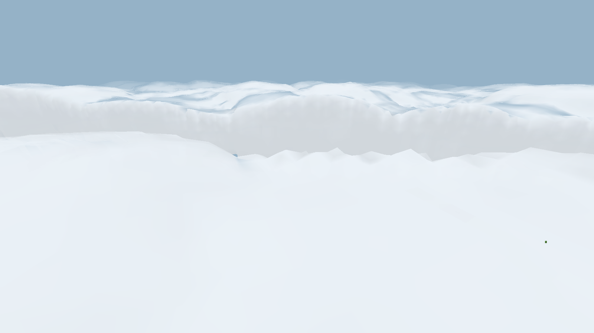
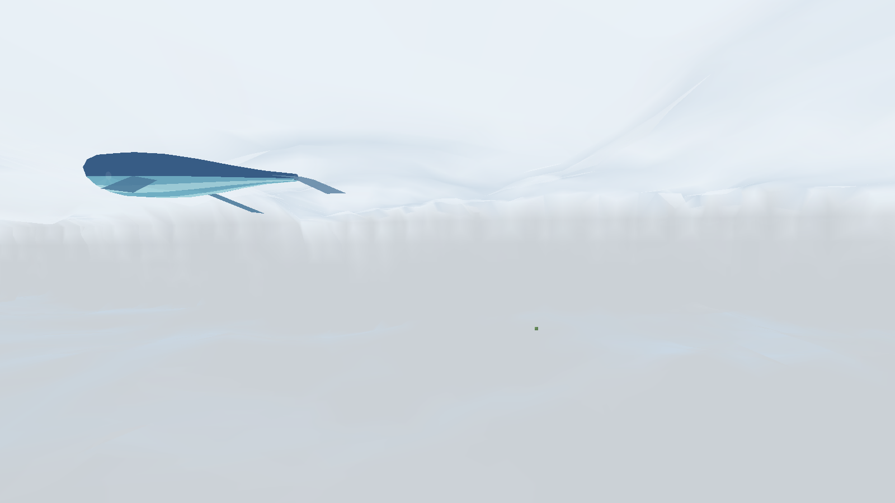
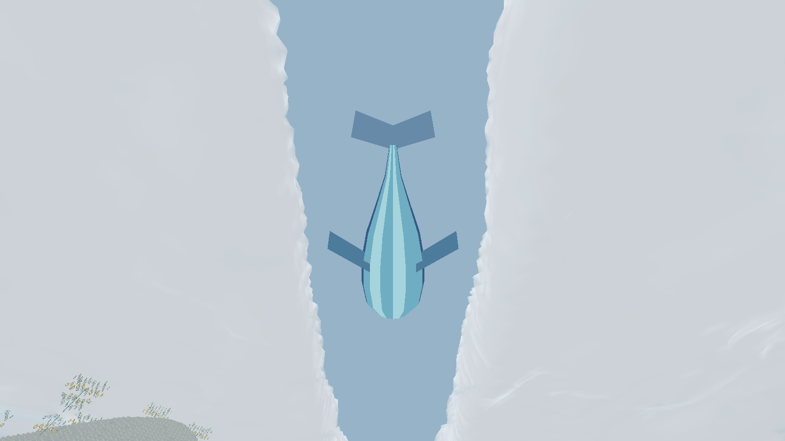
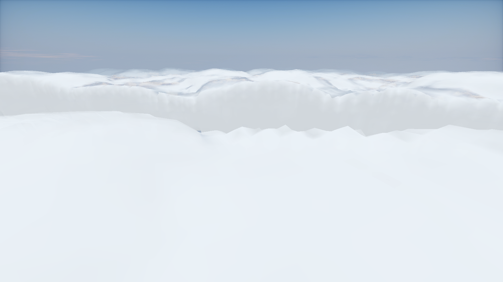

# 天门云域的可穿行云体

本轮重做的是天门云域云海。原先跟随摄像机的平面云盖与规则椭球，改为固定在世界坐标中的连续三维密度场，通过等值面生成有起伏、云唇、厚度和凹凸的云体。云顶、云底、侧缘都可观察；靠近时有视差，飞入时表面淡出并出现局部云内雾。玩家可以穿过，没有碰撞。

云层主体约在 Y=350–465，剑开天门沿世界中央斜向延伸，云缘随位置不规则变化。魔鲸位于实际缺口上方，地面阴影与其世界位置对应。天空不再因为玩家升高而把整层云一起抬高。

云是客户端环境几何，不是方块、生物实体或方块实体；没有 AI、掉落、存档与逐实体网络同步。未来 Boss 可使用 `CLOUDSEA_BOSS_CLOUD_ANCHOR_Y` 查找云端高度，但本轮不添加 Boss、平台或宫殿。

网格在单个后台线程生成，只读取确定性数学密度，不访问世界。工作队列最多 64 项，网格缓存最多 81 格；每帧使用缓存的邻近 49 格网格。相邻网格共享同一密度场，地表细节、法线和渐隐均有明确上限。不是全屏体积 raymarch，未对所有硬件作帧率保证。

普通渲染与光影分别检查，光影包可能覆盖局部雾色或绘制自己的远云。开发检查组为 `group:cloud_volume`，覆盖云上俯视、穿入和离开、地面看天门与魔鲸。玩家世界不增加测试相机或测试平台。

## 2026-10-15 实机记录

下图均来自实际开发客户端。0.1.2 组合版本在普通渲染、Complementary Reimagined r5.9.3、Photon Shader v1.3b 下，各通过 8/8 场景、12/12 检查；每套保留 41 张原始截图。组合检查同时包含法阵、方块和云海，不能作为未运行场景的验证。

