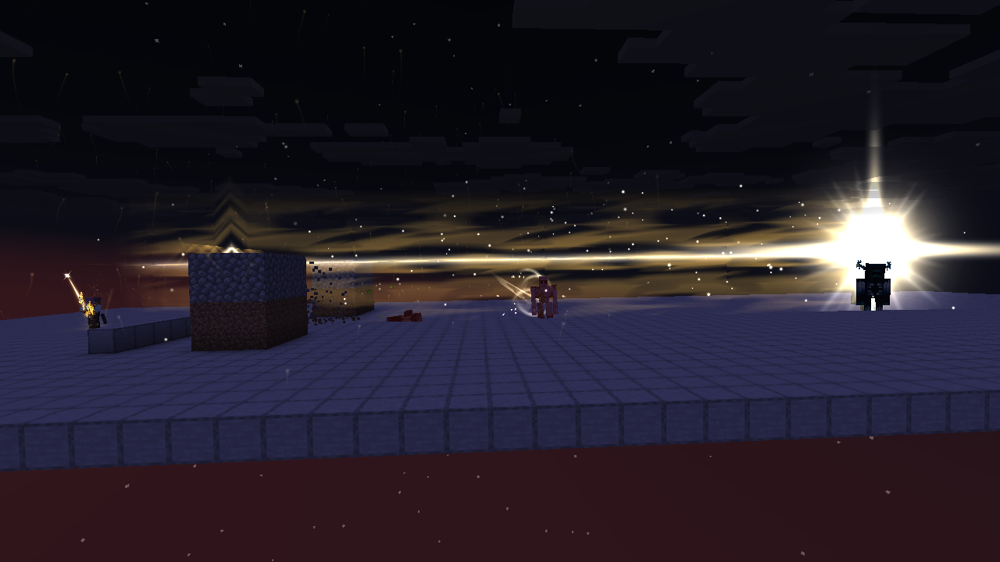

# 曦誓的蓄力彩蛋

致敬《Fate》系列的誓约胜利之剑。只有曦誓（`logos_dimension:dawnvow`）有，黑钢长剑照旧。长剑原有的动作不变：按住右键竖剑蓄力，松开举剑下劈。


## 蓄力斩的剑气

蓄力后松手劈下（剑刃接触的一刻），从脚前一格的地面放出一道剑气：Logos 物理游脉的样子，放大到宽 2.4、高 2，每刻 1.2 格贴着地面往前走（上得了一格台阶、跟着地面下到四格）。撞墙或走满 16 格为止。沿途碰到的生物各受 15 点物理伤害，剑气穿过它们继续走。地上留下发光的切痕，两侧翻起地面方块，过一会儿沉回去。不扣魔力。


## 大型蓄力

| 时刻 | 发生什么 |
| --- | --- |
| 7 秒 | 进入大型蓄力。站定不能移动、不能跳。四周 32 格内的地上不断升起金色光点，各自随机游走着上升、拖着细细的光痕，越接近蓄满越密。身上出现金色的蓄力光（没有法阵）：脚下一片柔光、两层缠着身体往上流的光、从脚边往上散开闪烁的细光线、绕身体盘旋上升的火星、从四周飞进身体的光点。从这时起开始扣魔力 |
| 12 秒 | 剑身发出长长的金光，伸到剑尖外很远，看上去剑长了一倍多，一边呼吸一边微微伸缩，剑尖一颗四芒星 |
| 15 秒 | 蓄满。胸前一团爆闪和放射的光芒，脚下一圈光向外扩开。剑身喷出金色的流动火焰（Logos 物品表面火焰，转成金色），金光更长更亮，身上的光更盛 |


| 第一人称 | 背后 |
| --- | --- |
|  |  |

**魔力**：从 7 秒到蓄满共 1000 魔力，按刻平摊（每刻 6.25）。中途不够时提示，大型蓄力中断：解除站定、身上的光收掉，回到普通蓄力，松手只放普通剑气。已经付的魔力不退。没蓄满就松手同样只放普通剑气，魔力也不退。

## 巨型剑气

蓄满后松手劈下，向前放出一道巨大的金色剑气：一面向前鼓起的弧形光墙，宽约 10 格、高约 9 格，每刻 4 格，射程 64 格。身后留下一条宽阔的光流，一秒多淡去。

剑气沿着地面往前走：
- 一格高的坎迈上去；下坡跟着落，最多 8 格，再深就悬空平着走。
- 两格以上的墙劈开。剑气所在高度往上 9 格、左右各 3.5 格内硬度不超过 3 的方块被削掉，和超电磁炮同一标准：泥土、石头、木头、深板岩、矿石都算。削掉的方块不掉落，带方块实体的、受出生点保护或领地保护的不削。
- 脚下的地面不动，迈上去的台阶也不动。
- 正前方那一列是劈不开的方块（黑曜石、铁块、基岩、箱子等）时，剑气停在它前面，同样十字爆闪、接光柱。

整条路线在出手时就定好，客户端按同一条路线画，削方块随剑气头逐刻进行。

- 生命值 ≤ 50 的生物：直接击杀。
- 生命值 50–100：受 50 点伤害，剑气穿过。
- 碰到生命值 > 100 的生物、劈不开的方块，或走满 64 格：十字爆闪，4 刻后 Logos 的金色光柱冲起（缩放 10，柱半径 16 格），半径 16 格内的生物受 200 点伤害。爆闪和光柱冲起时镜头各震一下：离爆点 16 格内最重，96 格外不震，强度跟随原版「屏幕效果」设置，关掉就不震。

伤害都是物理（按近战算护甲），不伤挥剑的人、同乘的和自己的宠物。生命值按剑气碰到时的当前生命算。


## 剑身金光保留 60 秒

放出巨型剑气后，剑身那道长长的金光保留 60 秒，最后两秒淡去。期间手持曦誓时：
- 攻击距离多 3 格（原版 3 格变 6 格）；
- 每一下连招命中另加 15 点物理伤害。

换下曦誓时攻击距离收回，换回来又有；死亡或时间到就结束。





## 实现

- 服务端 `dawnvow/DawnvowCharge`：招式状态机每刻报告手持曦誓的玩家的招式名，按 `charge_start`、`charge_hold`、`charge_release` 计时。站定是移动速度与跳跃力度上的 −100% 临时属性修饰。蓄满时把剑原来的 `logos:surface_aura` 记下来，结束后还原。服务器在蓄满时关掉、剑上留着金色火焰的，玩家下次登录时去掉。
- 服务端 `dawnvow/SwordWave`：两种剑气逐刻推进与结算。普通剑气用 Logos 公开的 `Vfx.vein` / `Vfx.veinEnd` 画，贴地方式与 Logos 游脉相同。
- 客户端 `client/vfx/`：`DawnvowClient` 收 `DawnvowPayload`；镜头抖动在 `DawnvowShake`（`ViewportEvent.ComputeCameraAngles`）；身上的光与四周光点在 `DawnvowAura`；剑身金光在 `DawnvowBlade`，挂在长剑骨骼上，第一、第三人称都跟着动作走；巨型剑气在 `ExcaliburWave`。
- 身上的光照 Logos 虚空巨型蓄力光环的层次重画，Logos 那套是包内私有的类和自定义着色器，没有复制过来。全部用 `VfxParts` 和 Logos 现有贴图，按 `logos:` 路径引用：`fire_beam/dot`、`laser`、`glow`，`surface/trail`，`force/streak`，`fire_impact/flash`，`lightning_beam/rays`，`physical_ray/wind`，`arcane_ray/impact_cross`。没有新增贴图。自定义几何都经 `ShaderPackOverlay` 提交。
- 普通剑气的游脉 id 从 −1,000,000 往下数。Logos 法术物体的 id 从 1 往上数，两边不会撞。主模组还没有给附属分配持续型特效 id 的公开方法，见 [VFX.md](VFX.md)。

## 复查

```text
./gradlew test runGameTestServer build -PdimensionTests=logos_dimension:dawnvow* -PlogosJar=/absolute/path/logos-0.6.0.jar
./gradlew runClient -PlogosJar=/absolute/path/logos-0.6.0.jar -PldTest=group:dawnvow_charge -PldTestHeadless -PldTestWindow=1280x720
```

世界测试 `dawnvow_charge_*` 五项：

- 蓄力斩剑气打中八格外的铁傀儡，受 15 点，不扣魔力。
- 按满 15 秒：7 秒起站定、按刻扣魔力，蓄满时剑上冒金色火焰、共扣 1000；放出后铁傀儡受 50、尸壳被击杀、监守者吃到光柱 200，随后解除站定、收掉火焰。
- 魔力只有 500 时大型蓄力中断，不会蓄满。
- 巨型剑气削开三格高的泥土墙（墙下地面不动），迈上一格高的台阶（台阶不动），停在黑曜石墙前爆开。
- 金光期间攻击距离 6 格，四格半外的铁傀儡也砍得到，受 7 + 15 点。

客户端场景 `dawnvow_charge`：
- 先蓄到 8 秒中途松手，检查身上的光、四周光点与剑身金光一秒内收干净；
- 再完整按一次 15 秒，拍各阶段与剑气、光柱，检查三种生物的伤害、土石墙被削开而台阶与地面还在、爆发时镜头抖动；
- 放出后检查剑身金光保留、攻击距离变长。截图在 `screenshots/dawnvow-charge/`。

没测：光影包、联机多客户端、坡地与洞穴里的剑气。
