# 曦誓的蓄力彩蛋

致敬《Fate》系列的誓约胜利之剑。只有曦誓（`logos_dimension:dawnvow`）有，黑钢长剑照旧。长剑原有的动作不变：按住右键竖剑蓄力，松开举剑下劈。

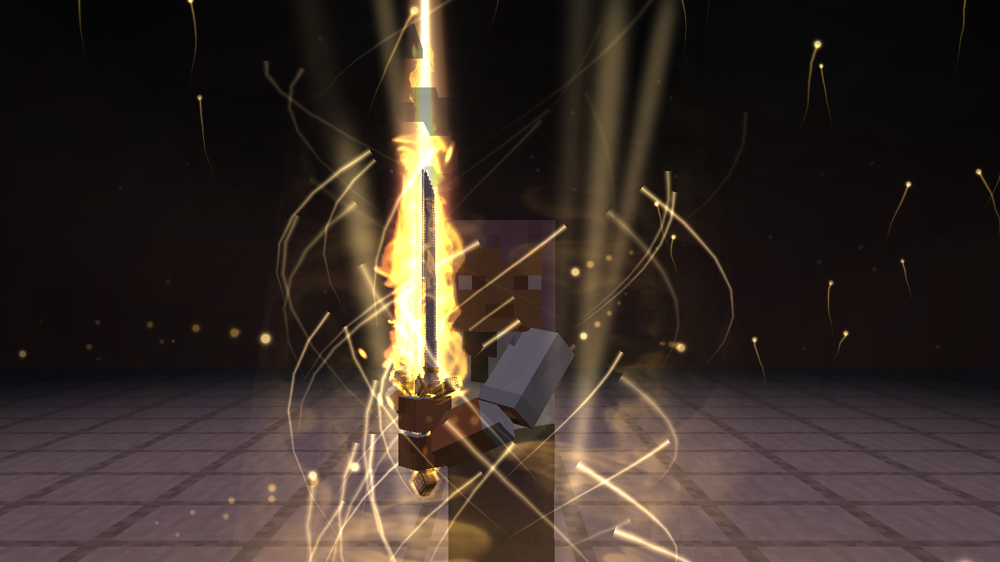

## 蓄力斩的剑气

蓄力后松手劈下（剑刃接触的一刻），从脚前一格的地面放出一道剑气：Logos 物理游脉的样子，放大到宽 2.4、高 2，每刻 1.2 格贴着地面往前走（上得了一格台阶、跟着地面下到四格）。撞墙或走满 16 格为止。沿途碰到的生物各受 15 点物理伤害，剑气穿过它们继续走。地上留下发光的切痕，两侧翻起地面方块，过一会儿沉回去。不扣魔力。

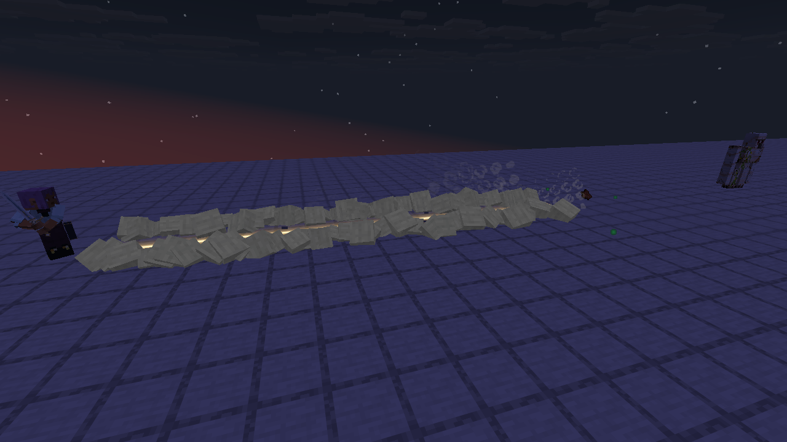

## 大型蓄力

| 时刻 | 发生什么 |
| --- | --- |
| 7 秒 | 进入大型蓄力。站定不能移动、不能跳。四周 32 格内的地上不断升起金色光点，各自随机游走着上升、拖着细细的光痕，越接近蓄满越密。身上出现金色的蓄力光（没有法阵）：脚下一片柔光、两层缠着身体往上流的光、从脚边往上散开闪烁的细光线、绕身体盘旋上升的火星、从四周飞进身体的光点。从这时起开始扣魔力 |
| 12 秒 | 剑身发出长长的金光，伸到剑尖外很远，看上去剑长了一倍多，一边呼吸一边微微伸缩，剑尖一颗四芒星 |
| 15 秒 | 蓄满。胸前一团爆闪和放射的光芒，脚下一圈光向外扩开。剑身喷出金色的流动火焰（Logos 物品表面火焰，转成金色），金光更长更亮，身上的光更盛 |

**周围暗下去**：进入大型蓄力后，全屏后期把画面调暗、褪色：蓄力的人和身边一圈（7 秒时 6 格，蓄满时 11 格）亮起来、带一点金色，再远的地面和天空暗下去，三秒内暗到只剩四成左右的亮度，蓄满时更暗（约两成半，画面边角更暗）。四周升起的光点、身上的光是调暗之后才画上去的，在暗处格外亮；发光的东西也不跟着暗：剑上的金色流火和它散出的火苗、剑身金光、光柱都还是原来的亮度，蓄力的人自己的身体在亮区里。离蓄力的人 48 格内的玩家看得最清楚，120 格外没有。中途结束时一秒内亮回来。

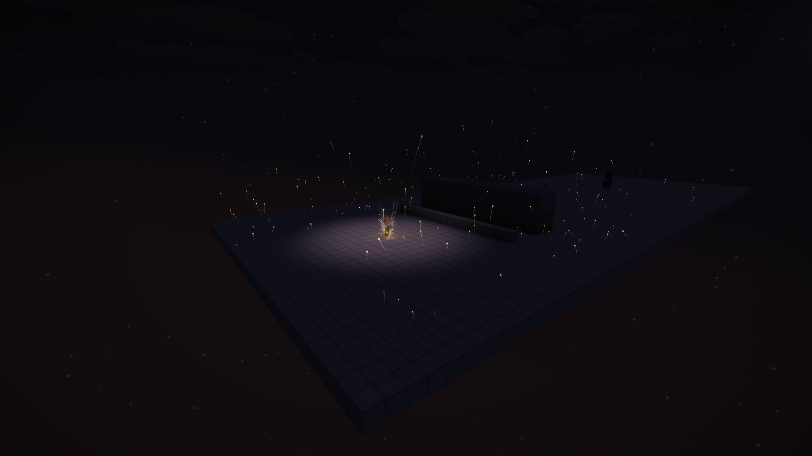

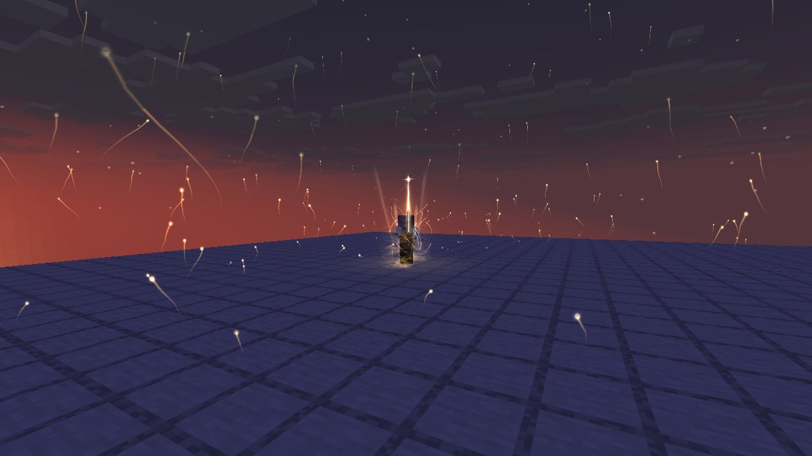

| 第一人称 | 背后 |
| --- | --- |
| 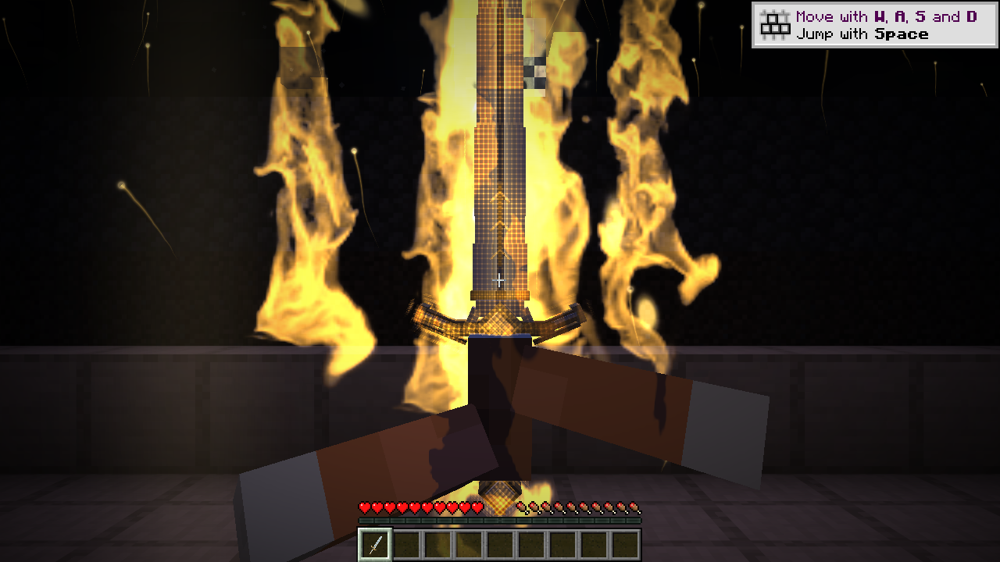 | 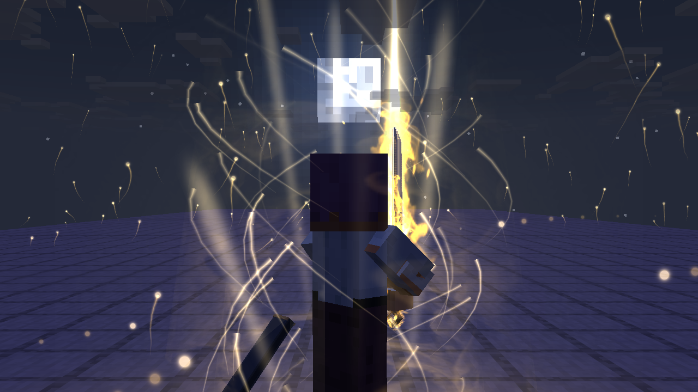 |

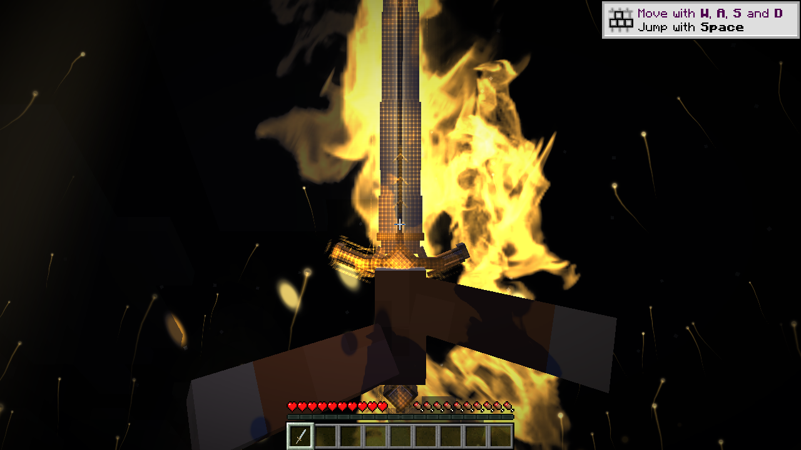

**魔力**：从 7 秒到蓄满共 1000 魔力，按刻平摊（每刻 6.25）。中途不够时提示，大型蓄力中断：解除站定、身上的光收掉，回到普通蓄力，松手只放普通剑气。已经付的魔力不退。没蓄满就松手同样只放普通剑气，魔力也不退。

## 巨型剑气

蓄满后松手劈下，向前放出一道巨大的金色剑气：一面向前鼓起的弧形光墙，宽约 10 格、高约 9 格，每刻 4 格，射程 64 格。身后留下一条宽阔的光流，一秒多淡去。周围仍是蓄力时的暗，剑气头照亮它经过的地面。

剑气沿着地面往前走：
- 一格高的坎迈上去；下坡跟着落，最多 8 格，再深就悬空平着走。
- 两格以上的墙劈开。剑气所在高度往上 9 格、左右各 3.5 格内硬度不超过 3 的方块被削掉，和超电磁炮同一标准：泥土、石头、木头、深板岩、矿石都算。削掉的方块不掉落，带方块实体的、受出生点保护或领地保护的不削。
- 脚下的地面不动，迈上去的台阶也不动。
- 正前方那一列是劈不开的方块（黑曜石、铁块、基岩、箱子等）时，剑气停在它前面，同样扎进地面、接光柱。

整条路线在出手时就定好，客户端按同一条路线画，削方块随剑气头逐刻进行。

- 生命值 ≤ 50 的生物：直接击杀。
- 生命值 50–100：受 50 点伤害，剑气穿过。
- 碰到生命值 > 100 的生物、劈不开的方块，或走满 64 格：剑气扎进地面，经过下面「光柱冲起之前」那一串画面，33 刻（约 1.65 秒）后 Logos 的金色光柱冲起（缩放 10，柱半径 16 格），半径 16 格内的生物受 200 点伤害。扎进地面、黑色爆发时镜头各轻轻一震，光柱冲起时重重一震：离落点 16 格内最重，96 格外不震，强度跟随原版「屏幕效果」设置，关掉就不震。

伤害都是物理（按近战算护甲），不伤挥剑的人、同乘的和自己的宠物。生命值按剑气碰到时的当前生命算。

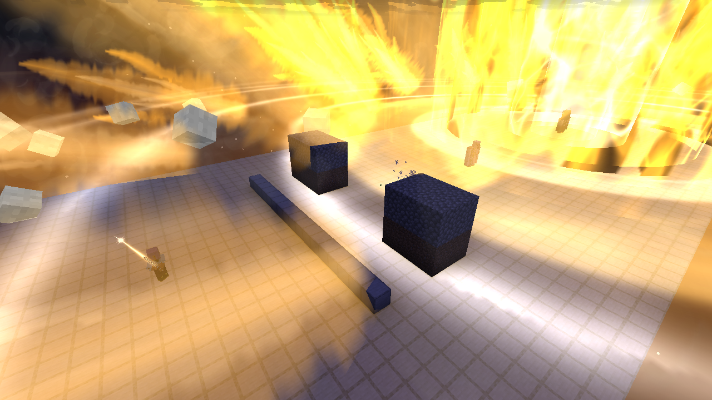

## 剑身金光保留 60 秒

放出巨型剑气后，剑身那道长长的金光保留 60 秒，最后两秒淡去。期间手持曦誓时：
- 攻击距离多 3 格（原版 3 格变 6 格）；
- 命中锥形从 60° 放宽到 90°，长度跟着变成 6 格；
- 每一下连招命中另加 15 点物理伤害；
- 蓄力斩的剑气走两倍远（32 格）。

换下曦誓时攻击距离收回，换回来又有；死亡或时间到就结束。

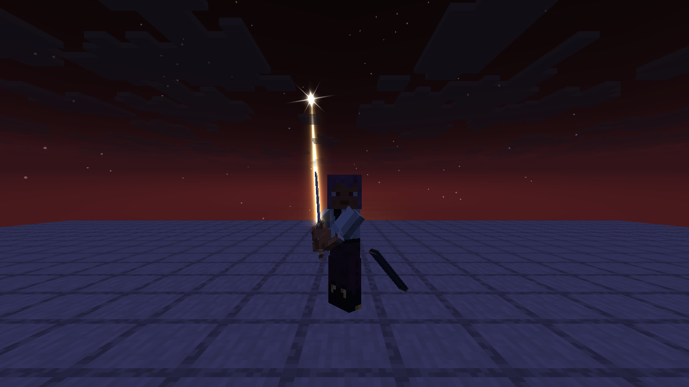

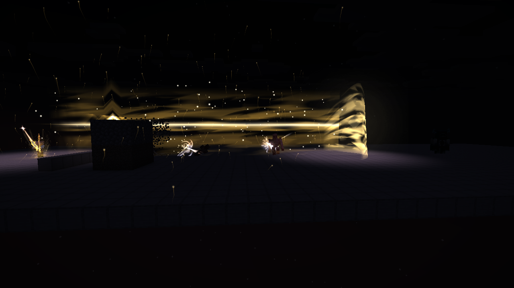

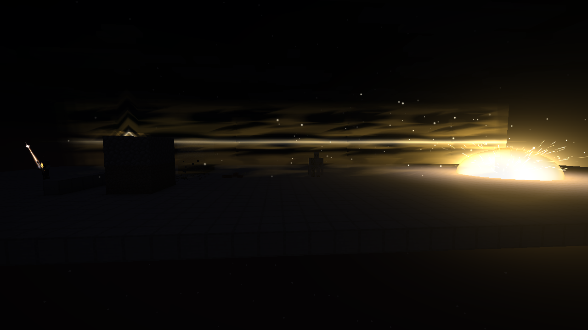

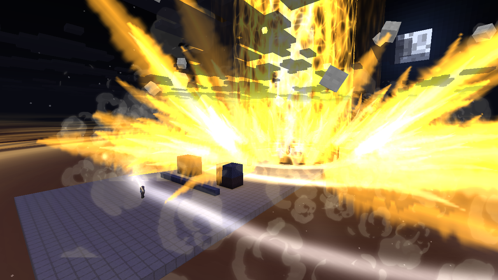

## 光柱冲起之前

剑气扎进地面之后、光柱冲起之前，用全屏后期很快地放一串画面，越来越紧，最后极亮的一下接光柱。节奏参考爆裂魔法（落地之后先蓄、再一阵很快的闪、最后极亮），但黑白闪不一样：爆裂魔法是写实的，取画面里的剪影和影子线；曦誓的是**几何**的，尖刺、反色、星，全是图形，和画面里有什么无关。

| 刻（从剑气到头算起） | 画面 | 声音 |
| --- | --- | --- |
| 0 | 剑气扎进地面：落点一闪，地上一团扁扁的白光，火星从里面四溅、拖着短短的光痕；四周暗到几乎全黑，落点附近的地面被照成金色 | 信标启动、监守者音波蓄力 |
| 0–14 | 光团鼓成穹顶，越来越白、越来越大，外面一圈金色的光晕 | |
| 14 | 黑色爆发：黑色的尖刺从穹顶一下炸满画面 | 信标熄灭 |
| 15–20 | 外围反而是亮的：金到琥珀的亮光（紧贴黑色的那一圈是白的）从画面边上往里收，把黑色压回成穹顶外面一圈带尖刺的黑冠 | |
| 20–25 | 几何黑白闪，24fps 一拍：反色两拍（白色的尖冠、蓝底、黑色的穹顶），白底黑星两拍（穹顶反色，黑色的四芒星和甩着细刺的墨点，带一圈蓝边），黑底白星一拍（金边），再一拍白底黑星 | 三叉戟雷鸣 |
| 25–29 | 爆发的前兆：穹顶猛地涨大，扑向镜头，边缘白、往里一圈金、一圈琥珀；四周仍是黑的，人成了穹顶前的剪影 | |
| 29–33 | 极亮：画面整个白掉，落点那里透一点暖色 | |
| 33 | 光柱冲起，结算伤害；白光六刻内退去，周围八刻内亮回来 | 爆炸、雷声 |

| | | |
| --- | --- | --- |
| 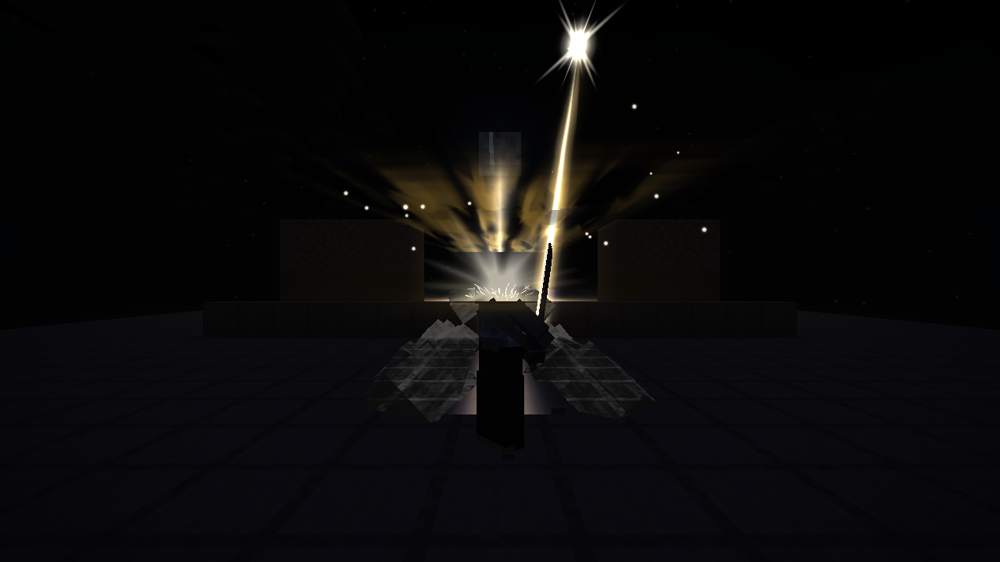 | 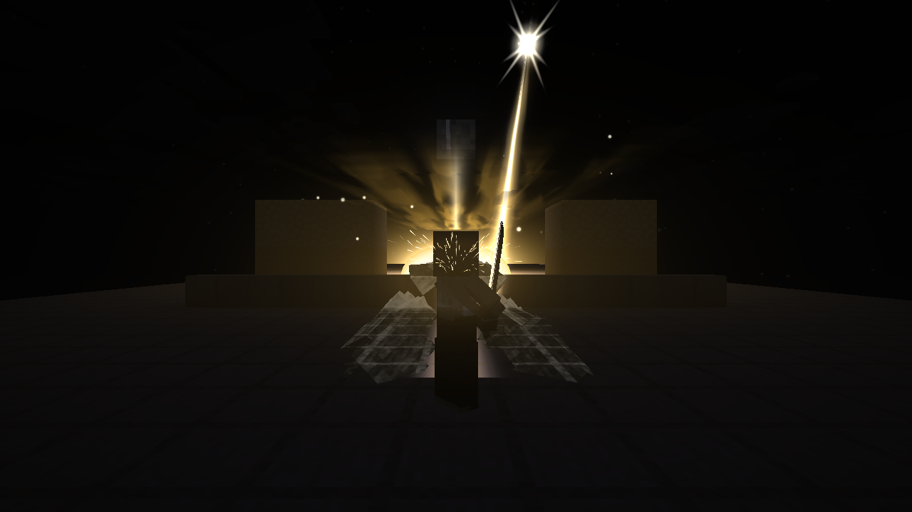 | 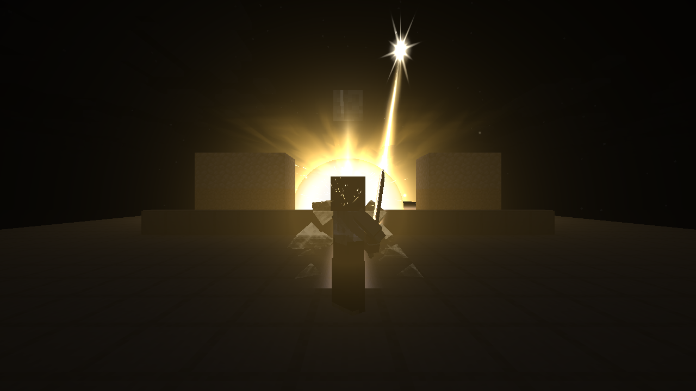 |
| 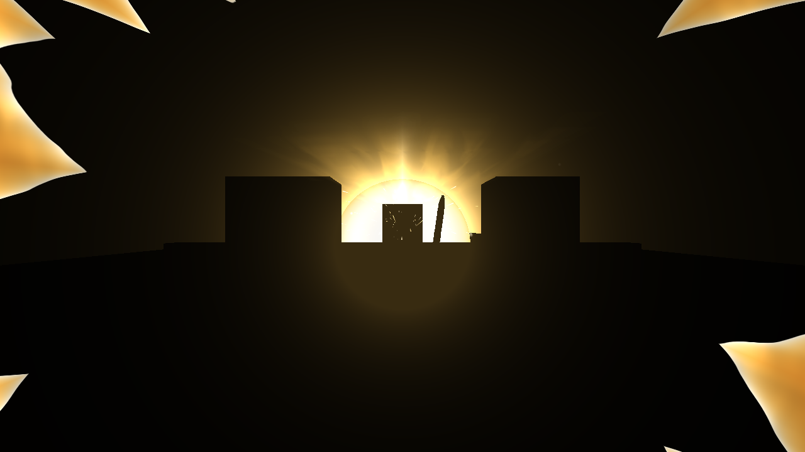 | 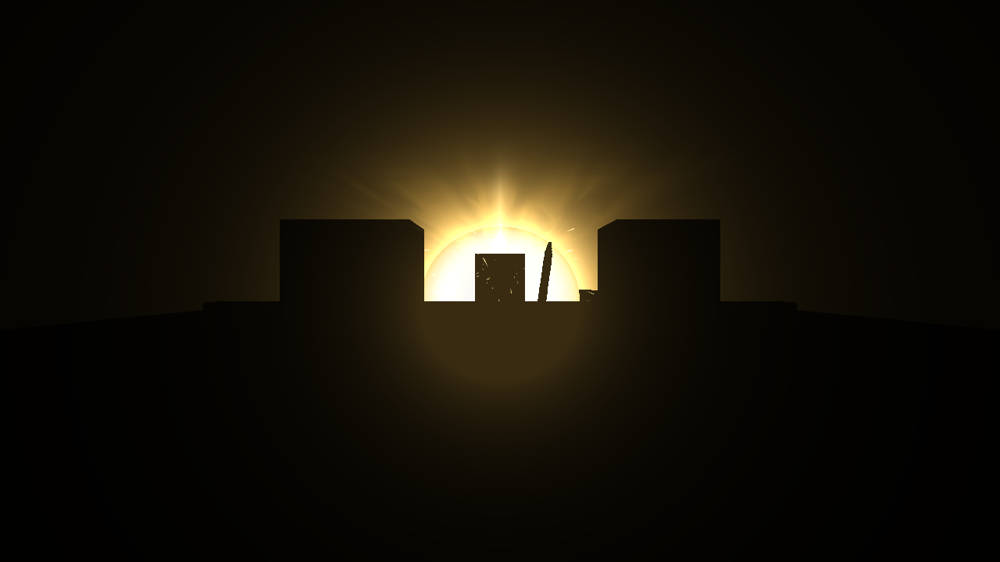 | 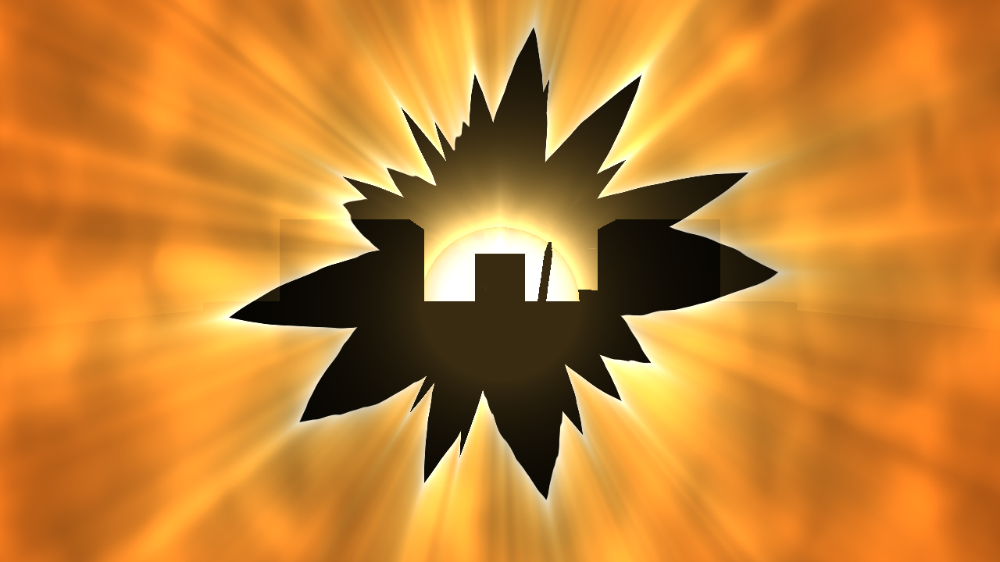 |
| 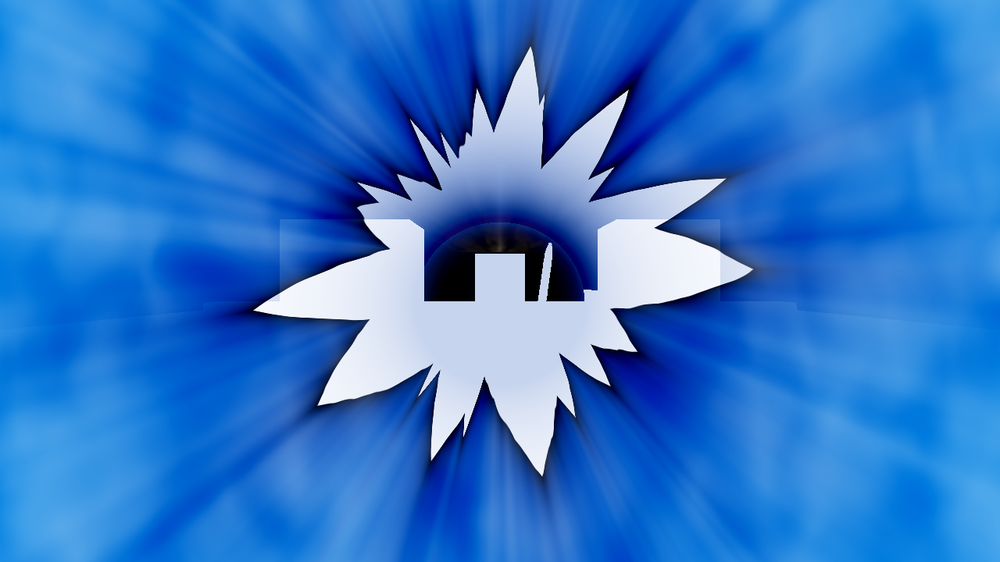 | 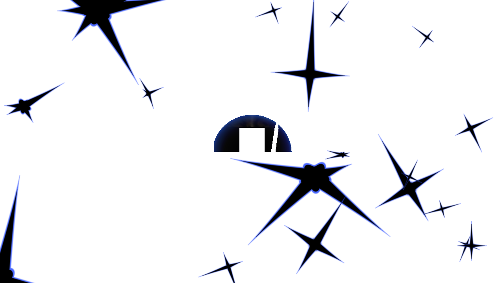 | 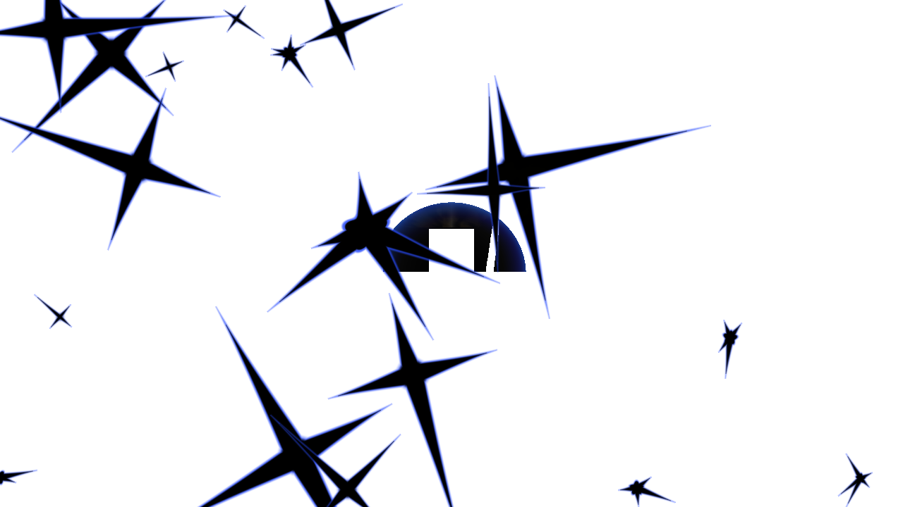 |
|  | 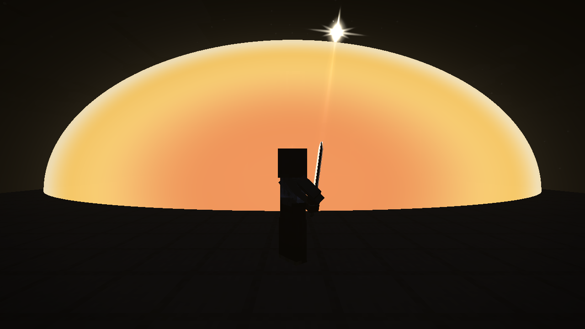 |  |

- **谁看得到**：离落点 64 格内看得到全部，160 格外没有；离得远到一半强度以下时不放黑白闪。黑白闪那几拍和极亮时不画界面。
- **光敏**：黑白闪一共 6 拍（约 0.25 秒），和全屏后期「一次最多 8 拍」的限制一致；原版选项「隐藏闪电的闪烁」打开时不放黑白闪（反色和星），黑色爆发和极亮也减半。
- **帧率**：每一拍至少显示一帧，帧率再低也不会跳过某一拍。
- **颜色**：曦誓一直是金色，所以穹顶、亮光是白热到金、琥珀；反色后金色成了蓝色。

## 实现

- 服务端 `dawnvow/DawnvowCharge`：招式状态机每刻报告手持曦誓的玩家的招式名，按 `charge_start`、`charge_hold`、`charge_release` 计时。站定是移动速度与跳跃力度上的 −100% 临时属性修饰。蓄满时把剑原来的 `logos:surface_aura` 记下来，结束后还原。服务器在蓄满时关掉、剑上留着金色火焰的，玩家下次登录时去掉。
- 服务端 `dawnvow/SwordWave`：两种剑气逐刻推进与结算。普通剑气用 Logos 公开的 `Vfx.vein` / `Vfx.veinEnd` 画，贴地方式与 Logos 游脉相同。
- 客户端 `client/vfx/`：`DawnvowClient` 收 `DawnvowPayload`；镜头抖动在 `DawnvowShake`（`ViewportEvent.ComputeCameraAngles`）；身上的光与四周光点在 `DawnvowAura`；剑身金光在 `DawnvowBlade`，挂在长剑骨骼上，第一、第三人称都跟着动作走；巨型剑气在 `ExcaliburWave`。
- 全屏后期 `client/vfx/DawnvowScreen` 一个通道（着色器 `shaders/post/dawnvow.fsh`），排在爆裂魔法的通道之后、`PostVfx` 之前：周围变暗、亮区提亮按深度还原的位置算；穹顶是每个像素算视线和椭球的交点；黑色爆发和星是画面上的图形。只读画面，和 Sodium、光影包走同一条路；没有大型蓄力和巨型剑气时一个通道都不跑。
- 调暗只调世界本身：发光的特效大多不写深度、在实心的世界画完之后才画，只看深度的话，火焰背后是远处的天空，会被当成远处跟着暗下去。所以世界画到几个阶段时各留一份画面，比较前后，「变亮了、没有哪个颜色通道变暗」的像素算加上去的光，保留原来的颜色。
  - 原版、Sodium、Iris 关光影：留实心的世界画完、半透明特效画完（Logos 物品上的火焰和它散出的火苗、光柱、剑身金光在这一遍）、天气画完三份；之后第一人称的手那一遍（手上那把剑的火焰）也算。水、粒子、云和天气照常调暗。玩家的皮肤是半透明画的，但那是把颜色换掉，不算光；还原位置用半透明特效画完时的深度，蓄力的人自己的身体才在亮区里。
  - 开着光影包：Logos 等光影包合成完画面再画自己的特效（`ShaderPackOverlay.draw`），`DawnvowOverlayMixin` 在那之前留一份。
  - 不直接相减还原：画面每个通道到 1 就截断了，夕阳的红天上加金色火焰，减出来会偏绿。
  - 都留不到时（比如 Logos 改了那个方法）退回整幅画面一起调暗。
  - 限制：开着光影包时第一人称的手不在最后的深度里，和黑白闪一样只能按手背后的东西判断，背后是暗处时手也跟着暗；原版、Sodium、Iris 关光影时手在亮区里。
- 剑气到头之后的时间轴在 `dawnvow/DawnvowBurst`，服务端（光柱、伤害、声音）和客户端（后期）共用。
- 后期把周围调暗时，身上的光、四周的光点和剑气交给 `PostVfx` 在调暗之后画（`PostLayer`），平常照旧在世界里画。挂在骨骼上的剑身金光、拔剑收剑的光点仍在世界里画。
- 身上的光照 Logos 虚空巨型蓄力光环的层次重画，Logos 那套是包内私有的类和自定义着色器，没有复制过来。全部用 `VfxParts` 和 Logos 现有贴图，按 `logos:` 路径引用：`fire_beam/dot`、`laser`、`glow`，`surface/trail`，`force/streak`，`fire_impact/flash`，`lightning_beam/rays`，`physical_ray/wind`，`arcane_ray/impact_cross`。没有新增贴图。自定义几何都经 `ShaderPackOverlay` 提交。
- 普通剑气的游脉 id 从 −1,000,000 往下数。Logos 法术物体的 id 从 1 往上数，两边不会撞。主模组还没有给附属分配持续型特效 id 的公开方法，见 [VFX.md](VFX.md)。

## 复查

```text
./gradlew test runGameTestServer build -PdimensionTests=logos_dimension:dawnvow* -PlogosJar=/absolute/path/logos-0.6.0.jar
./gradlew runClient -PlogosJar=/absolute/path/logos-0.6.0.jar -PldTest=group:dawnvow_charge -PldTestHeadless -PldTestWindow=1280x720
```

世界测试 `dawnvow_charge_*` 六项：

- 蓄力斩剑气打中八格外的铁傀儡，受 15 点，不扣魔力。
- 按满 15 秒：7 秒起站定、按刻扣魔力，蓄满时剑上冒金色火焰、共扣 1000；放出后铁傀儡受 50、尸壳被击杀、监守者吃到光柱 200，随后解除站定、收掉火焰。
- 魔力只有 500 时大型蓄力中断，不会蓄满。
- 巨型剑气削开三格高的泥土墙（墙下地面不动），迈上一格高的台阶（台阶不动），停在黑曜石墙前爆开。
- 金光期间攻击距离 6 格、命中锥形 90°，四格半外的铁傀儡也砍得到，受 7 × 1.5（准星正对，暴击）+ 15 点。
- 金光期间蓄力斩的剑气走到二十格外，打中那里的铁傀儡。

客户端场景 `dawnvow_charge`：
- 先蓄到 8 秒中途松手，检查身上的光、四周光点与剑身金光一秒内收干净；
- 再完整按一次 15 秒，拍各阶段（周围暗下去）与剑气、扎进地面、光柱，检查后期在画、三种生物的伤害、土石墙被削开而台阶与地面还在、光柱冲起时镜头抖动、几何黑白闪六拍都放到了；
- 放出后检查剑身金光保留、攻击距离变长；
- 最后只在本机重放一道巨型剑气（服务端不知道，没有伤害和光柱），用 `DawnvowClient.pin` 停住曦誓特效的时钟，按时间轴拍光柱冲起之前的每个阶段。截图在 `screenshots/dawnvow-charge/`。

后期在不装 Sodium 和 Iris、只装 Sodium、Iris 关光影、Iris + photon、Iris + Complementary 下都跑过这个场景。

没测：联机多客户端、坡地与洞穴里的剑气。
