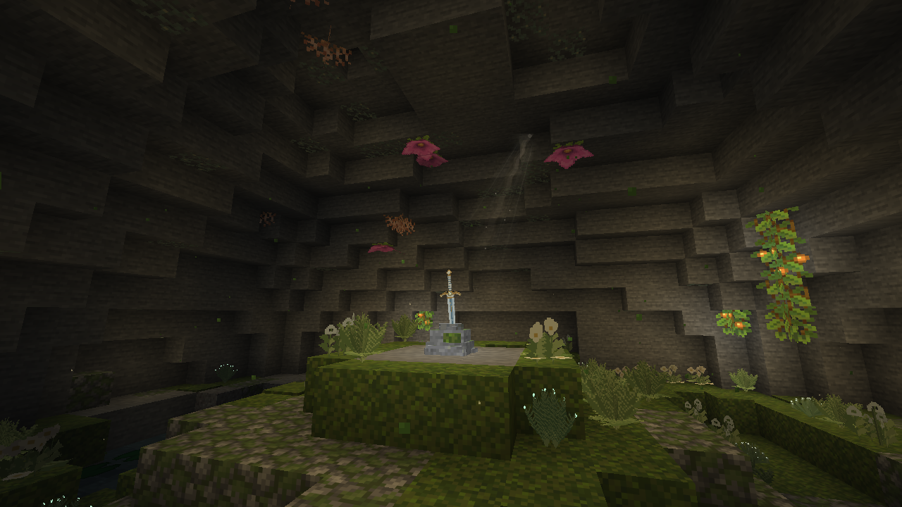
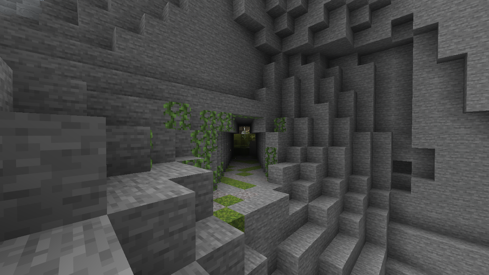
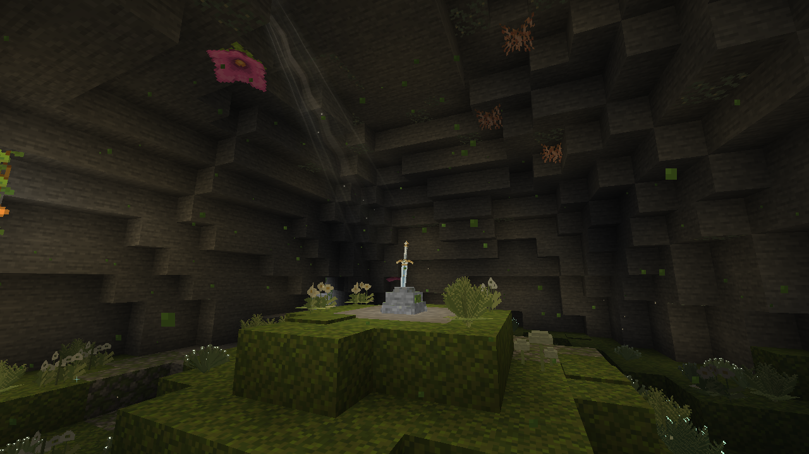
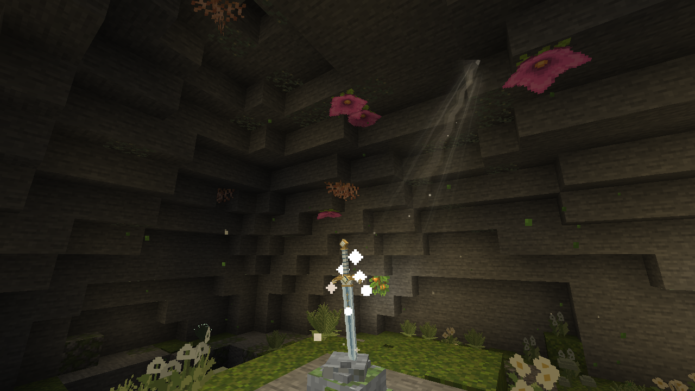
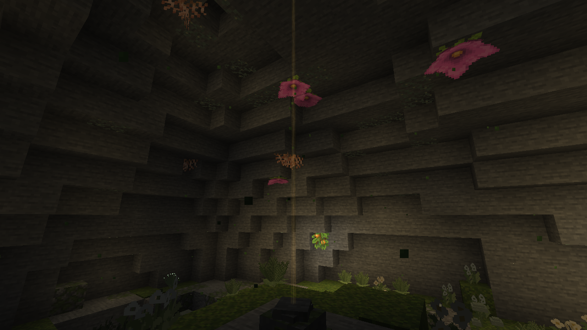
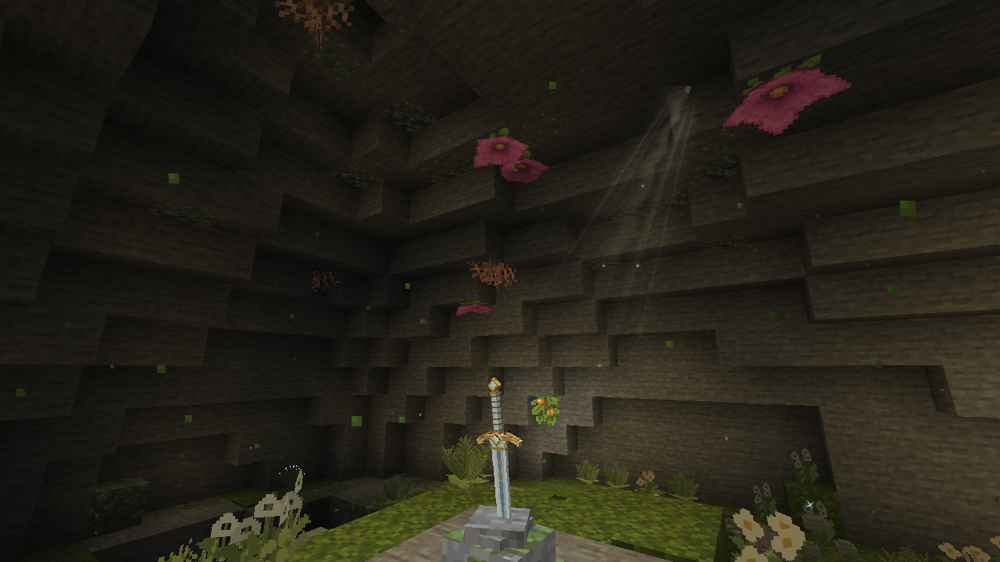
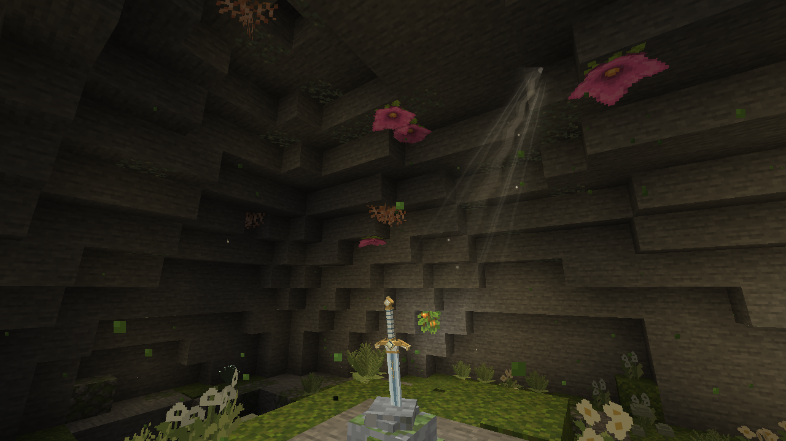

# 石中剑：曦誓之洞

圣剑「曦誓」现在可以在远行大陆的山里找到：它插在一间隐蔽山洞中央的石座里。



## 山洞

- **位置**：远行大陆有山的地方都可能有（樱野的山留给神狐聚落）。洞整个埋在山体里，洞顶上至少留 8 格岩层，只有一条约三格宽、四格高的窄洞从山坡通进来，洞口两侧爬着藤蔓。候选每 20 个区块一个，只有真正的高山才通过选址，平均约每 2000×2000 格一处。
- **洞内**：半径约 12 格的圆顶山洞，中央一座长苔的矮石丘托着石座，石丘后侧一汪小池漂着睡莲。洞底铺苔，种着远行大陆的林地蕨、微光蕨、星露草、月露铃兰、露灯菌、银莲花与冬星嚏根草；洞顶零星的发光地衣、垂根、几串发光浆果与孢子花。
- **石座**：插着剑时像火把一样发光（14 级），有一道淡淡的斜光从石座后上方的洞顶缝隙照下来。生存模式无法破坏（硬度与基岩相同，也不怕爆炸和活塞）。

```mcfunction
/locate structure logos_dimension:dawnvow_grotto
```





## 怎么拔剑

传说中只有被选中的人拔得出石中剑。这里每位玩家都能拔，但要选对时候：

| 规则 | 说明 |
| --- | --- |
| 破晓 | 只有日出前后（一天中第 22500–1500 刻，约现实 2.5 分钟）剑才会松动。其他时候拔 1.5 秒，剑只颤一下，提示“照在剑上的光还太淡”。破晓时斜光会稍亮一些，是给玩家的提示 |
| 按住 | 对石座按住右键（手里拿什么都行）连续拔 3 秒。剑会被一点点拔起、在石中颤动；松手超过半秒要从头来 |
| 次数 | 不限：拔过剑、手上还有一把的玩家，也可以去别的山洞再拔一把 |
| 归还 | 手持曦誓右键空石座，把剑插回去。插回的是这把剑本身（附魔、耐久、名字都保留），石座重新发光、出现斜光、变回不可破坏 |

拔出时金色光柱从石座冲起（Logos 的 `PillarBurst`），全服广播“某某在破晓时从石中拔出了曦誓”。空石座是普通石头硬度，用镐子挖下来可以带走。创造模式玩家可以直接拆掉插着剑的石座。没有昼夜的维度（下界、末地）里等不到破晓，剑拔不出来。





## 斜光

客户端特效（`client/vfx/DawnLightBeam`），像丁达尔效应或林间透下的光：一条笔直的光路，顶端窄，往下散开变宽，在洞顶缝隙附近最亮，越往下越淡，到石座处已完全透明；整体若有若无。光身里有几缕更细的光线，各自也是直线、明暗缓缓起伏。光束绕自身轴线转向镜头，任何角度看都是一道光；光源方向随石座朝向固定在剑的后上方，碰到洞顶就从那里开始，那一点画一团很淡的亮缝；光里飘落几粒微尘。贴图复用 Logos 的 `logos:textures/vfx/fire_beam/glow` 与 `dot`，没有新增贴图；经 `ShaderPackOverlay` 提交，排在 Logos 之后。

| 正午 | 破晓 |
| --- | --- |
|  |  |

以上均为实际客户端截图（`dawnvow_grotto_views`），未测光影包。

## 生成方式

与神狐聚落一样用 Java 结构（维护者 2026-11-03 同意）：洞要整个埋进山里、顶上留足岩层，洞口要正好开在某面山坡上，这得按真实地表高度去量。

1. **选址**（`DawnvowGrottoStructure`）：候选中心的地表至少高出海平面 30 格；洞正上方 5×5 个点的最低地表决定洞底最高能放多高（洞高 11 + 岩层 8），洞底至少高出海平面 4 格以避开含水层。
2. **洞口**：16 个方向、离中心 20–84 格逐点量地表，取最近的一处：那里没有水、比洞顶地表低至少 20 格、隧道坡度不超过 1:2，而且隧道一路都埋在山里。
3. **开凿**（`GrottoPiece`，在 `top_layer_modification` 阶段，晚于所有地物与流体泉）：先把洞外一圈和洞顶上方的天然空隙、积水和岩浆补成石头，再挖洞、堆石丘、灌小池、挖窄洞，最后种植物与装饰、放石座。所有形状都是坐标与种子的纯函数，每个区块只改自己范围内的方块。

## 方块

| 方块 | ID | 说明 |
| --- | --- | --- |
| 曦誓石座 | `logos_dimension:dawnvow_stone` | 插着剑；不可破坏、亮度 14；方块实体保存那把剑 |
| 空石座 | `logos_dimension:dawnvow_stone_empty` | 剑被拔走后；镐子可挖、掉落自身 |

石座模型由原版石头、安山岩、凝灰岩、苔石与苔藓块贴图拼成，剑用曦誓自己的物品模型倒插进石冠（`SwordStoneRenderer`），没有新增贴图。曦誓在创造模式「远行大陆 · 武器」页，石座（插剑的和空的）在「远行大陆 · 功能方块」页。

## 复查

```text
./gradlew test runGameTestServer build -PdimensionTests=logos_dimension:dawnvow* -PlogosJar=/absolute/path/logos-0.6.0.jar
./gradlew runClient -PlogosJar=/absolute/path/logos-0.6.0.jar -PldTest=group:dawnvow_dev -PldTestHeadless -PldTestWindow=1280x720
```

世界测试检查不可破坏与发光、破晓按住拔出、正午拔不动、背包里已有一把时还能再拔、中途松手重来、插回后保留那把剑。客户端场景 `dawnvow_grotto_views` 定位最近的山洞，拍洞口、窄洞尽头、洞内、正午与破晓的斜光，再在破晓拔一次剑确认石座变空。
