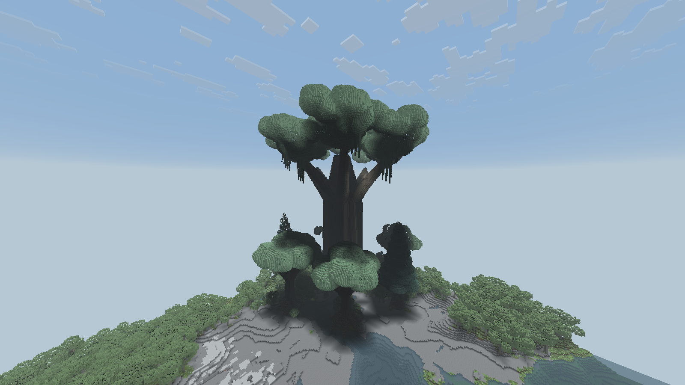
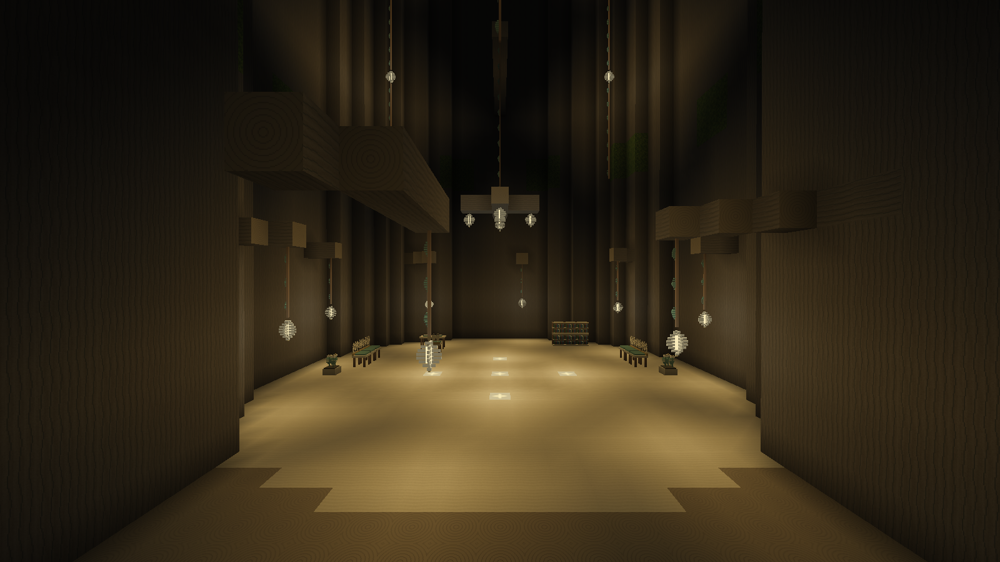
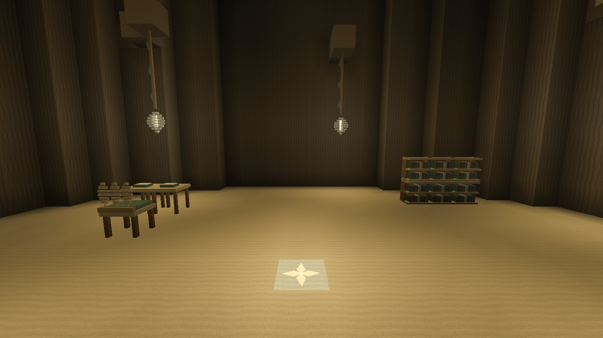
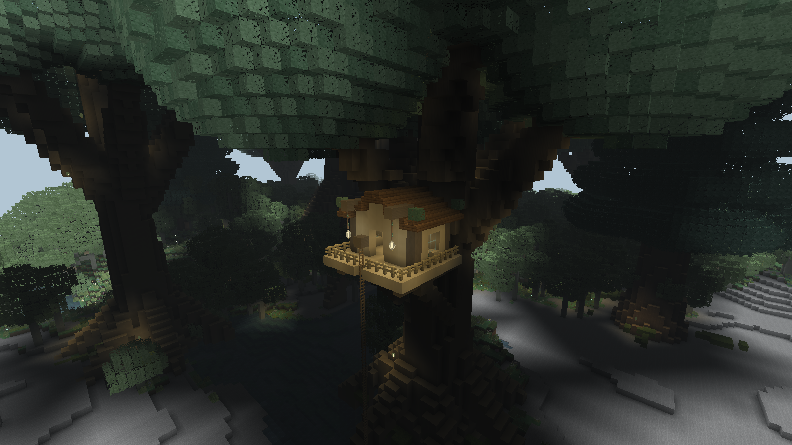
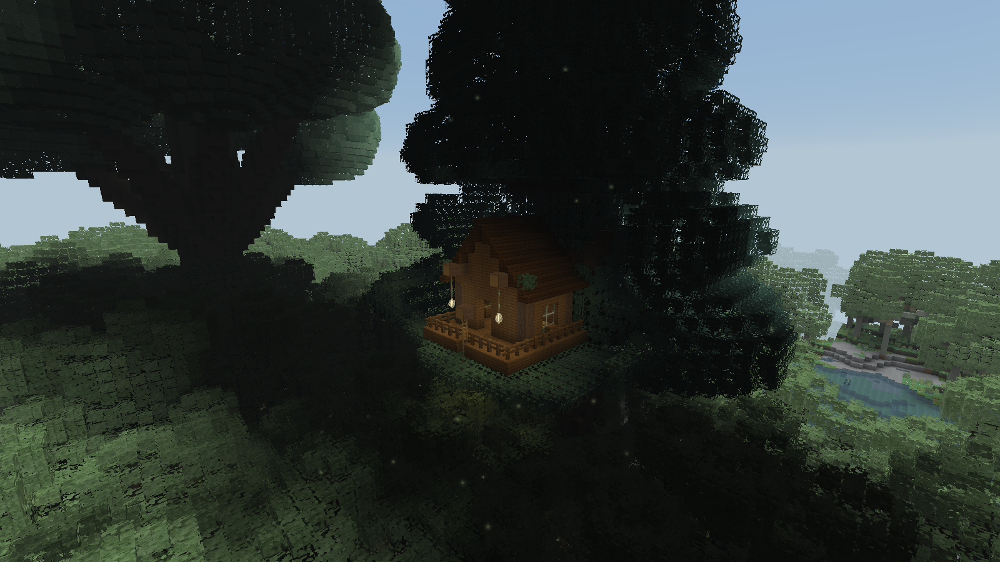
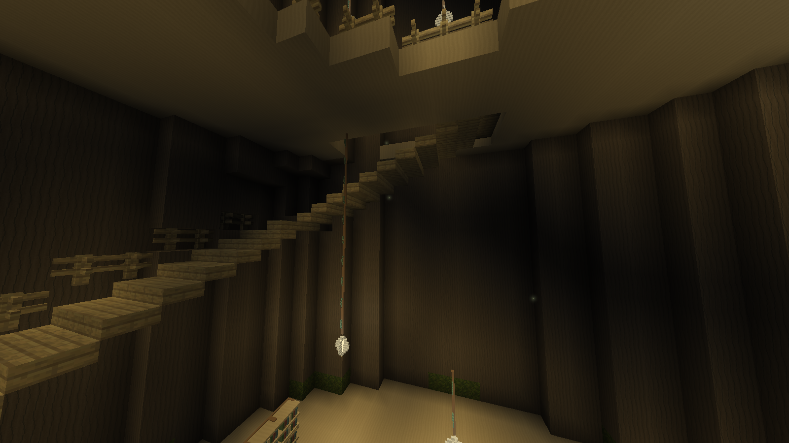

# 精灵森林与明亮树心

0.10.0 在远行大陆新增 `logos_dimension:elven_forest`。湿润、温和的大陆内陆会形成连片林地，苔地、蕨、灌木与小型伴生树填充林下。五种巨木高约 68–90 格，粗干与宽冠形成上层森林；地标世界树地表以上约 216 格，冠幅约 198×190 格，中央中空约 26 格宽。所有形体与贴图均由代码绘制。



世界树模板同时带八棵环绕巨木，使地标处在一片林冠中。群系内其他巨木独立稀疏生成。地标仍由原版结构候选和群系过滤决定，不保证每片连通森林恰好只有一棵。

## 树心布置



两侧各一张三模块叶背长椅，后侧三列藏书架，一组阅览桌椅，入口附近两处白花花架。浅木、苔绿与少量柔金边构成家具色彩。书架使用原版双格方块的成对放置和拆除规则；桌椅与书架目前仅用于装饰，没有座位或物品栏。

中央直径十格、高八格的主通道保持空旷。主灯在通道上方，木枝与藤索连接树壳；环壁叶灯和高处灯串补光。地板叶纹嵌片与叶灯均提供真实 15 级方块光照，中央九处行走高度的夜间光照最低采样值为 9。灯芯单独自发光，不依赖动态光照或光影包。



## 0.11.0 树屋、回廊与呼吸光

五种巨木各有带屋和无屋模板，权重分别为 2、5，平均每 3.5 棵巨木一间屋；世界树外围固定两间。阔叶木屋采用浅木宽檐，冷杉木屋采用深木尖顶，均有阳台、斜撑、侧窗、花槽、书架和叶灯。绳梯通往根颈附近：贴近按跳跃上攀，潜行停留，松开缓慢下降；离开绳体正常下落，拆除顶部锚点后下方绳梯移除。





世界树在相对树根 Y=17、33、49、65、81 加五层回廊，三格宽的八边形旋转楼梯逐半格上升，共 161 个中心踏步，外侧有扶手。中央半径约五格的光井贯通各层，底层十格宽通道保留。各层补书架、阅览角与叶灯。



树皮和枝条按空间哈希添加叶辉，森林地面使用原版 Feature。固定 10 级照明保持稳定；客户端另按世界坐标噪声分布光点，全部共享六秒呼吸周期。光点限定在玩家周围 48 格，普通设置最多 160 点，减少设置最多 64 点，最少设置关闭。每刻最多探测十八个噪声格，不加载新区块、不增加光源实体、不反复重算世界光照。未验证所有光影包或硬件帧率。

所有新增模型、贴图、光晕和软件预览均由代码制作，见 `tools/elven_habitation.py` 与 `tools/preview_elven_habitation.py`，没有使用图像生成服务。实际截图另行标注。已有区块不自动重建树屋或楼梯，但森林呼吸光也能在旧区块显示。精灵居民与功能设施尚未加入。

## 定位

在远行大陆执行：

```text
/locate biome logos_dimension:elven_forest
/locate structure logos_dimension:elven_world_tree
```

不在该维度时，管理员可以使用：

```text
/execute in logos_dimension:cloudsea run locate biome logos_dimension:elven_forest
/execute in logos_dimension:cloudsea run locate structure logos_dimension:elven_world_tree
```

`locate` 只报告坐标；先切创造模式，再按返回坐标在远行大陆传送。新群系和树形在新区块生成，旧区块不重建。

## 原版生成与开销

继续使用原版 `minecraft:noise`、`multi_noise`、`minecraft:jigsaw` 与 NBT。世界树分成 343 个 32³ 部件，最深拼接 12 层，0.11.0 另有 1,670 个单点原版向下树根 Feature；外围八棵巨木包含在同一地标。模板外部空位保留原地形，树心和入口使用显式空气清除障碍。没有矩形土台、地形削平、村民或动物。根部遇到实地停止，陡坡处仍可能露出较长根柱。

树冠删去不可见的内部填充，保留两格外壳；叶心与边缘面也随相邻叶块剔除。家具和灯没有方块实体、逐树扫描或额外实体光源，只有近景光晕使用有限预算动态绘制。巨树首次生成仍比普通树昂贵；不将开发截图视为硬件 FPS 保证。

为了给高海拔树冠留空间，远行大陆维度高度从 384 增至 512 格，最低点仍为 -64，最高可用 Y=447。原版地形噪声的高度仍为 384，新增上方空间为空气，不重做原有地形。

资源生成与审计：

```text
python tools/native_worldgen.py
python tools/audit_elven_forest.py
```

游戏测试、实际客户端验证范围见 [验证记录](../VERIFICATION.md)。上图是已生成地形上调用原版拼接器的开发场景；自然候选选址另用真实群系过滤验证，未把开发预览称作普通存档自动生成全过程。
