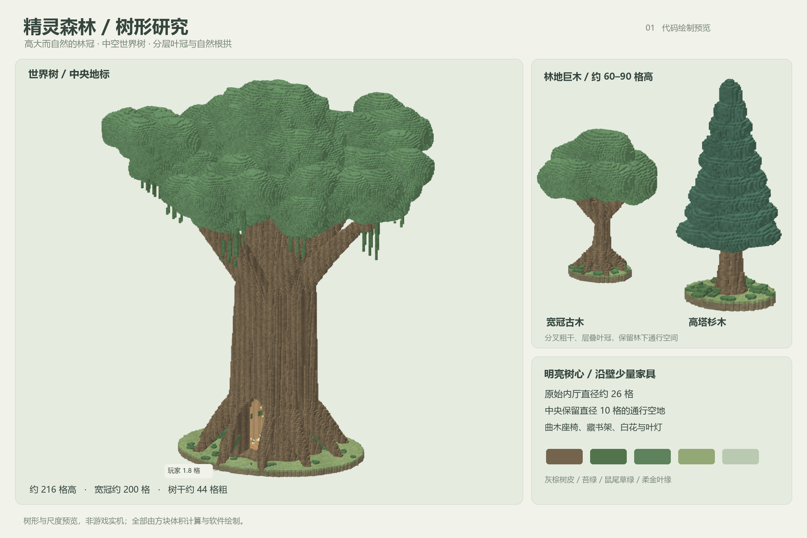
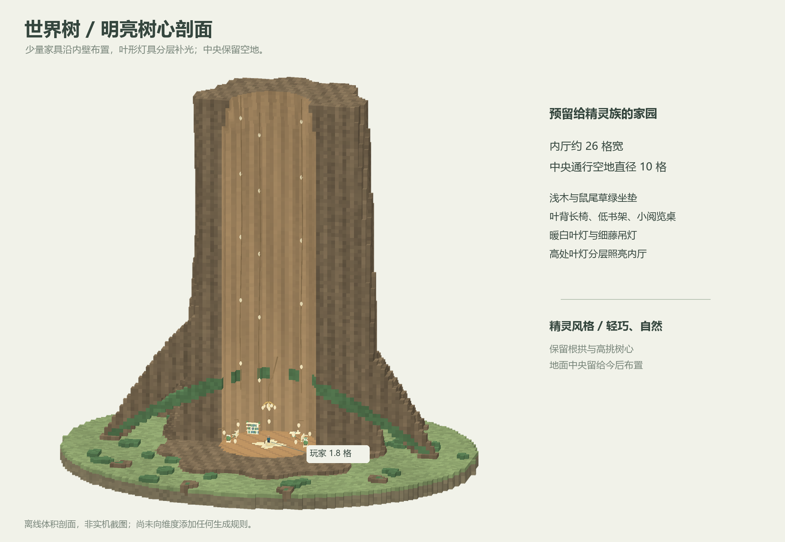
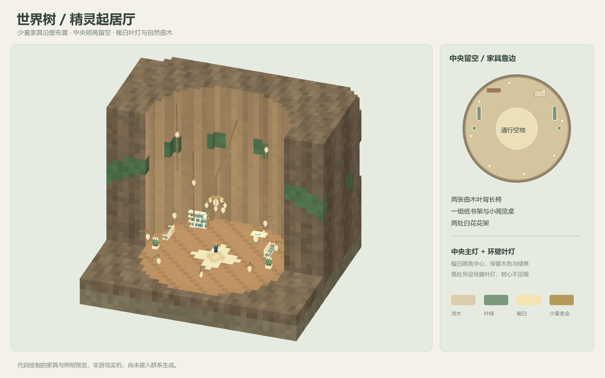

# 精灵森林树形研究

2026-10-21：按“树木要先画图”的要求，先制作树形、尺度与中空树心的离线预览，并按后续要求补充少量精灵家具与明亮的中央照明。使用 Python、NumPy 和 Pillow 计算体积、提取表面并绘制，不使用图像生成服务。本阶段不注册群系、不改变原有世界生成，也没有游戏中的定位命令。



世界树地表以上最高点为 216 格，冠幅约 198×190 格；中段树干约 44 格粗，根颈自然展宽。外侧棱脊、分叉粗枝、层叠叶团与少量垂叶共同形成轮廓。灰棕树皮配苔绿、鼠尾草绿，采用自然色彩，后续微光只用于少量叶尖和林下植物。

普通林冠树分为宽冠古木和高塔杉木，当前体积预览分别约 72 格与 86 格高。林内以这些巨木为上层林冠，未来再加入较矮的伴生树、蕨和发光草本，树下保留可行走空间；群系和密度尚未落地。



裸树体的树心圆形净空直径约 26 格，竖向连续净空至少 80 格，低处有自然根拱入口。脚本先逐格验证裸树体内厅为空，并验证入口上方外围至少三格的环形树壳连续存在；再单独校验家具与灯具不侵占中央直径 10 格、高 8 格的通行空间。图上小人按 1.8 格身高绘制。未来精灵住所的房屋、楼层与楼梯仍未添加。

## 精灵家具与明亮树心



两张曲木叶背长椅沿左右内壁布置，配浅木框和鼠尾草绿坐垫；后侧是一组低书架与一张小阅览桌，入口两侧各有一处白花花架。家具使用薄木构件、收尖叶纹与少量柔金边，保持轻巧，不塞满中央。桌椅与花架从地板表面起立；书架底板和立柱接地。

中央主灯悬在通行高度以上，花枝上垂下暖白叶形灯罩；环壁叶灯补充下部照明，细藤吊灯沿树心高度分层布置。地面为低对比木板与浅色四瓣叶纹嵌片，没有祭坛或其他中央障碍物。当前预览布置 31 个光源位置，包含主灯各灯芯、壁灯、桌灯、高处吊灯与地面嵌片。

软件渲染器按这些位置计算柔和点光照明与有限的灯芯光晕，中央保持明亮，树壳仍保留木纹和空间阴影。这是设计照明，不是 Minecraft 实际方块光照测试，也没有新增运行时实体或动态光源。

展示底面仅用来呈现根系与玩家比例，不是世界生成中的土台。当前体积含约 91 万个非空气格，只用于离线形态研究，不能据此声称游戏性能已通过。后续实现继续使用原版数据包、标准结构 NBT 与模板池，需进一步减少不可见体积、分块放置并验证生成开销，不添加 Java 运行时种树器。

## 蓝图参考

参考作者公开作品的粗干分叉、叶冠比例和中空布局，所有研究图的体积均由本仓库脚本独立计算，没有下载或重新分发其蓝图、贴图或原图：

- Textona：[Giant Oak Tree](https://www.planetminecraft.com/project/giant-oak-tree/)，用于观察大型橡树的分枝和叶冠组织。
- Ameobea10：[Huge Hollow Tree](https://www.planetminecraft.com/project/huge-hollow-tree/)，用于观察巨树中空空间。
- Tonylac：[Giant Tree — Hollow and Liveable](https://www.planetminecraft.com/project/giant-tree-hollow-and-liveable---by-tonylac/)，用于观察可居住树心的尺度思路。

## 复现

```text
python tools/elven_tree_study.py
```

需要 NumPy、Pillow 与 Windows 微软雅黑字体。输出树形、整体剖面、家具近景三张 PNG 和 `dimensions.json`；家具几何位于 `tools/elven_tree_furnishings.py`。结果为离线绘制，不是游戏实机截图。运行源码和发布包版本仍为 0.9.3。
