# 爆裂魔法（爆裂魔杖）

致敬《为美好的世界献上祝福》里惠惠的爆裂魔法：一根只能放一种魔法的法杖，吟唱二十秒，在远处放出一次覆盖几十个区块的大爆炸。

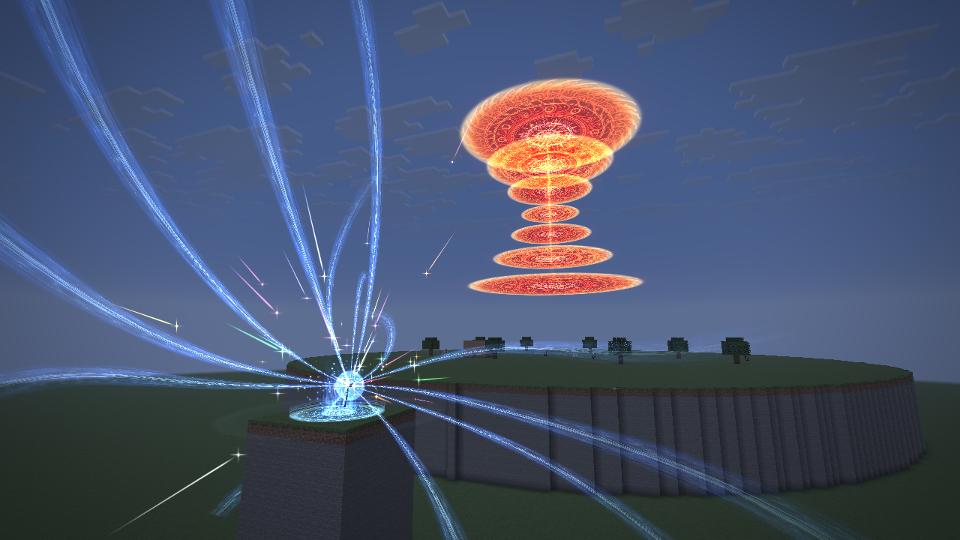

## 怎么用

| 项目 | 规则 |
|---|---|
| 获取 | 创造模式物品栏「远行大陆」页。还没有合成配方 |
| 吟唱 | 爆裂魔杖拿在**主手**，按住右键。开始时身上要有 **6400** 魔力（创造模式不要），之后每刻注入 16，**400 刻（20 秒）**注满 |
| 目的地 | 准星指的地方，最远 160 格；看着天空时从最远处往下落到地面。吟唱中跟着准星缓缓移动，每刻最多 3 格 |
| 释放 | 注满后松开右键 |
| 中断 | 没注满就松手、换手、死亡、下线、换维度：已注入的魔力散成游离魔力（和 Logos 的法杖一样）。魔力中途被别处用掉、不够某一刻的份时，吟唱停住，等魔力回来 |
| 提醒 | 自己站在爆炸范围里时每秒提醒一次 |
| 放完之后 | 魔力耗尽：爆炸的球体散尽时（松手后 162 刻），施法者被强制趴下 **30 秒**，原版的趴下姿势（和钻进一格高的缝时一样，能慢慢爬，不能跳、不能疾跑）。不提醒；死了或者变成旁观者就起来。只有用法杖放的才会累趴 |

试效果（管理员）：`/alchemy explosion`，不吟唱，直接在准星指的地方放一次。

## 爆炸

半径默认 **64 格**（直径 128 格，约五十个区块），在服务端配置 `serverconfig/logos_dimension-server.toml` 的 `[explosion]` 一节：

| 配置 | 默认 | 说明 |
|---|---|---|
| `breaksTerrain` | `true` | 爆裂魔法是否破坏地形。关掉后范围内照样全灭，但一个方块都不动 |
| `radius` | `64` | 爆炸半径，16 到 128。法阵、火柱都跟着缩放 |

- **强制击杀**：球面扫过的一切都没了。玩家（创造模式也算，旁观者不算）、生物、盔甲架、矿车、画、地上原有的掉落物和经验球。伤害类型 `logos_dimension:explosion_magic` 无视无敌、护甲、抗性、附魔、药水效果、盾牌和不死图腾；伤害被别的模组拦下时再补一刀原版的击杀。死者自己掉出来的东西留着。
- **气浪**：球体到最大时，半径一到 2.2 倍之间的东西被向外掀飞，越近越猛。
- **深坑**（开了 `breaksTerrain`）：地面以上按半球削掉，地面以下是一只碗，中心一直挖到基岩（基岩本身挖不动，成了坑底），往外渐浅，坑壁带一点起伏。不掉落，方块实体（箱子等）直接没了，床、工作台这类兴趣点一并注销。出生点保护、世界边界内施法者自己改不了的地方不挖；冒险模式不挖。

### 时间轴

松手之后（刻）：

| 刻 | 画面 | 服务端 |
|---|---|---|
| 0 | 法阵一下更亮，一根巨大的火柱从最高的法阵往下贯穿到目的地 | 给爆炸范围加载票，没加载的区块开始加载 |
| 12 | 火柱落地：地面一圈冲击环、风圈飞快推开，空气被推开的折射；落地点往上喷出火花 | 火柱里的东西没了 |
| 12–34 | 爆点周围渐渐红热，别处暗下去，最后白热；喷出去的火花被吸回中心 | |
| 34 | 一瞬间整个画面转成蓝色 | |
| 36 | 蓝色的画面中心爆出极亮的十字闪光：不大的白芯，上下左右四道细长的光芒（横的贯穿画面），斜向四道短芒；蓝色一直留到黑白闪 | |
| 39 | 加长的黑白闪（剪影、剪影、吞没、翻转、翻转、吞没） | |
| 42 | 黑白闪结束前换成白热的球体，开始扩大：球里正中一颗极亮的白球，壳上一层层锯齿形的亮纹从顶上往下流；掀起地面碎块，卷起尘浪，彩色十字闪炸向四周 | 球面扫过的一切被击杀，被整个扫过的区块挖成坑 |
| 112 | 球体到最大 | 外圈被气浪掀飞 |
| 112–162 | 球体按噪声一块块散去，露出坑 | 剩下没挖的区块挖完 |
| 162 之后 | 升腾的烟柱和尘环、余烬、慢慢飘起的彩色光点，约 20 秒散尽 | 施法者趴下 30 秒 |

声音按距离晚到（约每刻 17 格），远处的人先看到火光再听到轰鸣；镜头震动按「屏幕效果」设置缩放，六倍半径外不震。

| | |
|---|---|
| 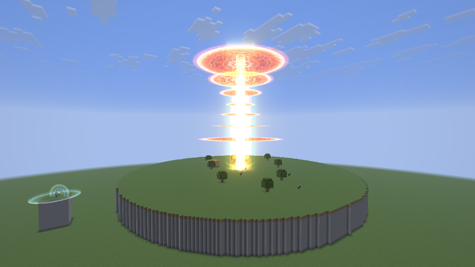 | 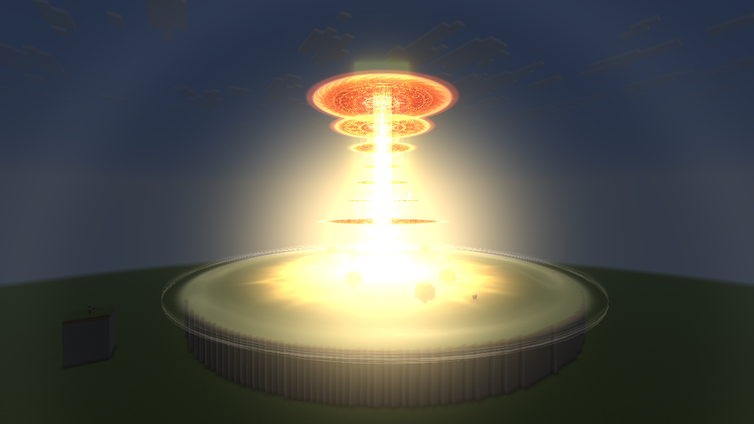 |
| 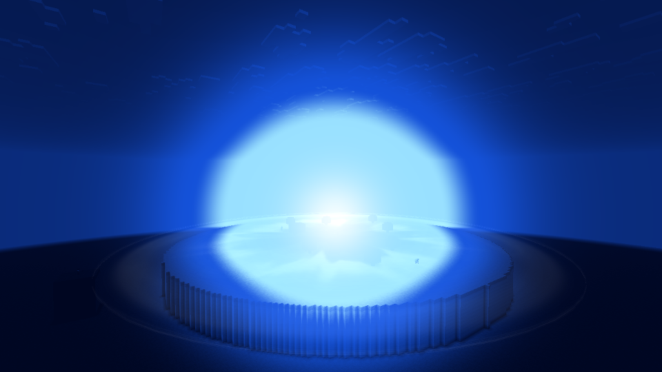 | 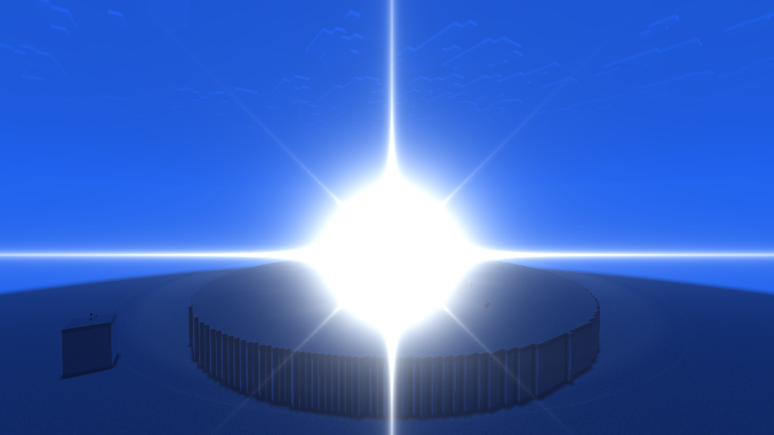 |
| 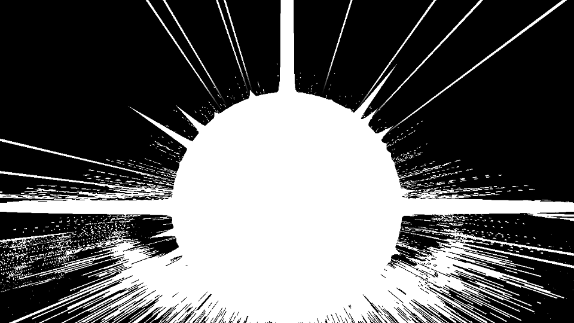 | 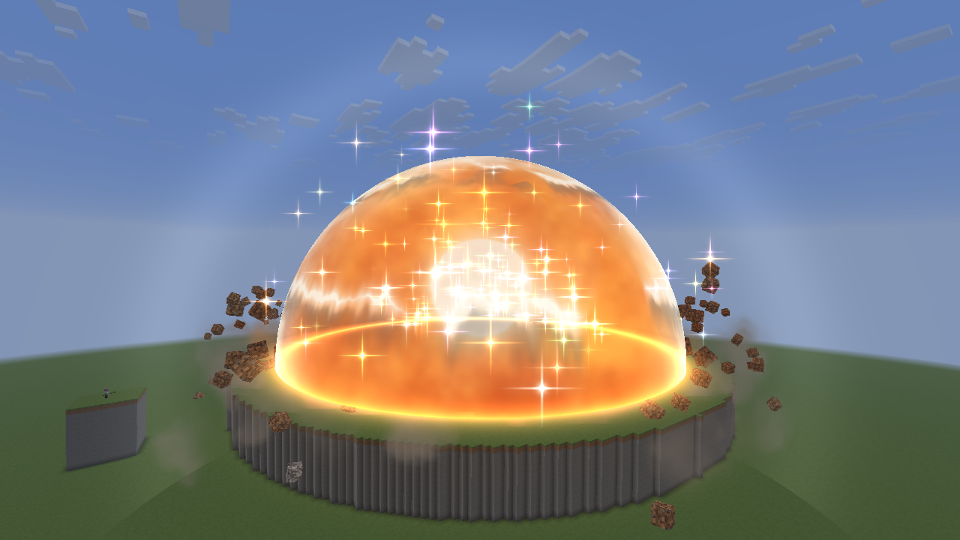 |

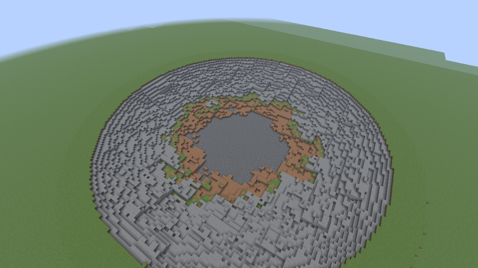

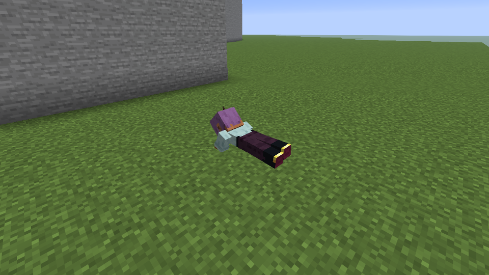

截图来自客户端场景 `explosion_staff`（远处的机位离爆点约 140 格，原版、不装光影）。

## 特效

### 吟唱

照 Logos 巨型蓄力的结构做（`ChargeHead` / `ChargeBody`），换成动画里的深蓝：

- 杖头就是红宝珠（模型里的 `wand_tip` 组，Logos 的 `CastPoints` 给出第一、第三人称里画在哪）：汇聚的光点、旋入的光痕、一阵阵冲击波、后半程收拢的高能球、蓄满后脉动的能量球。
- **条带**从远得多的地方汇来（30–55 格，Logos 是 11–19 格），每条只弯 20–40 度（条带这么长，弯得多了就成了绕着人转的圈），整条随吟唱慢慢转动，越远越宽越淡，像水流一样起伏，后段收细成线，蓄满时消失。
- 目的地上空**一个接一个出现红色法阵**，大小不一，竖直叠成一列（从下往上，高 22–74 格），每个出现时从小涨开、闪一圈光；一根细光柱穿过所有中心。一个法阵是几层：暗红光晕、火焰花瓣（Logos `fire_field/circle_05`）、金色符文环（`charge/circle_11`、`arcane_charge/circle_04` 轮换）、亮金外圈、中心小太阳纹。
- **后半程**出现各色的十字闪（黄、绿、粉、青、白、橙、紫），和条带一样快地飞向杖头，身边也有几颗在原地闪。
- **蓄满的那一下**，一大股魔力从身上冲出去：杖头一闪；两圈光环从胸口扩开成一个球形的冲击，别人看得到后期里空气被推开的折射；脚下一堵风墙卷到二十几格外；六十多道光痕水平地冲出去；附近的镜头一震，加一声风爆（原版风弹的声音）。
- **蓄满之后**魔力不停地往外涌：身上的光柱高一倍多、流得更快，不停冒出更高更快的上升光痕和往外往上冲的光点，脚下的风圈一阵阵更勤更远，身边一团呼吸的光。施法者自己第一人称时，画面四周一圈火苗似的蓝光往上流。
- 身上：脚下三层深蓝法阵和腰间、头顶各一个，光柱，上升的光痕，扩散的波浪，脚下的旋风，被卷上天的地面碎块。
- **周围变暗**：离施法者或目的地 64 格内的玩家，画面随吟唱渐渐变暗、偏冷，边角更暗（最多暗到约六成）。施法者身上和天上的发光特效是在变暗之后才画的，所以格外亮。

| | |
|---|---|
| 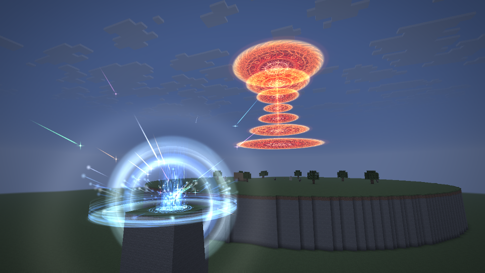 | 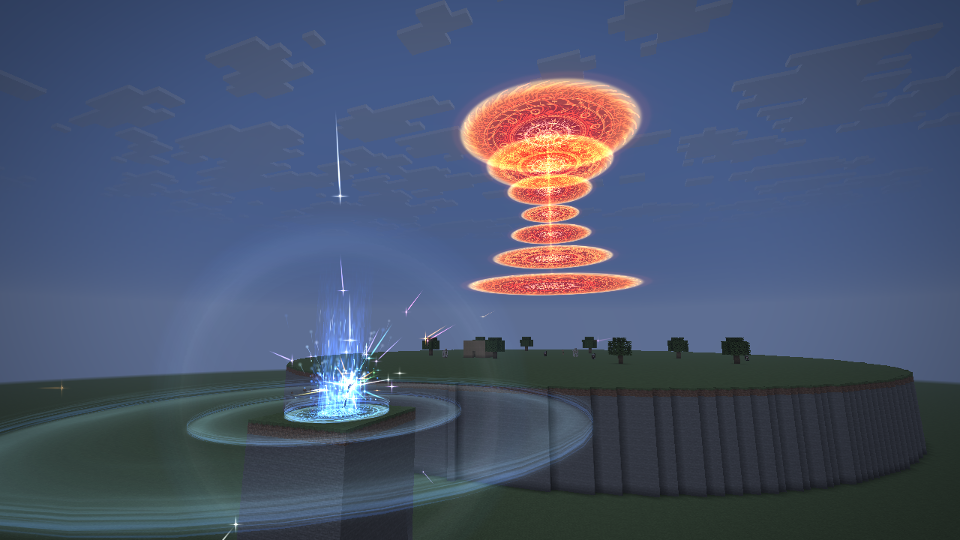 |

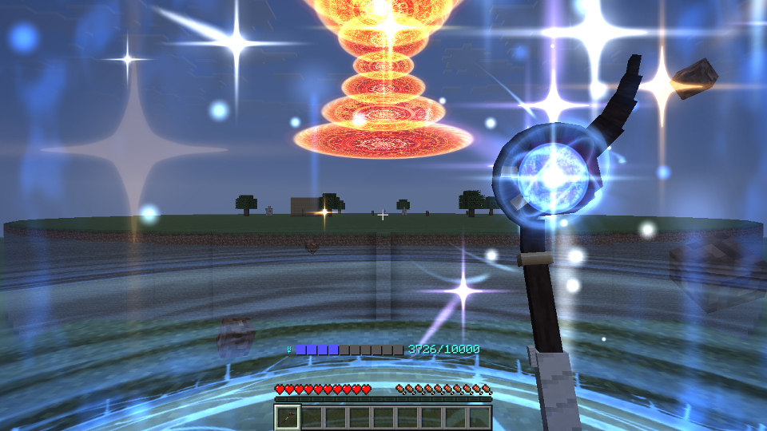

### 渲染做法

- 发光的特效都交给 `client/screenfx/PostVfx`：世界和手都画完、画面调完色之后，在全屏后期里按世界的投影画上去，和半透明之前的深度比较，被方块挡住的不画，手挡在前面的不画（第一人称杖头上的光例外）。所以它们不会跟着变暗，也不受雾和光影包的影响，几百格外的法阵、火柱照样看得见。
- 地面碎块、烟是实物，照常在世界里画（Logos 的 `VfxParts`），跟着周围一起变暗、受光照和雾。
- 全屏的部分在 `client/explosion/ExplosionScreen` 一个通道里：变暗、红热、白热、转蓝、十字闪；**球体**是每个像素算视线和球的交点：边缘一圈白热，往里越来越透，透出壳里翻滚的橙红火云（取视线上最贴近球心那一点的三维噪声）和正中一颗极亮的白球（球心在地面上、露出来的是半个球，白球放在这半个球看上去的正中，离地 0.32 个半径、半径 0.26 个半径，所以从哪个方向看都在中间，边缘带一点横向的毛刺）；壳上三道锯齿形、断断续续的亮纹（带一层光，前面压着一道暗影，像一圈浪）从顶上一圈圈往下流到地面，约 3.6 秒一趟；和地面相交处一圈更亮，散去时按噪声一块块消失，白球最后散；**空气被推开**是两层看不见的球壳，视线擦过球壳的地方把背后的画面往外折射一点。只读最终画面的颜色和半透明之前的深度，不碰光影包的缓冲。
- 球体的样子参考 Unreal `NiagaeaBigVFXPack/Effects/Niagara/Explosion`（`NS_Explosion_mesh1` 的发光球、菲涅尔球壳，`grain1` 先喷出再被吸回中心的火花，`kira` 的闪光，`LS_Explosion` 的节奏：球先长、停一下、再猛地撑开），颜色换成白热。拆解在仓库外 `art/explosion/`（导出脚本 `ue/export_explosion.py`，各系统的说明 `dump/*.txt`）。
- 贴图复用 Logos 的（`logos:textures/vfx/...`），只新增一张代码画的软边圆盘 `textures/vfx/explosion/disc.png`：法阵最底下那层暗红是按透明度叠的（不是加亮），白天的天空上法阵才不会被冲成粉白；Logos 现有的圆点贴图四角是不透明的黑，不能这样用。
- 黑白闪用现成的 `ScreenEffectRenderer`，光敏限制照旧：「隐藏闪电的闪烁」打开时不闪，转蓝和十字闪也大幅减弱。

### 性能

- 挖坑不走 `setBlock`：一个区块一个区块直接改方块数据，不发邻居更新；挖完重算高度图和天空光源，让光照引擎从新的天空光源往下补光（只会变亮，不用逐格检查），并马上把整个区块发给看得到它的玩家，一个区块一个包，地形在白热的球体还在时就消失；光照在自己的线程上算完（几毫秒到几百毫秒）后再发一次，带上正确的光照（原版只给它看见变化的子区块补发光照，挖开的坑收不到，不再发一次会一直是黑的）。每刻最多花 6 毫秒，超了留到下一刻；球面整个扫过一个区块之后才挖它。日志里有每次的方块数、服务端耗时和光照最慢多久算完（`Explosion crater at ...`）。
- 客户端：没有吟唱和爆炸时一个额外的通道都不跑。后期里的特效一帧几千个四边形，按贴图分批；全屏通道每个像素只在球体和球壳覆盖的地方算噪声。

## 模型

`tools/ExplosionStaffAssets.java` 用代码画模型和贴图（`java tools/ExplosionStaffAssets.java src/main/resources [预览图.png]`）：深褐色的细长木杖，中段缠白色绷带，脚下一块小平底；杖头向左上弯成钩，绕过红宝珠上方，在右上角收成一片尖尖的尾翼，宝珠由两道金箍扣在钩内，微微自发光。手握在模型 y≈8，和 Logos 的长杖一样。

物品继承 Logos 的 `WandItem`（没有术式槽），只是为了让 Logos 记下杖头在哪；潜行右键不会打开载页界面。吟唱时第三人称用 Logos 法杖蓄力的姿势；第一人称平时杖头往画面里斜一点（红宝珠整个在画面里），吟唱时把杖抬起来，红宝珠停在准星右上方，越到后面抖得越厉害，蓄满后稳住。

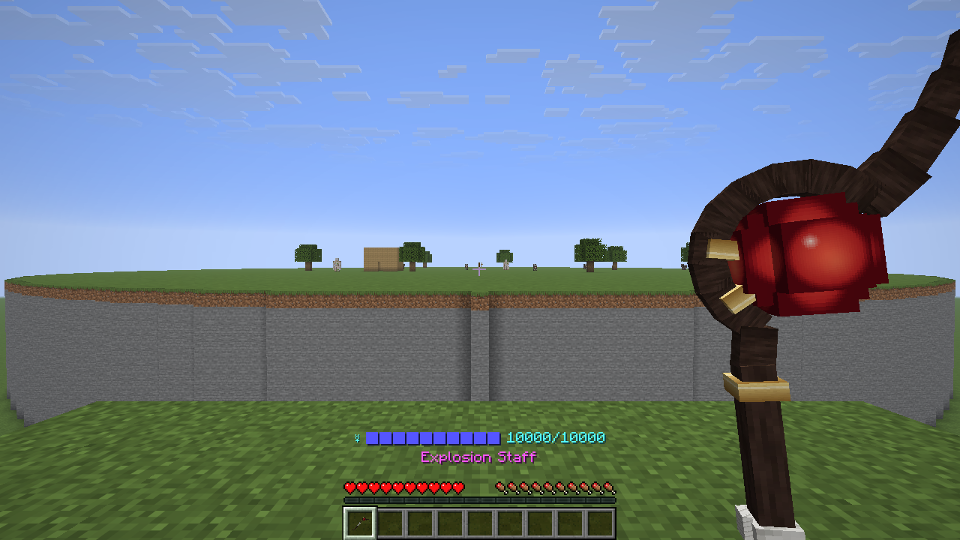

## 测试

```text
./gradlew runGameTestServer -PlogosJar=/absolute/path/logos-0.6.0.jar -PdimensionTests=logos_dimension:explosion_*
./gradlew runClient -PlogosJar=/absolute/path/logos-0.6.0.jar -PldTest=explosion_staff -PldTestHeadless -PldTestWindow=1280x720
```

- 世界测试 `explosion_*`：魔力不够、副手不能吟唱；400 刻注满 6400 魔力、每刻 16；中断后注入的魔力散成游离魔力；半径内的生物（戴下界合金头盔的僵尸、铁傀儡）都死、原有掉落物清掉、半径外的牛被掀开活着；开了破坏地形时坑中心挖到世界底部、半径外不动、离中心 12 格处挖不到底；关了时一块不动。测试里半径调到 16。
- 客户端场景 `explosion_staff`：超平坦上垫一块十几格厚的石台，真按住右键吟唱 20 秒，按进度从侧面截图，蓄满后从第一人称和远处各截一张（第一人称的几张开着界面拍：原版隐藏界面时连手里的东西一起藏）；爆炸按时间轴各个时刻截图（放出去之后停住特效自己的时钟，用 `ExplosionClient.advanceTo` 一刻一刻推到那一刻，所以客户端会比服务端快，早几张里看到的坑是测试的假象）。检查石台上的东西都没了、挖出了坑、坑底到了基岩、全屏通道确实跑过；球体散尽后施法者趴下（本机和服务端都是），从旁边截一张。
- 客户端场景 `explosion_bench`：同一个石台，从远处看一整次吟唱和两次爆炸（第一次不破坏地形、第二次破坏），按阶段记每帧的间隔，再取挖坑那几秒服务端每刻的耗时。场景里关掉帧率上限和垂直同步；原版一分钟没有输入就把帧率限到 30，也要改成只在最小化时生效，否则会量出假的 33 毫秒。超过 10 毫秒的帧单独记一行：在哪一段、吟唱到哪、爆炸第几刻、那一帧里有没有跑过垃圾回收。

### 结果

`explosion_bench`，1280×720，视距 16，不限帧率（场景里关掉帧率上限和垂直同步，量的是每帧真正花的时间，不是贴着上限的数），从约 140 格外看一整次吟唱和两次爆炸。每格是平均 / 99 分位 / 最慢，单位毫秒。表里是加了蓄满气浪、球体纹理之后的那次（原版前后跑了四次，平均彼此差 0.1–0.3 毫秒）：

| 阶段 | 不装 Sodium 和 Iris | Sodium + Iris + photon v1.4 |
|---|---|---|
| 平时 | 0.75 / 2.47 / 19.1 | 2.79 / 5.37 / 7.1 |
| 吟唱 20 秒（含蓄满之后） | 1.36 / 3.27 / 13.6 | 2.98 / 6.31 / 29.4 |
| 火柱到黑白闪 | 1.15 / 3.19 / 8.6 | 2.65 / 6.21 / 10.1 |
| 球体扩大 | 1.15 / 3.06 / 7.7 | 2.74 / 5.45 / 8.4 |
| 球体扩大，破坏地形（挖坑、重发区块） | 1.10 / 3.09 / 6.1 | 2.49 / 4.87 / 8.7 |
| 球体散去 | 1.12 / 3.09 / 6.7 | 2.68 / 5.34 / 7.1 |
| 烟（162–320 刻） | 0.87–0.93 / 2.91 / 18.1 | 2.17–2.28 / 5.22 / 12.0 |

整个过程比平时每帧多花不到 0.7 毫秒（原版）；开着 photon 时和平时差不多（后几段比「平时」还低，大概是「平时」那几秒刚传送过来、区块还在建网格，没细查）。挖坑和重发区块在客户端看不出额外的开销。

偶尔有 10–30 毫秒的单帧（平时也有，最慢 19 毫秒）：大多那一帧里跑过垃圾回收；吟唱的第一帧 13–15 毫秒（第一次跑到这些代码）；其余零散，那一刻区块网格没有排队，没找到固定的原因。基准不限帧率、每秒几百帧，内存分配和垃圾回收都比平常玩（每秒 60–144 帧）频繁得多。

服务端：挖 64 个区块、约 11.4 万方块合计 19–27 毫秒；爆炸那几秒服务端每刻平均 1.5–2.0 毫秒，破不破坏地形差不多。有一次不破坏地形时有一刻 10.7 毫秒（那次一个方块都没挖，原因没查），其余几次最慢 2–5 毫秒。


`explosion_staff` 在五种环境下都是 1/1 场景、6/6 检查：

| 环境 | 结果 |
|---|---|
| 不装 Sodium 和 Iris | 通过 |
| 只装 Sodium 0.9.2 | 通过 |
| Sodium + Iris 1.11.4，光影关着 | 通过 |
| Sodium + Iris + photon v1.4 | 通过，日志里有 `Using shaderpack: photon_v1.4.zip`，法阵、变暗、蓄满的气浪和四周的蓝光、红热、转蓝、十字闪、球体的白球和亮纹、黑白闪都对 |
| Sodium + Iris + Complementary Reimagined r5.9.3 | 通过，同上 |

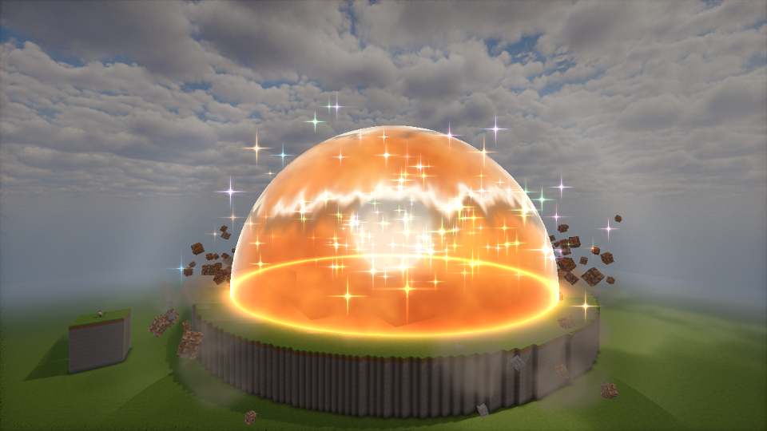

## 我替你定的（可以改）

- 破坏地形默认**开**，半径默认 64；坑的形状（地面以上半球、地面以下碗形到基岩、坑壁起伏）。
- 创造模式吟唱不扣魔力；开始时要有全部 6400（和 Logos 法杖一样），中断时注入的魔力散成游离魔力。
- 目的地最远 160 格，吟唱中跟着准星每刻最多挪 3 格；没有锁定。
- 强制击杀包括创造模式的玩家，不包括旁观者；只清爆炸开始时就在的掉落物和经验球；施法者自己站在范围里也会死（每秒提醒）。
- 方块不掉落，方块实体（箱子等）连同里面的东西一起没了；坑边的水不会流进坑（没有邻居更新），直到附近有方块变化。
- 没有合成配方，只在创造物品栏里有。
- 黑白闪是加长的六拍（剪影、剪影、吞没、翻转、翻转、吞没）；「隐藏闪电的闪烁」打开时不闪，转蓝和十字闪减到三成左右。
- 声音全是原版的（烈焰人、末地折跃门、监守者音爆、雷声等）叠出来的，按声速晚到。
- 累趴：从球体散尽开始趴 30 秒（不是松手的那一刻，先让人看完爆炸）；趴着能慢慢爬，跳和疾跑被挡掉；创造模式也趴；只有用法杖放的才算，`/alchemy explosion` 不算。
