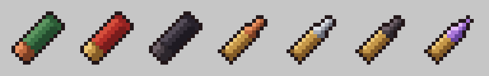
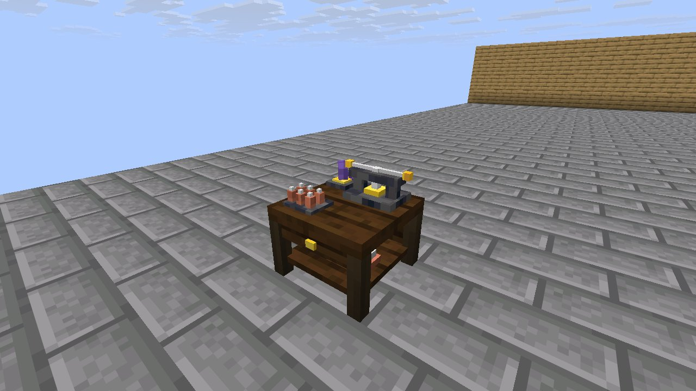
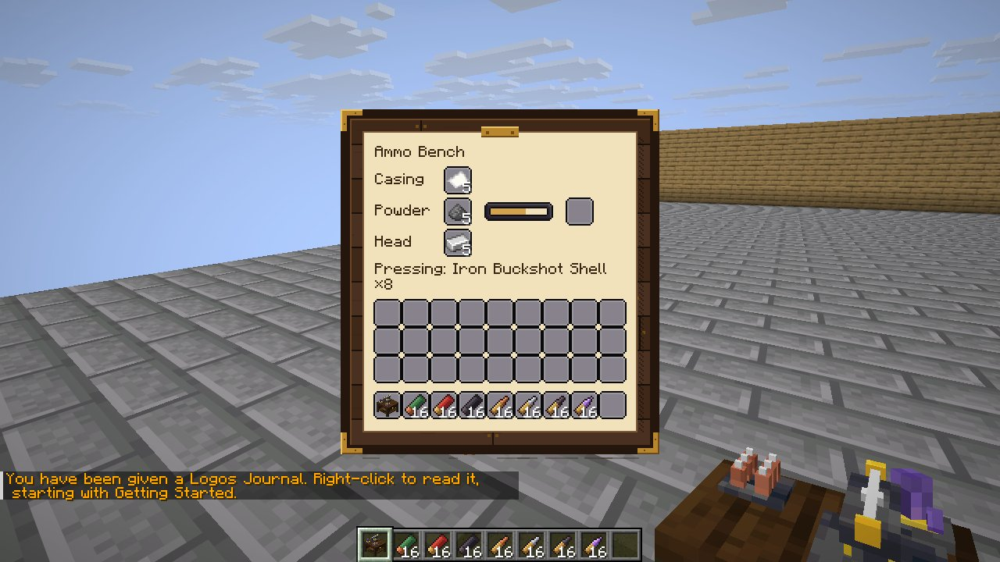
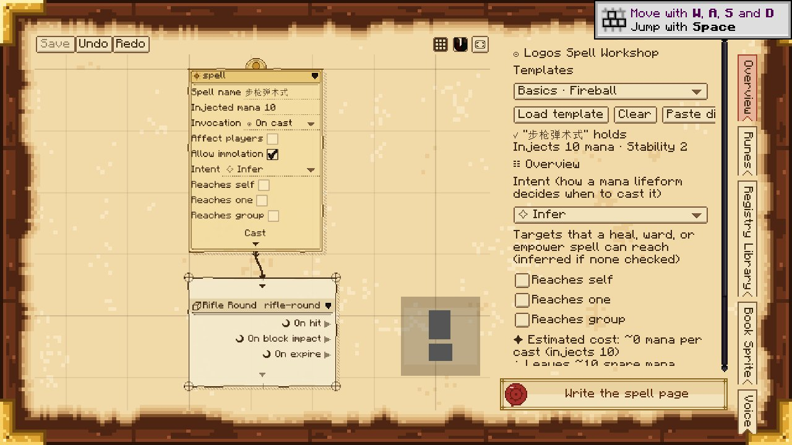
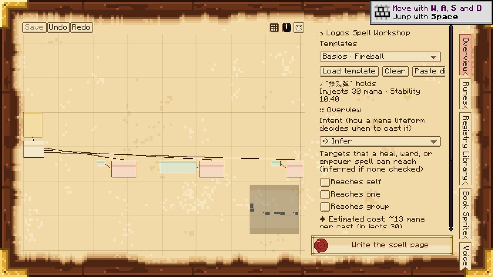
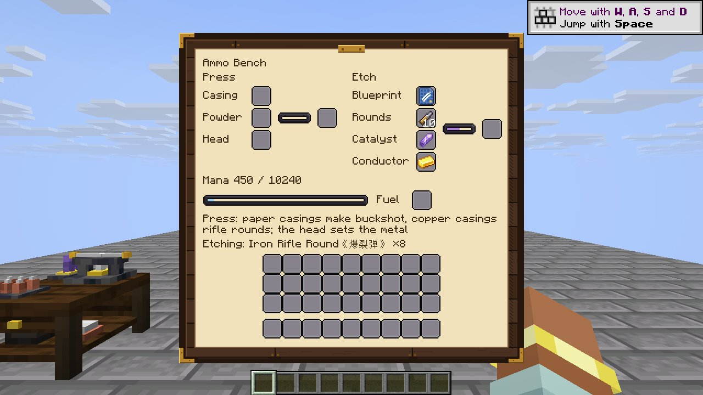
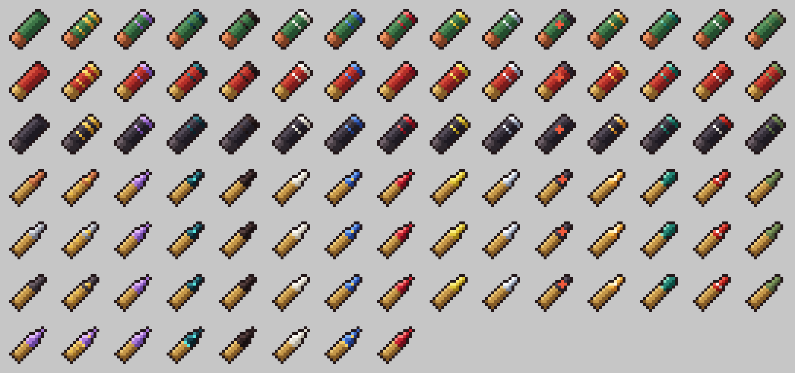
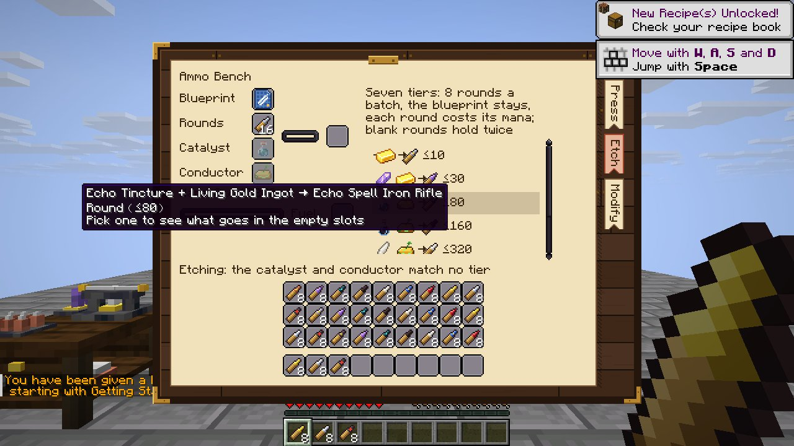

# 铳与弹药

维护者 2026-11-25 定下的方向：铳（枪械）和弹药是一个新领域，先把基础打好。弹药不分口径，统称弹药；
目前有普通弹（霰弹、步枪弹，各分铜、铁、下界合金三种弹头，外加空弹头），在铸弹台上压制；
术式弹在普通弹上刻进术式、注入魔力（第 9 节），改装弹用材料改出某种效果（第 10 节），以后还会加别的。
铳只管打出去，打出去是什么效果交给弹药，所以加一种弹药只写它的效果和画面，不用适配每一把铳。

第一把铳是[铳斧](GUNAXE.md)。

## 1. 分层

| 层 | 管什么 | 代码 |
|---|---|---|
| 弹药 | 打出去是什么：命中判定（射线、弹体、施放术式……）、伤害与元素、附加效果、声音；画面（弹道、命中）由客户端按同一种弹药注册的画法画 | `firearm/Ammo`（`fire(Shot)`，物品实现 `Ammo.Item`）；画面 `client/firearm/AmmoVisuals` |
| 铳 | 怎么打：容量、散布倍数（瞄准时更准）、威力倍数、什么时候扣扳机（招式文件）、换弹动作 | `firearm/Firearm`（物品实现） |
| 公共流程 | 装弹状态、背包里的弹药、R 键与弹药轮盘、换弹结算、扣扳机（扣掉一发交给弹药、广播给客户端）、铳口火光 | `firearm/Firearms`、`client/firearm/FirearmClient` |

## 2. 装弹状态

存在铳这件物品上的组件 `logos_dimension:gun_load`（`GunLoad`，存档并同步，别人也看得见转轮里还剩几发）：

- `selected`：选中的弹药，存的是一件物品的样子（带组件）。以后写了不同术式的术式弹，组件不同，就是不同的弹药。
- `loaded`：膛里装的是哪种弹药。一个转轮（弹匣）只装一种，换种类就是整个换。
- `rounds`：还剩几发。

## 3. 操作

| 操作 | 效果 |
|---|---|
| 短按 R | 用选中的弹药换弹：没装满，或者要换种类时才换。 |
| 长按 R（0.3 秒） | 打开弹药轮盘：背包里每种弹药一格（图标和总数），指向一种松开 R（或点一下）就选中它并换弹。版式照 Logos 的术式轮盘，一圈 10 格，多了用滚轮翻页。 |
| 打空最后一发 | 自动换弹（背包里有弹药时）。 |
| 空膛扣扳机 | 只“咔哒”一声，然后自动换弹。 |

- R 也是 Logos 术式轮盘的键。主手拿着铳时 R 归铳（按键的冲突范围只在拿着铳时生效），副手拿着法杖也不弹术式轮盘（`ScreenEvent.Opening` 里拦下）。
- 第一人称举枪瞄准时（招式名以 `aim` 开头）不画原版准星，照门和准星就是准星（`FirearmClient.aiming`）。新铳的瞄准动作要让照门、准星对准屏幕中心。
- 不显示弹药数（全局规则：不在 HUD、聊天、动作栏写状态）。转轮窗口里看得到还剩几发：打掉的那几发子弹骨骼缩成 0。弹药轮盘里的数字是维护者要的。

## 4. 换弹与开火的结算

都在服务端，时机由招式文件给（[COMBAT_SKELETON.md](COMBAT_SKELETON.md) 第 5、6 节）：

- 招式的 `fire` 时刻扣一次扳机：膛里有子弹就扣掉一发，交给这发弹药的 `Ammo.fire`。射线起点是射手眼睛、方向是视线（准星对着哪里就打哪里），铳的散布一起交过去；威力是铳的威力倍数乘这一招的 `damage`（连招收尾的那一枪可以比瞄准开枪重）。然后把弹道终点广播给射手和看得见他的玩家，铳耗 1 点耐久。空膛只放咔哒声。
- 招式的 `feed` 时刻装到位：没打完的退回背包（背包满了掉在脚下），再从背包装满要装的那种。中途被打断（没播到 `feed`）不结算。
- 要装哪种：选中的（背包里还有，或者创造模式）；选中的用完了，就改用背包里的另一种，并记为选中。
- 创造模式不消耗、也不退回。
- 转移的前提：`loaded`（膛里有子弹）、`empty`（空膛）、`reloadable`（有弹药可装，并且没装满或要换种类）。铳斧的第五下就是 `attack → shot_5 [loaded]`、`attack → dry_5 [empty]` 两条。
- 打空最后一发、空膛扣扳机时，服务端自己给一次 `reload` 输入；招式文件里这一招的 `reload` 转移写成缓冲到取消点，收势之后接换弹。

## 5. 普通弹

弹体做好就定了，分三层看：**弹种**决定怎么打（弹道形状、射程、散布），**弹头金属**决定多重，**术式**（以后）决定命中时放什么。
子弹都是瞬间命中（射线），不做追踪、抛物这类飞行方式；要追踪就在术式里放 Logos 的魔弹。

| 弹头金属 | 物理伤害 | 另外 |
|---|---|---|
| 铜 | ×0.8 | 便宜，量大 |
| 铁 | ×1.0 | 基准 |
| 下界合金 | ×1.4 | 步枪弹多穿透一个目标；物品不怕火 |

金属在 `firearm/RoundMetal`。伤害最后还要乘铳的威力倍数和这一招的 `damage`（铳斧第五下 ×2 只乘物理伤害）。

七种普通弹的图标（左起铜、铁、下界合金霰弹，铜、铁、下界合金步枪弹，空弹头）：

### 霰弹（`copper_buckshot_shell`、`buckshot_shell`、`netherite_buckshot_shell`）

一发 8 颗弹丸，锥形散开（半角 7°，瞄准时减半）。8 格内满伤，之后线性衰减，到 24 格射程尽头剩 40%。
每颗 2.5 点物理伤害（铁弹头），贴脸全中 20 点（铁剑 6 点）。铁霰弹沿用最早的编号 `buckshot_shell`。

- 锥形里的几个目标都会挨。
- 同一个目标挨的几颗合成一次伤害：Logos `Effects.followUp`，物理元素，不吃受击冷却。
- 击退按挨了几颗算。不打自己、自己的宠物和同乘的。

数值在 `firearm/Buckshot`。画面（`BuckshotVisuals`）：八条短弹道，只画前 10 格；终点溅方块碎屑或暴击星；铳口前喷一团火星。

### 步枪弹（`copper_rifle_round`、`iron_rifle_round`、`netherite_rifle_round`）

一发一颗，沿视线直射（半角 1.2°，瞄准时减半）。32 格内满伤，之后线性衰减，到 64 格射程尽头剩 70%。
12 点物理伤害（铁弹头），打中第一个目标就停；下界合金弹头穿过第一个，再打一个。

和霰弹的分工是远近：贴脸不如霰弹全中，二十格外胜过霰弹，霰弹射程（24 格）外只有它打得到。
数值在 `firearm/Rifle`。画面（`RifleVisuals`）：一条细密的弹道一直画到最远的落点，经过的每个目标溅暴击星。

### 空弹头（`blank_round`）

铜弹壳、火药，弹头是一枚紫水晶，没有弹丸：打出去只有铳口火光和一声响，不伤人、不画弹道。
它是纯术式弹的弹体，刻进术式之后才有用（第 9 节）。

铳口火光和烟由铳统一画。目前用原版粒子，声音也借原版的（爆炸、烟花），以后换成自己的。

## 6. 铸弹台（`ammo_bench`）

一格大的工作台：深色橡木台面，站在正面看右后一台螺旋压床，左后一座嵌紫水晶的铸铁底座（以后在这里刻术式），左前一盘立着的子弹，台下火药桶。
台面朝着摆放它的人。右键打开界面，样式和 Logos 的魔力器具一样，是工作台上摊开的一页账本，书签翻页：压制、铭刻（第 9 节）、改装（第 10 节），见第 11 节。

 

- 三个输入格：弹壳、火药、弹头。对上一条压制配方、出货格放得下，就每 2 秒压一批 8 发，三格各扣一份，没料或出货格满了就停。
- 出货格只出不进；出货格里放着别的弹时不压。
- 漏斗、管道：材料从任何一面送进对应的格子（每格只收这一格用得上的东西），弹药从出货格取走。
- 拆掉时材料和弹药掉出来。

压制配方是数据（`data/logos_dimension/recipe/ammo_pressing/*.json`，类型 `logos_dimension:ammo_pressing`，`firearm/AmmoPressRecipe`），弹种看弹壳、金属看弹头：

| 弹壳 | 弹头 | 出 |
|---|---|---|
| 纸 | 铜锭 / 铁锭 / 下界合金碎片 | 8 发铜 / 铁 / 下界合金霰弹 |
| 铜锭 | 铜锭 / 铁锭 / 下界合金碎片 | 8 发铜 / 铁 / 下界合金步枪弹 |
| 铜锭 | 紫水晶碎片 | 8 发空弹头 |

火药都是一份。铸弹台本身：锻造台、上面一台活塞、两边两块铜锭（工作台合成）。
模型、配方、掉落由 `tools/ammo_bench.py` 生成，弹药图标由 `tools/firearm_icons.py` 生成。

## 7. 加一种弹药

1. 物品实现 `Ammo.Item`，`ammo()` 返回它的打法；放进武器页（`AddonTabs.WEAPONS`），写语言。
2. `Ammo.fire(Shot)`：自己做判定、伤害、效果、声音，返回弹道终点（没有弹道就返回空）。射手是 `LivingEntity`，不要假定是玩家（以后同伴、NPC 也会用铳）。
3. 客户端在 `FirearmClient.packets` 里 `AmmoVisuals.register(物品编号, 画法)`；不注册用默认画法（细弹道加命中碎屑）。
4. 物品组件可以随弹药走：术式弹把术式、档位和注入的魔力写在弹药物品的组件 `etched_spell` 里（第 9 节），`Shot.round` 就是这一发的样子；新的弹种要能刻术式，在 `SpellRounds` 里登记它的寄托形体、在 `word` 里认出它，开火时调 `SpellRounds.carry` 和 `strike`。

## 8. 加一把铳

1. 物品实现 `Firearm`（容量、散布、威力）和 `CombatWeapon.Holder`，在 `fire`、`feed`、`allows` 里交给 `Firearms.fire`、`Firearms.feed`、`Firearms.allows`。
2. 招式文件写 `fire`、`feed` 时刻和带 `require` 的转移，动作里标 `fire`、`feed`、`cancel`（单元测试对照）。
3. 网格里的子弹一发一根骨骼 `Round0`、`Round1`……，`Round0` 是下一发；`MuzzleLocator` 是铳口（画火光、弹道的起点）。
   换弹要“旧弹匣被顶出去”的，网格里再有一份 `SpareCylinder` / `SpareRound*`（铳斧由导入脚本自动复制）。
4. 客户端摆子弹的规则在 `FirearmClient.rounds`：
   - 还剩 n 发时 `Round0..n-1` 有弹。
   - 动作里每次扣扳机（`fire`，空响也算）扳击锤都把转轮转一格（`cyl_spin` 从 0 转到 60°，扇击连转几格）。
   - 客户端过了 `fire` 那一刻就按开完这一枪的发数摆，同时把转轮往回拨一格，两者相抵；扳击锤时转回 0，正好接上下一段动作的 0，不会往回转（#302）。
   - 服务端扣发数比客户端过 `fire` 晚一两刻，这几刻先按欠着的少画一发。
   - 换弹动作在 `feed` 之前新弹匣满弹、备用的按换之前的发数。
   - 转轮一枪转一格（360°/容量）的铳可以直接沿用，别的结构要在这里加规则。

## 9. 术式弹

维护者 2026-11-26 定下的做法：弹体管物理伤害和飞行（第 5 节），术式只管命中时放什么；术式写在弹药图纸上，在铸弹台上刻进普通弹。

 

### 三种弹是 Logos 的寄托形体

霰弹 `buckshot-round`、步枪弹 `rifle-round`、空弹头 `blank-round` 各是 Logos 里登记的一个寄托形体（`Runes.hosted`，`firearm/SpellRounds`）：没有参数，只有三个事件，谁都能写、不用领悟。编辑器节点在 `firearm/RoundNodes`（类名不能改，存下来的图纸按类名记节点）。

| 事件 | 什么时候 | here / target |
|---|---|---|
| `on-hit` 命中生物 | 每个被打中的生物一次：霰弹几颗打中同一个只算一次，步枪弹穿透的每个都算，空弹头只算第一个 | 命中点 / 那个生物 |
| `on-impact` 命中方块 | 一个都没打中、弹道落在方块上时（霰弹看正中那条弹道） | 那个方块 |
| `on-expire` 消散 | 一个都没打中、飞到射程尽头时 | 尽头那一点 |

开枪时弹药先照常结算物理伤害（第五下的 ×2 也只乘物理伤害），再带着刻进去的术式按上表触发事件。施术者是开枪的人，一发里所有事件共用这一发注入的魔力，用不完的像施法结束一样放出（Logos 的 `HostedSpells`）。空弹头没有弹丸：一道术式沿视线直射，射程同步枪弹。

### 弹药图纸（`ammo_blueprint`）

- 合成：纸、金粒加一发那种弹（霰弹任一金属、步枪弹任一金属、空弹头），做出来就写好了「启式 → 这种弹」，三个事件空着。
- 它就是一张 Logos 载页（`AmmoBlueprintItem extends SpellPageItem`）：放到术式编纂台上打开术式工坊，接上事件、写好注入量保存；拓印、符文解锁、书灵都照常。
- 品级取最高一档只是为了编纂台不按载页承载报"超出"；每发能注入多少由铸弹台的蚀刻档位决定。
- 挂到法杖上直接施放时，寄托形体只会让术式结束（Logos 的规则）。

### 铸弹台铭刻

铸弹台的铭刻页（第 11 节）：图纸（不消耗）、要刻的普通弹、催化、导体。对上一档蚀刻配方（`data/logos_dimension/recipe/round_etching/*.json`，类型 `logos_dimension:round_etching`，`firearm/RoundEtchRecipe`），就每 3 秒刻一批（最多 8 发），扣一份催化、一份导体和每发的注入魔力。

| 档 | 照 Logos 载页 | 催化 | 导体 | 每发最多注入（空弹头加倍） |
|---|---|---|---|---|
| 1 | 基础 | — | 金锭 | 10 |
| 2 | 晶辉 | 紫水晶碎片 | 金锭 | 30 |
| 3 | 回响 | 回响酊 | 活金锭 | 80 |
| 4 | 炼成 | 鸦首 | 活金锭 | 160 |
| 5 | 白垩 | 白垩 | 活金锭 | 320 |
| 6 | 天穹 | 天穹之石 | 活金锭 | 640 |
| 7 | 贤者 | 贤者之石 | 活金锭 | 1280 |

- 刻不了的时候，界面最下面一行写原因：图纸弹种不对、这一档装不下图纸的注入、主人的稳定度不够、魔力不够、出货格满了。
- 台子存魔力（最多 10240，够刻一批第七档）：补魔物品放进补魔格整个烧掉（不收不稳定的），Logos 的魔力散布器、渡魔符文也能灌。
- 稳定度按摆放它的人算（像术式发射器），主人每次打开界面都会更新。
- 刻好的弹带组件 `logos_dimension:etched_spell`（`EtchedSpell`：图纸原文、档位、每发注入）和外观 `round_finish`（第 11 节）：名字带档位和术式名、有附魔光泽、弹头换成这一档的样子，说明里写档位和注入。同一张图纸、同一档刻出来的弹能叠在一起，装进同一个转轮；弹药轮盘里各占一格。

## 10. 改装弹

维护者 2026-11-26 要的：普通弹加一份材料改成有某种效果的弹，不刻术式，是术式弹的下位替代，用物理手段做出某种魔法效果。同一天又加了荧光、末影、震爆和药水四种。

| 改装 | 添加物 | 一份改几发 | 效果 |
|---|---|---|---|
| 燃烧弹 `sulfur` | 硫粉 | 8 | 打中的生物着火 5 秒 |
| 水银弹 `mercury` | 水银瓶（空瓶留在台子上） | 8 | 打亡灵和腐败生物（`logos_dimension:corrupted`）时物理伤害 ×1.5，并附加虚弱 II 5 秒 |
| 烟火弹 `firework` | 烟火之星 | 8 | 落点炸开这颗烟火之星：形状、颜色跟着星，伤到周围，用的是原版烟火的爆炸 |
| 荧光弹 `glowing` | 荧石粉 | 8 | 打中的生物发光 10 秒，和光灵箭一样（原版没有发光药水） |
| 末影弹 `ender` | 末影珍珠 | 1 | 落在生物或方块上时，开枪的人传送过去，像末影珍珠那样受 5 点伤害；飞到尽头没落地的不传送 |
| 震爆弹 `blast` | TNT | 4 | 落点炸开（威力 1.5，恶魂火球是 1、苦力怕是 3），伤到、震开周围，不毁方块、不起火；开枪的人离得近也会被炸到 |
| 药水弹 `potion` | 药粉（Logos，`logos:potion_powder`） | 1 | 打中的生物得到药粉里的药水效果，时长不打折；治疗、伤害这类瞬间效果当场生效，叠在子弹的伤害上 |

- 落点：打中的第一个生物、打在方块上，或者飞到尽头（霰弹看正中那条弹道）。烟火弹、震爆弹在哪儿落定就在哪儿炸，末影弹只认真落在生物或方块上的。
- 一份添加物改几发写在配方里（`rounds`，不写是 8，最多 8）：末影珍珠、药粉本身就是一次传送、一瓶药水，所以一份只改一发；TNT 一块四发。
- 霰弹、步枪弹都能改；空弹头没有弹丸，不改装。
- 改装过的不能再刻术式，刻过术式的也不能改装：一发弹要么是术式弹，要么是改装弹。
- 配方是数据（`data/logos_dimension/recipe/round_modifying/*.json`，类型 `logos_dimension:round_modifying`，`firearm/RoundModRecipe`）；效果写在 `firearm/RoundEffects`，加一种改装要在那里写它的效果。
- 烟火弹不飞：寿命设成 0（`mixin/FireworkRocketAccess`），下一刻在原地炸开。
- 末影弹传送前先发 NeoForge 的「用物品传送」事件（`EntityTeleportEvent.ItemConsumption`），领地保护之类的模组能拦下；落点退回半格，卡在方块里就往下、往上找个放得下的高度。
- 药水弹：药粉的 `minecraft:potion_contents` 原样带进弹里，配方只收真有药水效果的药粉。名字后面带药水名，像药粉那样：「药水铁步枪弹（迅捷药水）」；说明里列出药水效果（原版的药水说明）。
- 瞬间效果叠得上去：子弹刚打过，目标还在受伤冷却里，药水弹像 Logos 的追加伤害那样先清掉冷却。

## 11. 外观、铸弹台三页与 JEI

**外观**：一发弹带外观组件 `logos_dimension:round_finish`（`spell_1`–`spell_7`，改装的七种），物品模型按它选贴图（原版的 `minecraft:component` 选择），还是那 7 种物品。

- 术式弹按档位换弹头（霰弹换封口和一道色环）：基础在金属上加金纹，晶辉紫水晶尖，回响幽匿纹，炼成死灰黑尖，白垩白尖，天穹蓝里透金，贤者红色晶尖。术式弹带附魔光泽。
- 改装弹：燃烧黄尖、水银镜银尖、烟火弹多一层按烟火之星的颜色染色的星纹（原版的 `minecraft:firework` 染色），荧光是带亮点的橙金尖（荧石），末影是一颗青绿的珠子（末影珍珠），震爆红尖一道白环（TNT），药水弹的弹头（霰弹的封口和色环）是单独一层，按药水颜色染（原版的 `minecraft:potion` 染色，和药粉一样）。改装弹没有光泽，一眼分得出有没有术式。
- 名字前面带上档位或改装：「晶辉术式铁步枪弹《爆裂弹》」「燃烧铁霰弹」「药水铁步枪弹（迅捷药水）」。
- 贴图和模型由 `tools/firearm_icons.py` 生成。

**铸弹台三页**：右边三条书签翻页（压制、铭刻、改装，`AmmoBenchUI`）。

- 每页左边是格子（名字写在旁边），右边是配方册：每条一行「材料 → 成品」，成品图标角上的数字是一次做出几发。
- 格子里的东西对上哪一条，哪一条就亮起来；点一条，空着的格子里画出该放什么（半透明的虚影）。
- 铭刻页的配方册就是七档蚀刻表（催化、导体、每发上限）；台子的魔力和补魔格也在这一页。
- 每页最下面一行写正在做什么，做不了的话为什么。
- 配方随数据包发给客户端（`AmmoRecipeBook`、`client/firearm/ClientAmmoRecipes`），配方册和 JEI 都读这份。

**JEI**（`compat/jei`，只在装了 JEI 时加载）：压制、铭刻、改装各一个分类，铸弹台是它们的工作站；每种弹按外观组件分成不同条目（像药水），刻了术式、改装过的每种外观都在物品列表里，能单独查配方。铭刻和改装的分类里，左边的弹和右边的成品一起轮换。药水弹不再按药水分条目（每种弹一条「药水铁步枪弹」，不然六种弹乘几十种药水太多），它的改装配方里药粉跟着轮换，每种药水一份，成品是那种药水的弹。

## 12. 还没做

- 开火时、穿透时这类事件（以后按需要加到寄托形体上）。
- 霜冻弹（浮冰）：维护者觉得用处不大，没做；毒弹由药水弹（剧毒药粉）代替。
- 自己的音效与铳口火光、弹道贴图（目前原版粒子、原版声音）；铭刻、改装用的是附魔台、锻造台的声音。
- 铳的配方（维护者要求先只放创造物品栏）；弹药、图纸和铸弹台已经有配方。
- NPC、同伴用铳：接口已按 `LivingEntity` 写，弹药来源还只有玩家背包。
