# 神狐聚落

灵狐樱野（`cloudsea_white_cherry`）的山顶聚落与上山小路。每片足够大的樱野山大约一处：山脚起一条小路沿山坡绕行而上，路旁有溪流与石板桥、竹林与樱，近山顶出现红色鸟居；最后一段石阶穿过大鸟居，聚落才在眼前展开。

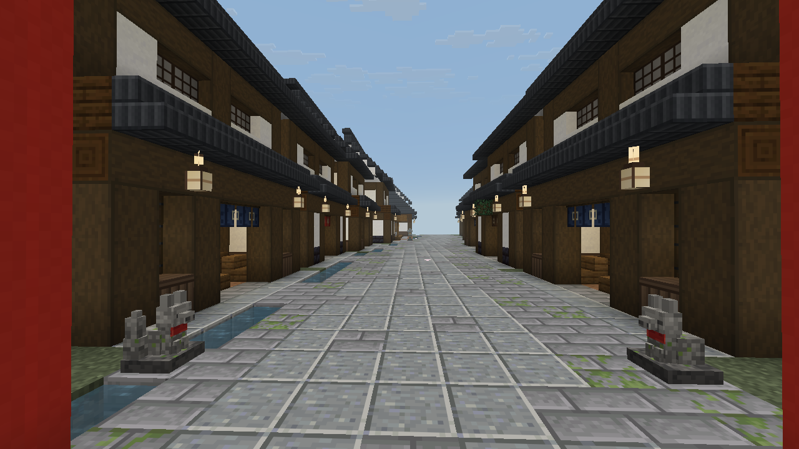

## 为什么用 Java 结构

本附属的结构原则上只用原版数据包（见 AGENTS.md）。神狐聚落经维护者同意破例：

- 原版拼接只会把部件挂在接口上，不知道哪边是上坡，铺不出贴着山坡下行的小路；
- 结构的 `terrain_adaptation`（Beardifier）只能在部件盒里削掉地形，向下最多填一两格，山顶平台下坡一侧会悬空。

所以 `dev.logos.dimension.fox` 里有一个结构类型 `logos_dimension:fox_sanctuary`：选址、整形山体、铺山路与溪流由 Java 完成；建筑仍是 `tools/` 下代码生成的 NBT 模板，由结构按设计数据摆放。其他结构不照此扩展。

## 生成流程

1. **选址**：候选很密（每 8 个区块一个）。候选中心必须在樱野，周围 ±88 格 5×5 采样至少 15 点是樱野；300 格内只留下覆盖最好的那个，所以聚落之间不会重叠，每片樱野山大约一处。
2. **定高**：胜出的候选按真实地表取 9×9 个点。主街标高 P 取核心区高处（90 分位）加 3，且至少比山脚（外圈中位数）高 34 格；高差超过 64 格的地方不建。
3. **朝向**：设计图的入口在西侧、山路向北绕山。结构试遍 8 种镜像与旋转，选山路开挖最少、山脚最贴近自然地面的一种。
4. **山体**（`SanctuaryGroundsPiece`）：核心 176×176 按设计高度削填；核心外一圈 40 格是人工山坡，从核心边缘高度降到山脚，再与自然地形取平滑最大值，原本更高的山脊会保留。山坡表层是樱野草皮，生成后由群系照常长出樱树。
5. **山路**：每格一个采样点，路面 3 格宽，高度跟随山坡下降、坡度至多约 1:2、永不回升；下坡一侧填出路肩，上坡一侧削出坡面。高处一段铺石板，山腰为乱石阶，山脚为土路配木阶，有高差处自动放台阶。
6. **溪流**：自近山顶的泉眼沿路外侧下行，水面比路面低两格；两处从路下穿过换边，路面在那里就是石板桥。
7. **路边**：鸟居只在快到山顶的一段出现、越近越密；石灯笼疏落地放在溪流另一侧，山脚一对高石灯；两三段竹林。
8. **聚落**：核心分成 4×4 块模板；商铺、屋台、住宅是可替换地块，每处从同类变体里随机挑一个。

每个区块只改自己范围内的方块，结果只取决于保存在结构里的规划数据与该列原地形，不会逐刻更新或回头改已生成的区块。

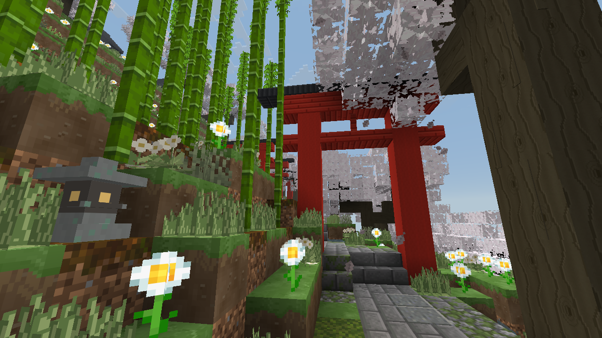

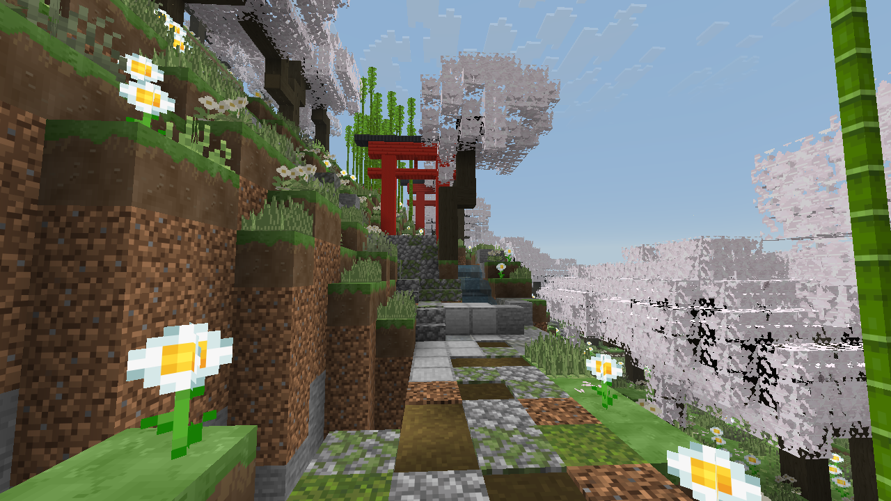

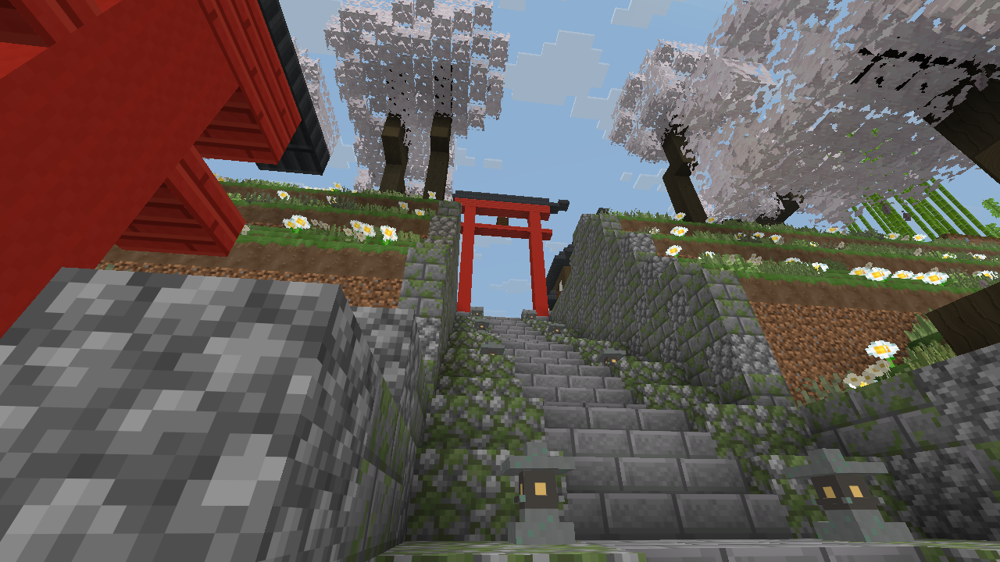

## 聚落布局

设计坐标 u 向东、v 向南，高度相对 P：

| 区域 | 位置 | 内容 |
| --- | --- | --- |
| 入口 | 西侧中段 | 自 -14 升到主街的石阶槽，两侧石垣与石灯，顶端大鸟居与一对狐像 |
| 主街 | 自入口向东，略作 S 形 | 石板路、北侧小水渠与门前石板，两侧町家商铺 |
| 屋台街 | 主街中线 | 十三处路边屋台分五组一字排开，组间对准巷口留出横穿的口子，食摊广场门前留空 |
| 食摊广场 | 主街北侧中段 | 四处屋台、水井、长凳、樱 |
| 温泉旅馆 | 主街东段南侧 | 门与前庭、三层本馆（二三层朱栏外廊）、木廊围合的中庭樱树与池、两翼客房与食堂、内汤与露天风吕 |
| 神社 | 街尾向北的山包，+16 | 街尾大鸟居、两侧千本鸟居的石阶、参道石灯与狐像、手水舍、拝殿与本殿、绘马挂、老樱与注连绳 |
| 住宅 | 主街以北 | 三排，越往外间距越大；屋前屋后有菜园、柴棚，有的带土藏 |
| 田地 | 西南，逐级下降的台地 | 高处旱田，低处小块水田；台地边砌石作田埂，地头灌溉沟、农具棚与稻草人 |
| 外缘 | 四周 | 土埂上的樱与竹，从山路上看不见聚落 |

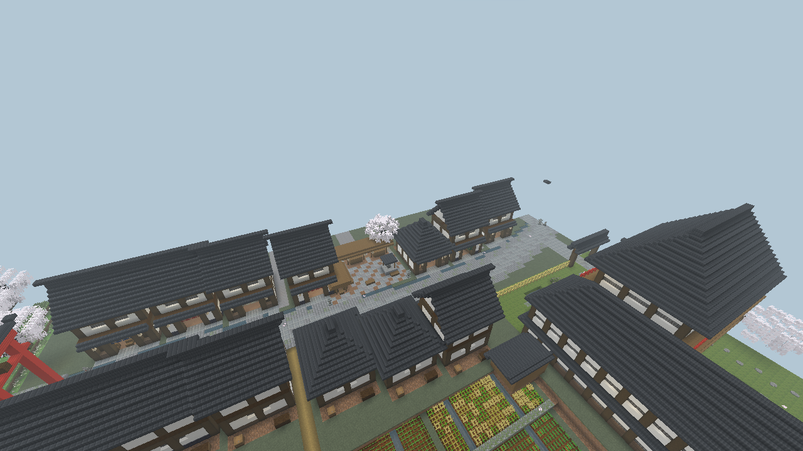

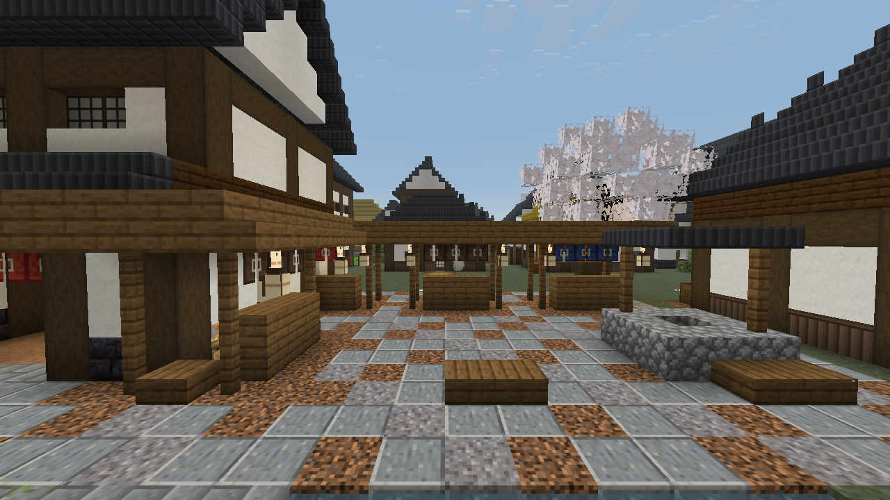

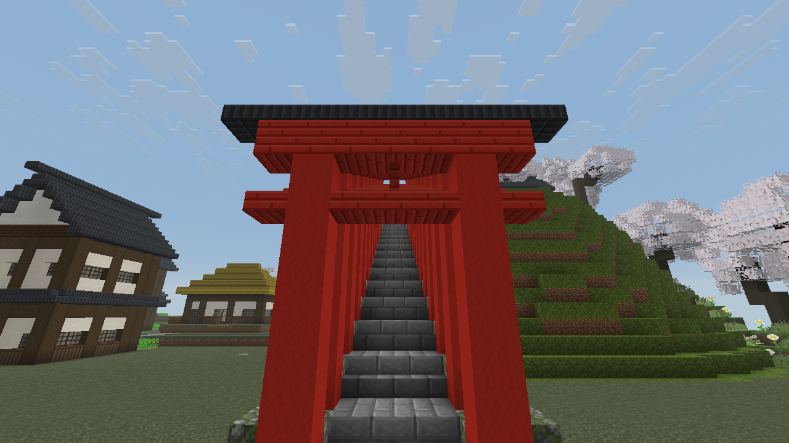

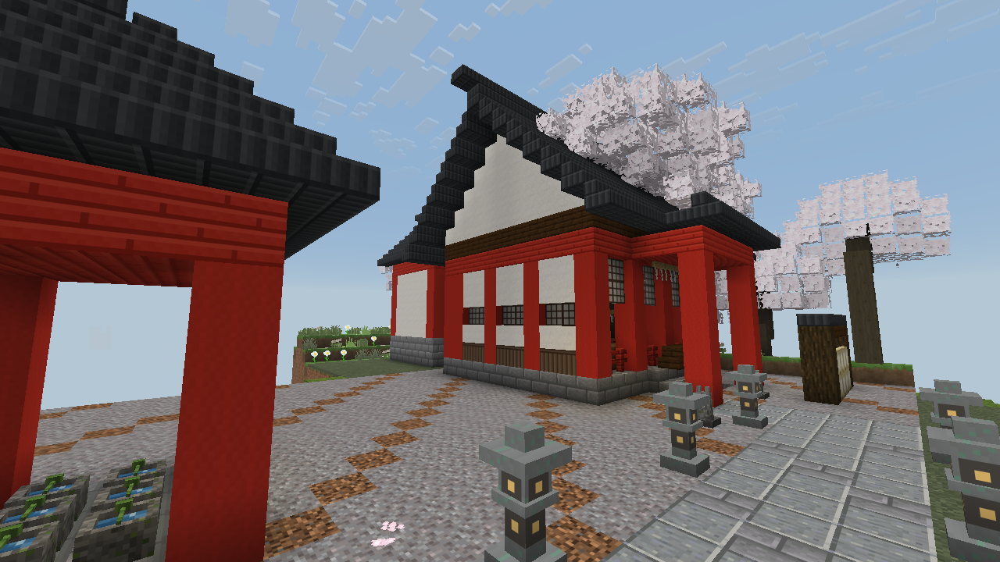

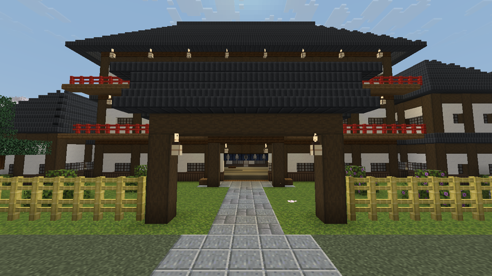

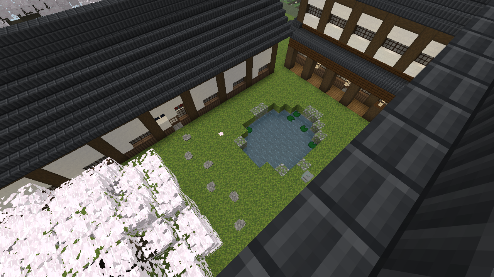

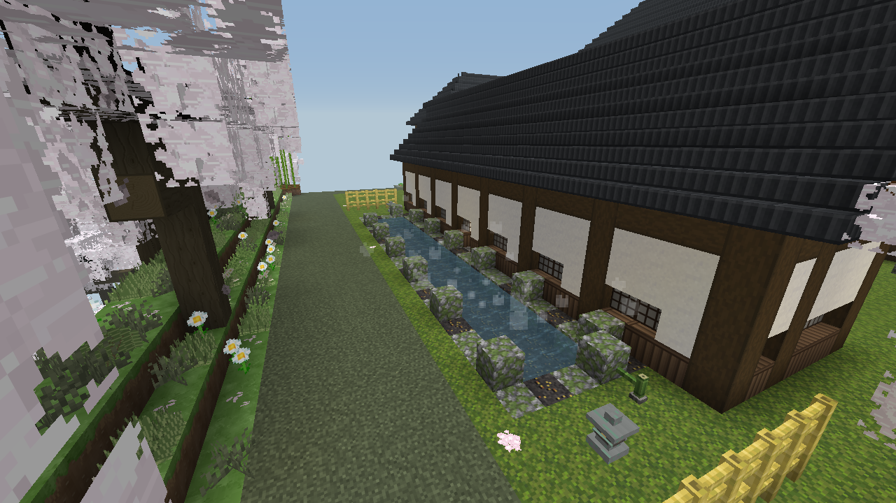

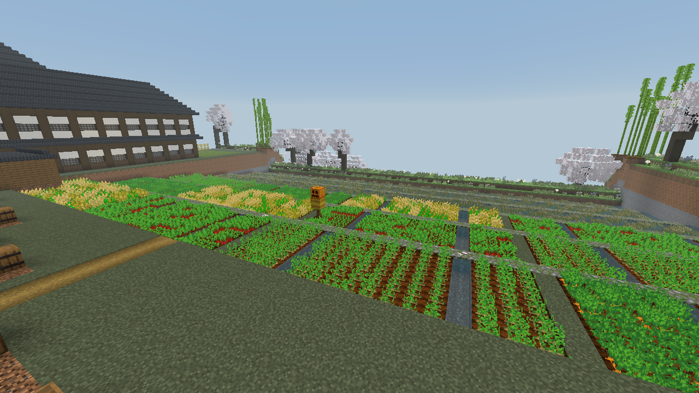

以上均为实际客户端截图（`fox_sanctuary_views`，春季正午），未测光影包。

## 主街屋台

仿福冈中洲的路边屋台，由 `tools/fox_yatai.py` 生成，地块种类 `yatai`，每处从六种里随机挑一个：拉面、烤串、关东煮、甘味、酒、章鱼烧。

- 车身 3×2：前排上半砖柜台（下面留出伸腿的空当），后排灶台（烟熏炉、炉子、营火、汤锅、酒桶）；柜台前是长凳或栅栏加压力板的高脚凳。
- 屋顶在第三层：板葺平顶与布篷顶面 2.5 格，灰瓦与朱漆的人字小坡顶屋脊 3 格；檐下 2 格净空，行人从檐下走过不碰头。檐下一排暖帘或纸灯笼。
- 西端挂双面写店名的吊牌（字会发光、无碰撞），东端挂灯笼、堆酒桶竹箱；同一组朝向一致、间隔 2 格，所以组内也有一格能横穿主街。
- 柜台、灶台、座位三排以主街中线为中心，两侧各留至少 2 格通行，两侧商铺地块不动。

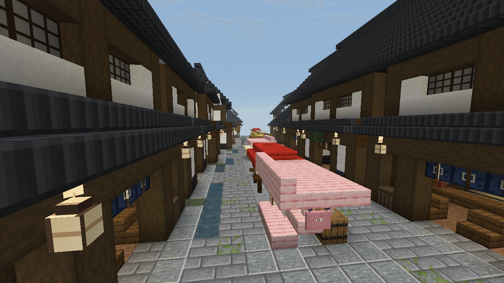

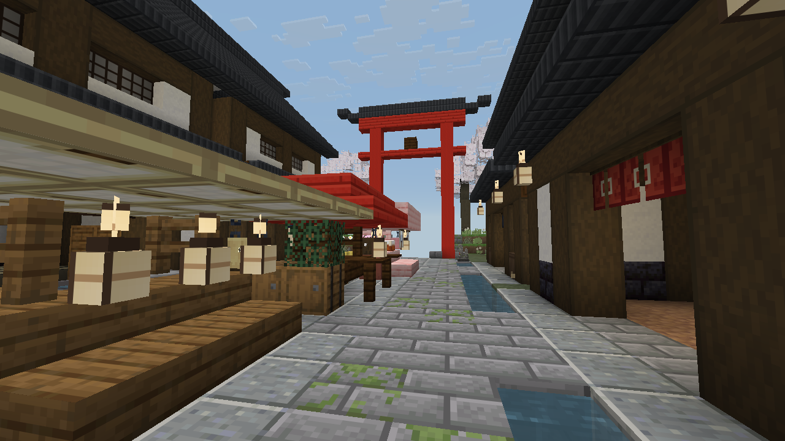

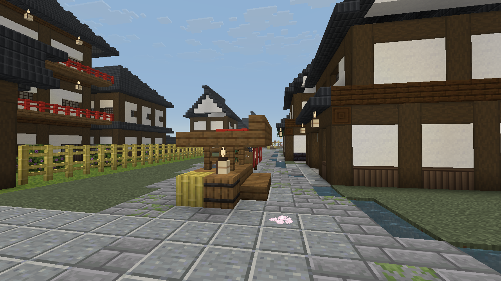

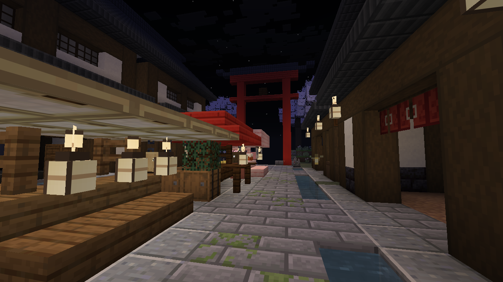

以上为实际客户端截图（`fox_sanctuary_views` 的 `yatai_*` 机位），未测光影包。

## 方块

沿用的和风建材：白灰泥墙、木质腰墙、灰黑陶瓦三件、朱漆木六件、榻榻米两件、障子门窗、和纸灯笼、矮石灯笼、春日高石灯笼。

重新绘制（ID 不变）：灵狐石像、手水钵（带竹勺）、竹出水口、踏步石（三种形状随机朝向）、小石龛、暖帘、注连绳与纸垂、温泉石、温泉蒸汽粒子（`tools/fox_props_art.py`）；和纸灯笼改为带木圈与竹骨的提灯模型，障子门窗换细木格，朱漆原木与木板加木纹（`tools/fox_shrine_art.py`）。新增暖帘三色：茜色、生成、焦茶。

障子拉门打开时整扇滑进旁边的墙，而不是像普通门那样转开。

神社用具（`tools/fox_shrine_art.py`）：

| 方块 | 用法 |
| --- | --- |
| 绘马挂 `journey_ema_rack` | 像粉色花簇一样可叠 1–4 层，层数越多框上旧绘马越密。手持绘马右键挂上去（最多三块），这三块总在最外面一排；潜行空手右键取回最后挂上的一块。拆掉时挂着的绘马会掉出 |
| 绘马 `journey_ema` | 在铁砧上改名即写下愿望，挂出后名字写在绘马上 |
| 赛钱箱 `journey_offering_box` | 手持金粒、铁粒、铜锭或绿宝石右键投入，叮当一声 |
| 鈴緒 `journey_suzu_rope` | 挂在铃下或天花板下，可接成几格，最下一格带穗；右键摇响上方四格内的铃 |

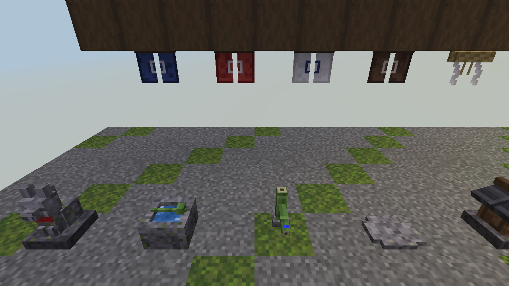

## 群系调整

- 樱树、倒木、岩块、碎石、地被与白花改用只认自然草皮的放置规则（`fox_wild_*`），聚落的屋顶、街道、草坪与田里不会冒出随机的树和杂草；原规则仍供其他群系使用。这些副本按最终高度图落点（结构整形发生在特征阶段，`*_WG` 高度图此时不再更新），所以新堆出的山坡上照样长樱树。
- 樱野加一层薄雾（环境属性：雾起 10 格、雾尽 176 格）。

## 维护

```text
python tools/fox_props_art.py      # 小品贴图与模型
python tools/fox_sanctuary.py      # 设计数据、模板（含 fox_yatai.py 的屋台）、结构 JSON、樱野放置规则
./gradlew runClient -PlogosJar=... -PldTest=fox_sanctuary_views -PldTestHeadless -PldTestWindow=1280x720
./gradlew runClient -PlogosJar=... -PldTest=fox_props_views -PldTestHeadless -PldTestWindow=1280x720
```

测试世界默认关闭结构生成；`fox_sanctuary_views` 只在开发场景里用反射把它打开，再像正常存档一样让聚落随区块自然生成。

已有存档：旧区块不会重建。旧版遗留的 `cherry_road`、`cherry_mountain_trail` 与 `fox_settlement` 结构已删除，已生成的部分保持原样。
