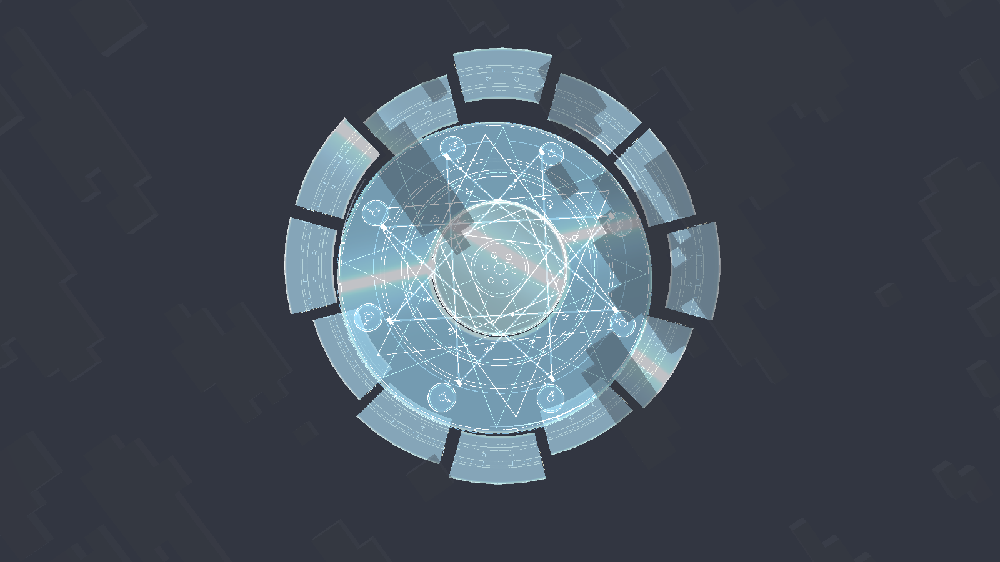
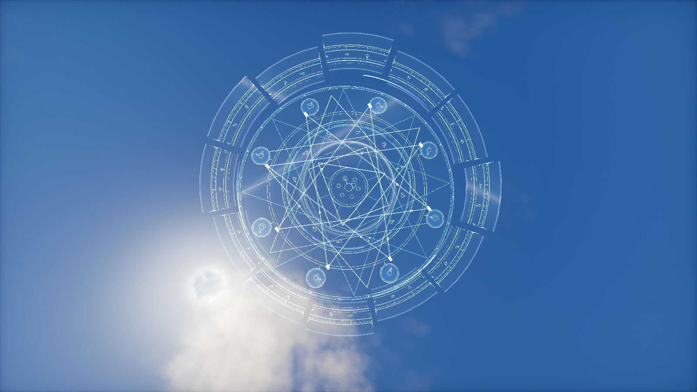

# 玻璃质感魔法阵

在已有展开、分离、重组编舞上，加入三组有厚度边缘的透明玻璃承载面。独立顶点/片元着色器计算视角菲涅耳、镜面高光、宽反射带、锐白扫光与边缘轻微色散。刻线改为清亮的加法混合，冷蓝线与暖金符号分层，施法波从中心向外传播。外环十二块玻璃与刻线同步错位，中层、核心保持反向旋转和倾转。

这是一种解析光照的玻璃观感，不采样场景颜色，不做屏幕空间折射或实时环境反射。没有新增粒子实体、帧缓存复制、全屏后处理或云体网格。玻璃使用 352 个固定四边形，覆盖有限环带；线条与能量波另有限量几何。顶点属性完整，沿用 Logos 的光影合成后收集器。

开发场景 `group:glass_array` 记录 16 张连续实机截图；截图应分别检查普通画面和实际启用的光影包。纹样入口仍为 `tools/polish_models.py` 的 `astrolabe()`，支持资源重生成。

## 0.1.3 实机验证

0.1.3 组合验证：18/18 单元测试、14/14 GameTest；普通渲染、实际启用的 Complementary Reimagined r5.9.3 与 Photon Shader v1.3b，各通过 10/10 场景、15/15 检查，各保留 26 张实机截图。 下图来自实际客户端，不是概念图。

