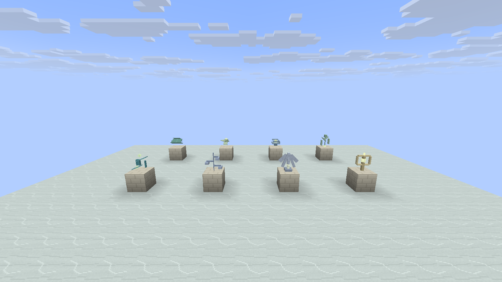
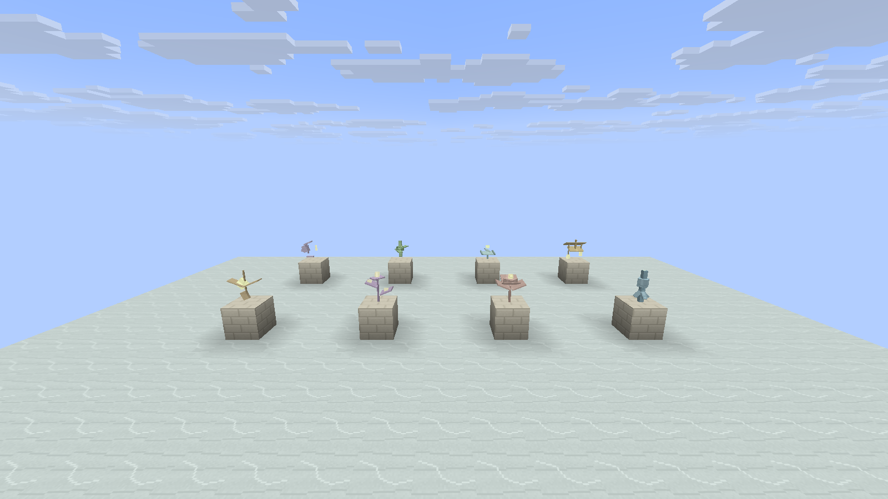
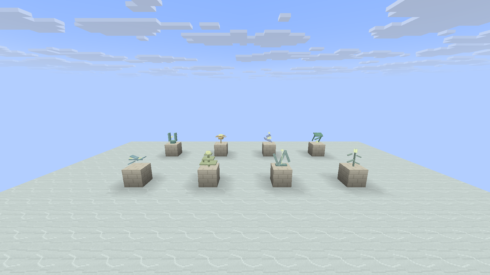
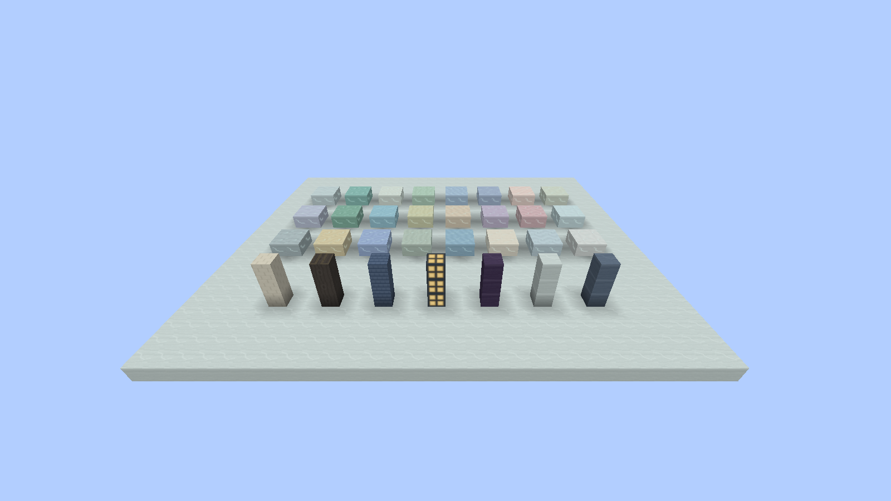

# 独立方块模型实机检查

逐种部件目录见 [模型目录](INDIVIDUAL_BLOCK_MODELS.md)。

## 2026-10-15 实机记录

下图均来自实际开发客户端。0.1.2 组合版本在普通渲染、Complementary Reimagined r5.9.3、Photon Shader v1.3b 下，各通过 8/8 场景、12/12 检查；每套保留 41 张原始截图。组合检查同时包含法阵、方块和云海，不能作为未运行场景的验证。

