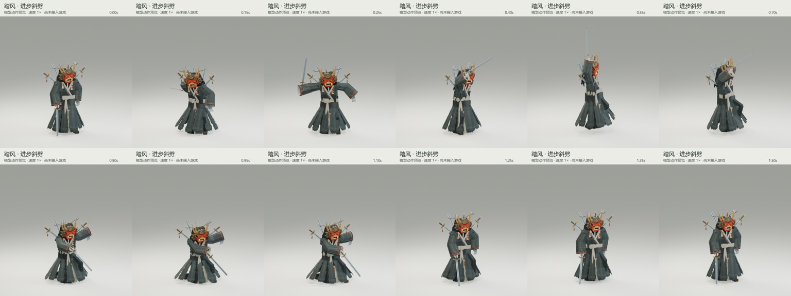
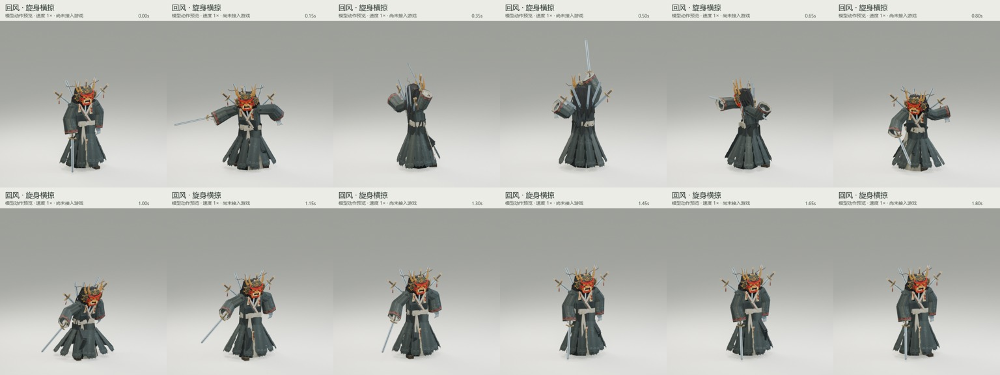
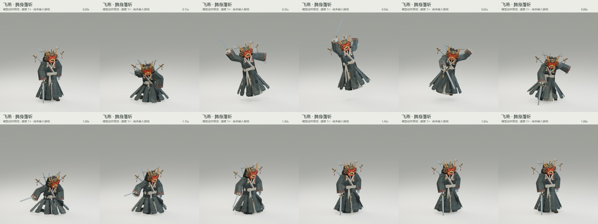

# 剑祟：四格高模型与剑招美术

用于太玄灵境下方场地的中式剑祟美术资源。当前只交付外观与动作，未注册实体、放置生成点或实现战斗机制；现有 `/summon` 指令不能召唤本模型。场地说明见 [太玄灵境](TAIXUAN.md)。

## 外观和尺寸

四角鎏金鬼面、猩红眉纹与暗青底色，破损深色长袍、发束和背负残剑。面具、头发、眼瞳沿用维护者修改的模型；没有把已经删除的内置持剑重新加回角色。

| 项目 | 数值 |
|---|---|
| 制作尺寸 | 静态总高 128 制作单位，2 倍制作 |
| 计划显示尺寸 | 缩放 0.5，四格高；碰撞箱与眼高留待实体接入时校准 |
| 几何 | 865 方块、3724 个有效四边面、152 骨骼，满足少于 1000 方块、4000 面 |
| 贴图 | 单张 512×224 PNG，alpha 仅 0 / 255 |
| 几何格式 | Bedrock 1.12.0，`geometry.jian_sui` |
| 动画格式 | Bedrock 1.8.0，短动画名，30 帧/秒烘焙 |

原贴图上方的 512×176 像素区保留，新衣物连接片的织纹位于下面的附加区域。材质按 [NPC 模型规范](NPC_MODELS.md) 使用 alpha 裁切、双面和实体光照。`ysmGlowEyeLeft`、`ysmGlowEyeRight`、`ysmGlowCoreSeam` 是满亮部件；其他骨骼不因此发光。本次没有修改渲染器。

## 骨骼与衣物连接

使用 TLM 的 `Root → AllBody → UpBody → UpperBody` 和 `AllBody → DownBody` 主层级，头部、肩肘腕、髋膝踝保留其标准名称。附加骨骼按部件拆分，不使用布料物理：

| 部件 | 层级 / 动作 |
|---|---|
| 下袖 | `LeftLowerSleeve` / `RightLowerSleeve` 挂各自前臂，肘口保留搭接 |
| 肩肘过渡衣褶 | `Left/RightShoulderFold`、`Left/RightElbowFold` 分担关节旋转，过渡片藏在袖内 |
| 长袍 | `RobePanel*` 固定上段；`RobeLower*` 摆动下段，`RobeFrontLower` 为前搭襟下段 |
| 腰部内搭 | `WaistBridge0`–`WaistBridge7` 连接上身与骨盆，位移、旋转、伸展已烘焙 |
| 裤腿 | 按膝点分段，保留重叠；原设计的裙摆破口仍然存在 |
| 武器 | 空 `Weapon` 挂点保留在 `UpBody` 下，网格原点在握柄中心、+Y 为剑尖方向；`idle` 与三组攻击中跟随右手，`collapse` 中脱手落地 |

之后制作新动作时，摆动 `RobeLower*`，不要再把整片 `RobePanel*` 从腰部掰开。新姿势还需检查袖筒、腰桥与下摆穿插，不能据这次检查断言任意动作都不会穿模。

## 动作

| 动画名 | 时长 | 编排 |
|---|---|---|
| `attack_1` | 1.5 秒 | 踏风：引剑、穿步、提膝过顶、弓步斜劈、收势 |
| `attack_2` | 1.8 秒 | 回风：外摆、绕步回旋、横掠、反切、收势 |
| `attack_3` | 1.8 秒 | 飞燕：下压蓄力、腾身、转髋落剑、低位落地、收势 |
| `idle` | 2 秒循环 | 双臂放低的持剑待势，首尾一致；`Weapon` 每帧按 v5 的持剑关系跟右手 |
| `collapse` | 2 秒，停在最后一帧 | 被击败时散架：眼与光缝熄灭，背剑弹开、面具裂开仰落、衣摆摊开，腰部 `Skirt` 与八片 `WaistBridge` 一起落下，贯穿古剑插地立住 |

衣物压力测试 `cloth_stress_test` 只供制作检查，留在 Blockbench 源工程里，不进游戏资源。`collapse` 与 `idle` 的 `Weapon` 轨道由仓库外的 `art/jian-sui-model-v6/source/adjust_pr280.py` 在导出文件上生成；从源工程重新导出时要重跑它，或把这两处做进源工程。

此前双手的目标点离肩部过近，肘部大部分时间折叠。现在先确定腕点，再求握点；腕点沿肩部圆弧运动，半径独立插值，避免过渡穿过肩旁。105 个离线采样中，持剑肘弯曲约 35–58°，左肘约 39–65°。左臂参与转身平衡，袖口和袍摆继续跟随。

动画包含拟定的 `input_open`、`contact`、`trail_start`、`trail_end`、`cancel` 时间标记。这些只是制作标记，不触发伤害或刀光；接入 MoveRunner 时按正式导出动画的时间线对齐，见 [战斗骨架规范](COMBAT_SKELETON.md)。`jian_sui/animation_events.json` 从正式导出文件重新提取；它与 Blockbench 源轨道的原始小数时间有取整差异。

### 离线预览

下面是模型动画的离线渲染，不是 Minecraft 截图；视频为 20 帧/秒、1 倍速。使用单独的剑道具展示握持和剑路，该道具没有合入角色几何。

[三组剑招完整视频](jian_sui/attacks.mp4)







## 文件与接入边界

资源位于 `src/main/resources/assets/logos_dimension/`：

- `geckolib/models/entity/jian_sui.geo.json`
- `geckolib/animations/entity/jian_sui.animation.json`
- `textures/entity/jian_sui.png`

Blockbench 源文件按规范留在仓库外，已单独交付维护者。模型和完整动画通过 Blockbench 原生编解码器导出；入库仅压缩 JSON 排版，不改其数据。当前没有 `walk` 等移动状态，也没有 Boss AI、属性、伤害、刀光样式、召唤物品、结构生成或独立武器的游戏接入。这些需后续按战斗系统另做，不能只替换资源就宣称可战斗。

## 检查

```text
python tools/audit_jian_sui.py
```

已完成的离线 / Blockbench 记录见 [validation.json](jian_sui/validation.json)：12 项检查通过；实际打开 865 方块、152 骨骼，贴图错误数为 0。三组动作共核对 18 个时刻，每刻六块关键衣片，与预览矩阵最大顶点偏差约 0.00002705 制作单位。

入库审计检查几何与动画格式、父子关系、骨骼引用、方块 / 面数、UV 与贴图、有限关键帧、循环首尾和导出的事件时间。不将这些数据检查等同于游戏实测。

未验证：GeckoLib 解析烘焙、Minecraft / TLM 客户端、光影包、世界生成和实体碰撞。模型、美术和动作来自本次自行制作及维护者提供的工程修改；视频仅作动作参考，未提取或复制其中的动捕数据。
