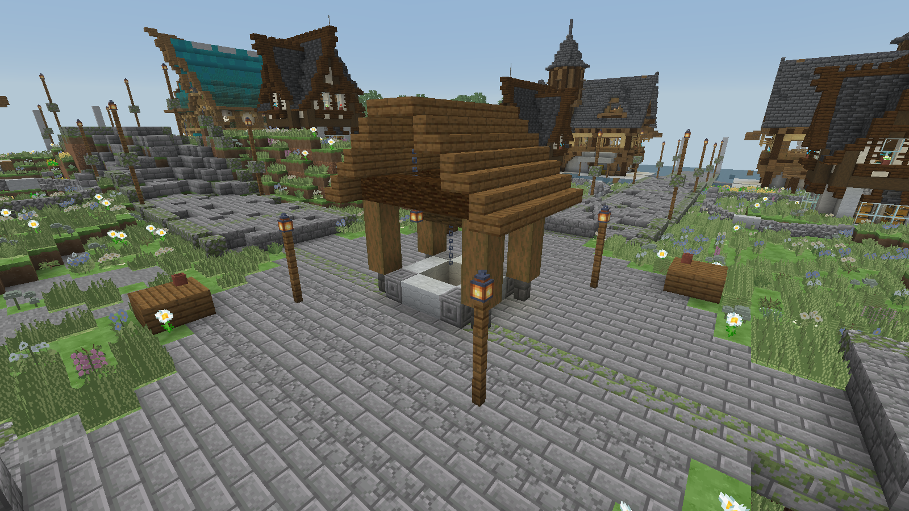
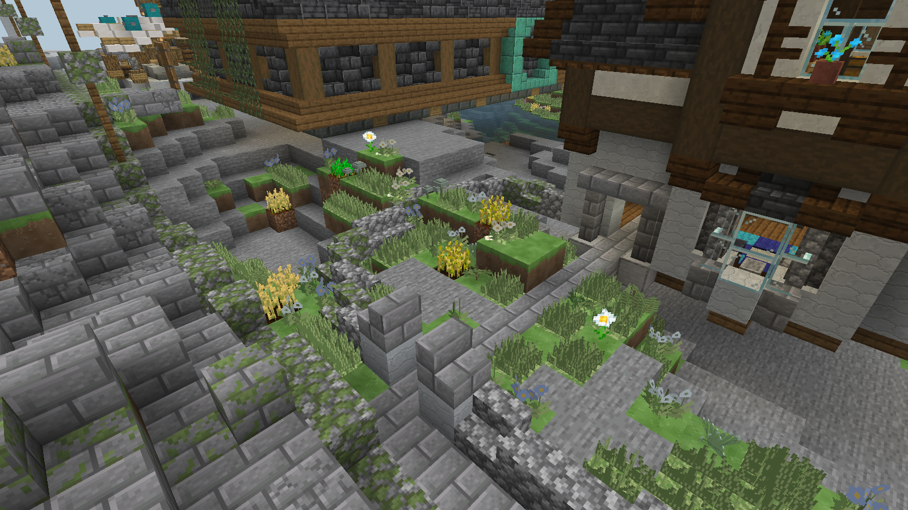

# 林隙村镇与随地势小麦

0.9.2 保留用户提供的七份中世纪蓝图改造建筑、16/24 个住宅地块与市场。来源见 [蓝图记录](../references/user_blueprints/README.md)。0.9.1 已撤掉旧版水田；本版继续去掉源蓝图带入的低处地表土、耕地、水和其上农作物，以及脚本额外填入的整块泥土/草坪底板。建筑楼板、砌石基础、较高处的内嵌花槽保留。

## 模板净空与井

室内封闭空间、已有楼板上方的有顶空间和入口通道使用显式 `minecraft:air`。房屋外侧和删掉土层的位置使用 `minecraft:structure_void`，原版 `block_ignore` 处理器只忽略结构空位，**不忽略空气**。结构空位意味着“不改原位置”，不能用于要求绝对清空的室内。池部件覆盖为 `ignore_waterlogging`，避免放置时保留旧水源对楼梯、活板门等的含水状态；这不阻止开放口后来进水，水下建筑仍需要密封外壳。

中央井为有封闭井底和石砌井沿的井筒，水位下沉，四根木柱承托人字顶，横轴、链条和灯构成辘轳。起始模板高度减去井筒的三格埋深，避免整座广场被井筒抬高。道路和门口用石砖、裂纹石砖、苔石砖，源蓝图沙砾、沙子、混凝土粉末替换为稳定石材。

所有模板实体列表均为空，村镇不生成村民或动物；所有远行大陆群系也移除自然动物生成表，聚落额外覆盖 creature 表为空。已有存档的动物不删除，手动生成与其他模组的额外生成规则不受此数据修改控制。

## 直接沿原地表种植

农舍周围由原版 `feature_pool_element` 调用 `block_column` Feature。每次候选独立读取 `MOTION_BLOCKING_NO_LEAVES` 高度，检查当前地表是原版草方块、泥土、砂土或本附属对应草皮，且上方完全为空。

通过检查后仅做两步：将**原高度**上的这一块土转成原版耕地，在它上方的空位种原版小麦。石头、道路、木材、箱子、建筑、水、已有植物和其他农作物都跳过。没有清空空气、搬移方块、抹平山坡、垫泥层或生成灌溉水。

候选点围绕农舍边缘散布，接受的麦株多少取决于现有地形和可种空位，不再限定方形大田。小麦的生长、干湿耕地、骨粉、收割和补种全部使用原版规则，没有新增作物行为。192 次候选限制在锚点周围 7 格，避免写入远处生成区块。

## 避免抬地与掩埋

种植的结构部件只有一个点，没有大型田块包围盒；聚落的 `terrain_adaptation` 为 `none`，取消原版 Beardifier 自动填高或削低地表。房屋本体不再包着土台，外部空位保留原地形，道路仍按原版高度投影放置。种植本身只改合法土壤及其上方原本的空气。刚性房屋仍有固定楼板，极端陡坡与河谷上的贴合不等于手工选址。

生产生成继续仅使用原版数据包格式，没有 Java 填地、种植或地形生成器。聚落中心仍限定为曦光林隙、星铃花甸、长风草原、野花草甸，间距继续稀疏，locate ID 保留：

```text
/locate structure logos_dimension:journey_hamlet
/locate structure logos_dimension:journey_town
```

## 已有存档

新生成聚落采用新布局。旧版已生成的水田、土台、村民和动物不会自动拆除或删除，避免误删玩家修改；原始地形也没有可供自动回填的快照。旧水稻的注册 ID 和资源仅为旧存档保留，已从创造物品栏隐藏，不再由聚落生成。

```text
python tools/settlements.py
python tools/audit_settlements.py
./gradlew test runGameTestServer -PdimensionTests=logos_dimension:settlement_*
./gradlew runClient -PldTest=group:blueprint_settlements -PldTestHeadless -PldTestWindow=1600x900
```

世界测试逐格对照高低坡地及受保护物件，验证种植前后只有合法的耕地/小麦变化。客户端截图为已生成地形上的原版拼接预览，结果见 [VERIFICATION.md](../VERIFICATION.md)。




