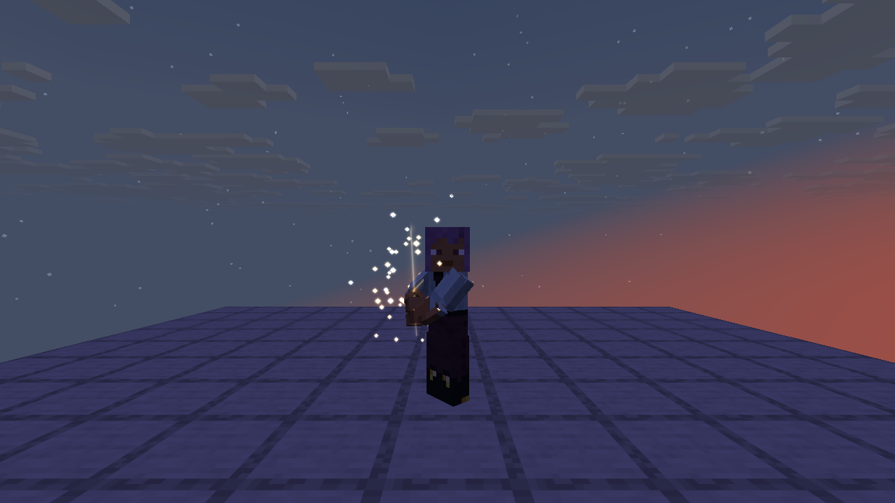
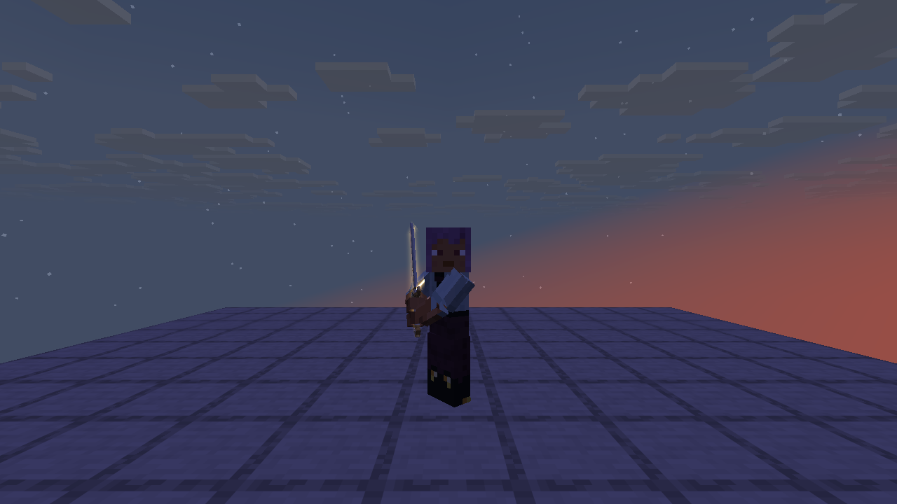
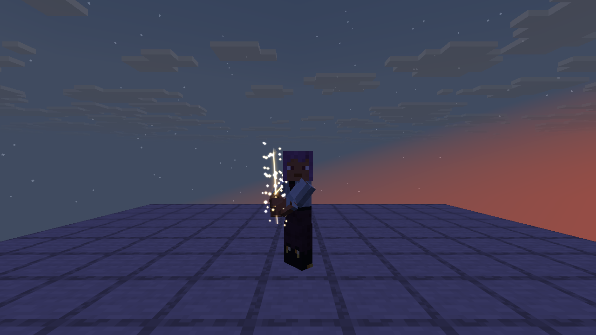
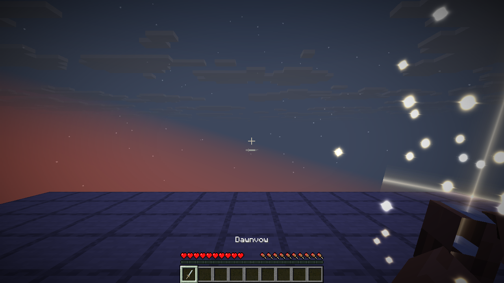

# 双手长剑试玩

加入两把独立物品，均位于创造模式「远行大陆」物品栏：

| 物品 | ID | 外观 |
| --- | --- | --- |
| 曦誓 | `logos_dimension:dawnvow` | 银白剑身、金色护手与剑身饰纹的圣剑 |
| 黑钢长剑 | `logos_dimension:blacksteel_longsword` | 细长黑色金属剑身、直护手、轮形配重；原版附魔台粒子符文 |

开启作弊后也可以直接获取：

```mcfunction
/give @s logos_dimension:dawnvow
/give @s logos_dimension:blacksteel_longsword
```

## 安装

试玩包替换原有的 `logos_dimension` JAR，放进实例的 `mods` 文件夹；同一个实例只保留一份本附属。需要 Logos 0.6.0 或更新版本及其依赖。联机需要服务端和客户端安装同一试玩包。

本轮实测为 Minecraft 26.1.2、NeoForge 26.1.2.112、Java 25、Logos 0.6.0、LDLib2 26.1.2.42、Photon 26.1.2.3、KilaGraph 26.1.0.16、GeckoLib 5.5.2。安装包不内嵌这些前置，也没有修改 Logos 本体。附属内部开发版本仍是 0.11.0，试玩文件名另外带 `longswords-playtest`。

## 操作

| 操作 | 动作 |
| --- | --- |
| 主手选中长剑 | 从身体左侧拔出，双手握持，转到右侧待机；约 1.2 秒。曦誓不同：见下文「曦誓的拔剑与收剑」 |
| 左键／攻击键 | 斜斩、反向回斩、横斩三段循环；可连续点按或按住 |
| 按住右键／使用键 | 约 0.55 秒将剑竖直移到前方中央，随后保持蓄力 |
| 蓄力后松开右键 | 举过头顶再下劈，最后回到侧持待机 |
| 很快松开右键 | 未完成竖剑时反向回到待机，不攻击 |
| 切换到另一格 | 翻剑、收回身体一侧，约 1.2 秒后恢复原版持物；切到另一把长剑会接着重新拔剑 |
| 丢弃、剑损坏、死亡或换维度 | 取消未结算攻击，清理动作 |

### 曦誓的拔剑与收剑

曦誓不挂剑鞘。拔剑时双手直接摆成持剑的样子，手里先是空的；金色光点从四周旋着聚拢到剑的轮廓上（剑身、护手、握柄、剑首），剑的虚影随之渐亮，0.7 秒时剑凝成实体、整把剑一闪，1 秒后进入待机。收剑时剑先亮起，0.15 秒时散成光点，向外飘散、上浮、半秒内淡去，0.6 秒后双手放开。第一、第三人称一样，光点画在剑骨骼上、跟着手走。

| 第三人称：光点聚拢 | 凝成 | 收剑：散成光点 |
| --- | --- | --- |
|  |  |  |



招式文件 `combat/movesets/dawnvow.json` 用 `"extends": "logos_dimension:longsword"` 继承长剑，只换 `draw`（`idle` 动作 1 秒）和 `sheathe`（`idle` 动作 0.6 秒）两段，连招与蓄力照搬，以后调长剑手感曦誓跟着变。招式文件的 `extends` 是这次加的：顶层字段和同名招式以子文件为准，其余照搬父文件。剑鞘由武器注册时的 `withoutSheath()` 去掉，网格文件不改，重新导入美术也不会把剑鞘带回来。光点与光影在 `client/vfx/DawnvowSummon`，贴图复用 Logos 的 `fire_beam/dot` 与 `laser`。

双手占用期间不显示副手物品，也不执行副手使用。第一人称待机剑身靠右，中央准星区域留空；蓄力和攻击按动作需要进入中央。左手惯用设置镜像整套动作。第三人称使用玩家本人的皮肤，保留原版头部和腿部；原版胸甲的双臂分段跟随动作，收剑后恢复原版双臂。

2026-11-02 修复潜行时腰部错位：保留原版弯腰与下沉，双臂、剑、剑鞘及分段胸甲使用相同的潜行变换。Q 丢弃后立即清理持剑动作，同一物品栏槽位恢复空手，待结算攻击取消。

两把剑的自定义持剑渲染现在会调用 Logos 的公开 `SurfaceAuras.submitItem` 入口。魔力缠绕的贴附光层与世界拖尾跟随实际剑骨骼，支持第一、第三人称和左右手；解除缠绕后停止发射。没有复制或重写元素特效，也不修改符文伤害。魔力缠绕附在主手上，丢弃武器后仍可能按 Logos 原本规则显示空拳缠绕。所需接口不在 Logos 0.5.1 中，因此附属声明的 Logos 依赖下限同步提高为 0.6.0。

## 攻击判定

两把剑暂时共用钻石剑的基础属性：**7 点攻击伤害、1.6 次/秒、1561 耐久**，可使用原版剑类附魔。未添加额外魔法、蓄力增伤、制作配方或掉落来源，方便先比较模型与动作。

普通连招每段原始长度 0.625 秒，随攻击速度属性缩放；收势最后四刻可缓存下一段输入，两次出招间隔超过 1.5 秒重新从第一段开始。原版伤害结算仍会考虑攻击冷却、附魔、暴击、护甲、盾牌和耐久。0.625 秒不是整刻，连续攻击时原版冷却的取整可能造成很小的伤害差异。

攻击按剑刃接触时刻结算，而非按下鼠标时：前三段约在出招后 0.24／0.25／0.25 秒，蓄力释放约在 0.54 秒。服务端在这一刻读取当前朝向、原版近战距离和方块遮挡，调用原版玩家攻击，不接收客户端指定的目标或伤害。切槽、丢弃和死亡可取消尚未接触的攻击。

## 动作与素材维护

两种视角各使用同一套九个动作：`draw`、`idle`、`attack_1`、`attack_2`、`attack_3`、`charge_start`、`charge_hold`、`charge_release`、`sheathe`。两把剑只换几何、剑鞘和材质，不复制动作；曦誓的拔剑、收剑借用 `idle`。

运行时骨架、剑网格与动作按 [战斗骨架与兼容性规范](COMBAT_SKELETON.md) 存放在 `assets/logos_dimension/combat/`（`skeletons/player_*.json`、`weapons/*.json`、`animations/longsword_*.animation.json`），骨骼使用 TLM 名称。它们从用户审定的曦誓 v04、黑钢长剑 v01 素材导入；运行时剔除预览人偶的头、躯干和腿。`tools/import_longswords.py <本地素材目录>` 可从原始交付文件重新导入，目录中需包含 `dawnvow/v01`、`dawnvow/v04_preview_fix`、`blacksteel_longsword/v01`。保留原始采样与接触帧，只合并恒定轨道，第一人称靠右的根骨轨道也保留。

黑钢纹理中的五枚符文来自 Minecraft 26.1.2 的 `textures/particle/sga_l.png`、`sga_o.png`、`sga_g.png`、`sga_o.png`、`sga_s.png`，沿剑尖到剑根排列。不是 Logos 界面的符文，也没有参照现有石中剑设计。

## 复查

```text
./gradlew test runGameTestServer build -PdimensionTests=logos_dimension:longsword* -PlogosJar=/absolute/path/logos-0.6.0.jar
./gradlew runClient -PlogosJar=/absolute/path/logos-0.6.0.jar -PldTest=group:longsword -PldTestHeadless -PldTestWindow=1280x720
```

单元测试检查时序、循环、靠右根骨、潜行腰部和资源；八项世界测试检查前摇、连段、蓄力、取消、换槽、丢弃、墙体和距离。客户端三组为曦誓、黑钢右手、黑钢左手，检查第一、第三人称、潜行连招、潜行胸甲、恢复站立、收剑、原版 Q 丢弃路径和奥秘／火焰缠绕。首版截图在 `screenshots/longswords/`，修复截图在 `screenshots/longsword-fixes/`。

本轮客户端为普通渲染的单人集成服务器；没有运行双客户端联机延迟测试或光影包检查。其他模组提供的特殊全身盔甲模型、饰品与玩家动作覆盖需另行适配。
