# 双手长剑试玩

加入两把独立物品，均位于创造模式「远行大陆」物品栏：

| 物品 | ID | 外观 |
| --- | --- | --- |
| 曦誓 | `logos_dimension:dawnvow` | 银白剑身、金色护手与剑身饰纹的圣剑 |
| 黑钢长剑 | `logos_dimension:blacksteel_longsword` | 细长黑色金属剑身、直护手、轮形配重；原版附魔台粒子符文 |

开启作弊后也可以直接获取：

```mcfunction
/give @s logos_dimension:dawnvow
/give @s logos_dimension:blacksteel_longsword
```

## 安装

试玩包替换原有的 `logos_dimension` JAR，放进实例的 `mods` 文件夹；同一个实例只保留一份本附属。需要 Logos 0.6.0 或更新版本及其依赖。联机需要服务端和客户端安装同一试玩包。

本轮实测为 Minecraft 26.1.2、NeoForge 26.1.2.112、Java 25、Logos 0.6.0、LDLib2 26.1.2.42、Photon 26.1.2.3、KilaGraph 26.1.0.16、GeckoLib 5.5.2。安装包不内嵌这些前置，也没有修改 Logos 本体。附属内部开发版本仍是 0.11.0，试玩文件名另外带 `longswords-playtest`。

## 操作

| 操作 | 动作 |
| --- | --- |
| 主手选中长剑 | 从身体左侧拔出，双手握持，转到右侧待机；约 1.2 秒。曦誓不同：见下文「曦誓的拔剑与收剑」 |
| 左键／攻击键 | 斜斩、反向回斩、横斩三段循环；可连续点按或按住 |
| 按住右键／使用键 | 约 0.55 秒将剑竖直移到前方中央，随后保持蓄力。黑钢长剑不同：竖剑格挡，见下文「黑钢长剑的格挡与施法」 |
| 蓄力后松开右键 | 举过头顶再下劈，最后回到侧持待机（曦誓） |
| 很快松开右键 | 未完成竖剑时反向回到待机，不攻击 |
| 切换到另一格 | 翻剑、收回身体一侧，约 1.2 秒后恢复原版持物；切到另一把长剑会接着重新拔剑 |
| 丢弃、剑损坏、死亡或换维度 | 取消未结算攻击，清理动作 |

### 黑钢长剑的格挡与施法

黑钢长剑同时是一根 Logos 法杖（`BlacksteelLongswordItem` 继承 Logos 的 `WandItem`），连招和拔剑、收剑与曦誓相同：

| 操作 | 动作 |
| --- | --- |
| 潜行右键 | 和法杖一样打开载页栏位，6 格 |
| R（术式轮盘键） | 和法杖一样选择要施放的术式 |
| 按住右键 | 竖剑格挡，动作与曦誓的竖剑蓄力相同。用原版的格挡组件：0.3 秒举剑前摇之后挡住正面的攻击，减伤、击退与破盾走原版流程，**不损耗耐久**。前方浮现一圈奥秘符文（Logos 奥秘射线的字形 `arcane_ray/runes`），前摇结束、真正挡得住时才成形 |
| 格挡中点左键 | 开始施法蓄力（Logos 的 `Charging`，没挂载页、魔力不够时照 Logos 提示，仍在格挡）。单手握剑、剑尖指向前方，蓄力特效聚在剑尖；第三人称剑尖随视线俯仰。蓄力时不再格挡 |
| 蓄满后松开右键 | 施放。术式以光柱开头（Logos 的 `CastPose.gesture` 判定，看启式后的第一条语句）时一直剑尖前指，光柱从剑尖射出，光柱结束后收回；其他术式向前一送再收回待机 |
| 没蓄满就松开右键 | 照 Logos 规则散掉已注入的魔力，剑收回待机 |

- **蓄力速度**：Logos「法杖数值」第 3 档（注入流量 70、汇集加速 130）。
- **魔力缠绕**：拿在主手时给 Logos 的 `wrap_cost` −30%、`wrap_power` +30%（属性修饰器，随施法快照）：用它施放的术式里，魔力缠绕本身、维持费以及缠绕事件里（连同事件再引发的）每个符文花费少三成，其中的伤害、群体伤害多三成。缠绕外的符文不受影响。需要带这两个属性的 Logos；没有时剑照常能用，只是没有这项加成。
- **剑身铭文发光**：蓄力时随进度变亮，施放时最亮随后消退，光柱持续时常亮；身上有魔力缠绕时一直微微呼吸着亮。颜色取施法或缠绕的元素色，发光层贴图 `textures/item/blacksteel_longsword_rig_glow.png` 由 `tools/make_blacksteel_glow.py` 从铭文像素生成。
- **剑尖挂点**：按 Logos 的法杖规范写在物品模型 `models/item/blacksteel_longsword.json` 的 `wand_tip` 组里（剑尖 (8, 24.4, 8)）。剑由本附属的骨架绘制，不走原版持物渲染，所以每帧按剑实际画出的位置换算（网格原点即物品模型的 (8, 1, 8)），上报给 Logos 的 `CastPoints`，第一、第三人称都贴在剑尖。
- **动作**：施法的 `cast_aim`、`cast_thrust`、`cast_lower` 与格挡放下的 `guard_lower` 由 `tools/blacksteel_cast_moves.py` 用 `tools/combat_author.py` 编排、IK、烘焙生成，写进 `combat/animations/blacksteel_longsword_{tp,fp}.animation.json`；美术交付正式动作后替换。招式文件 `combat/movesets/blacksteel_longsword.json` 继承长剑，换掉右键的蓄力下劈。

| 格挡（第三人称） | 格挡（第一人称） | 蓄力（第一人称） |
| --- | --- | --- |
| 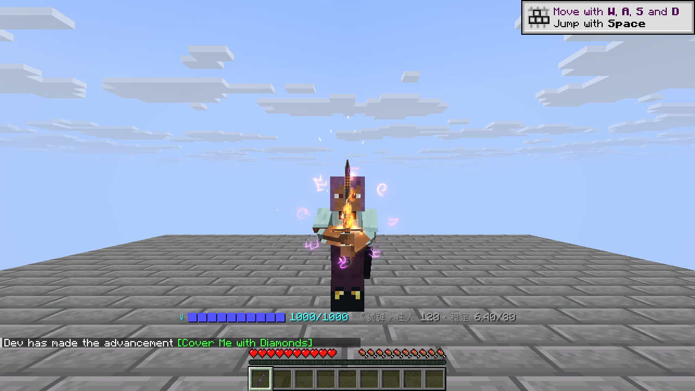 | 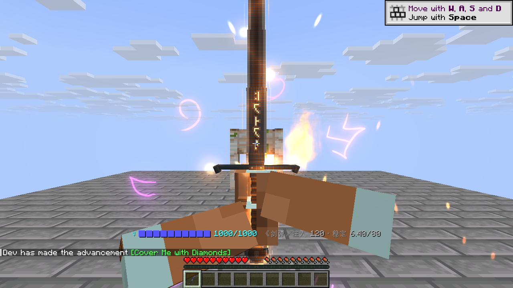 | 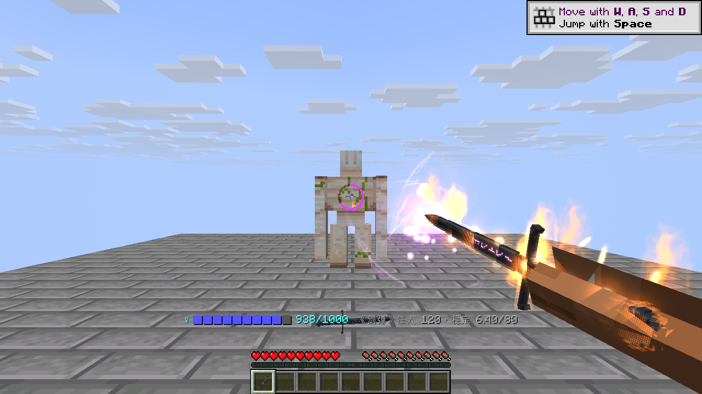 |

| 蓄力（斜侧） | 施放：向前一送 | 光柱（第一人称） |
| --- | --- | --- |
| 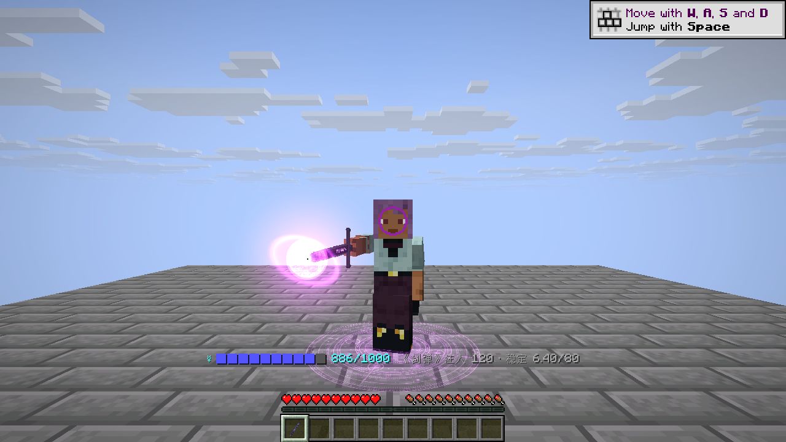 | 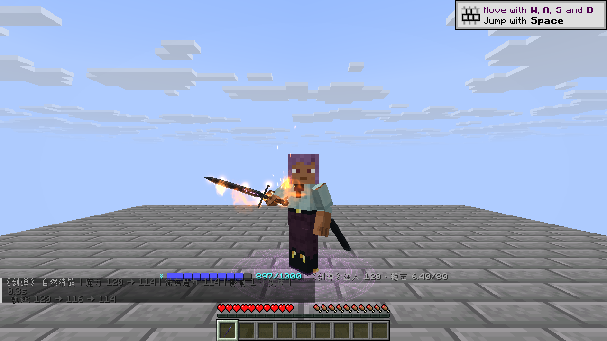 | 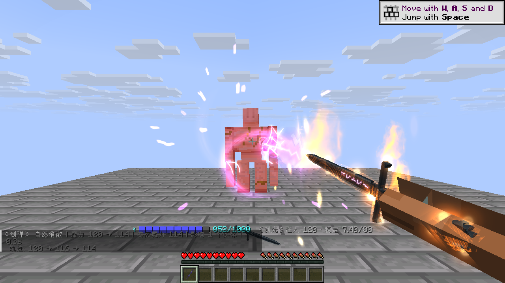 |

### 曦誓的拔剑与收剑

曦誓不挂剑鞘，拔剑与收剑有自己的动作（第一、第三人称各一份）：

- **拔剑**（1.8 秒）：双臂抬起、伸直到身前，掌心向上；金色光点从四周旋着聚拢到横在掌上的剑的轮廓上（剑身、护手、握柄、剑首），剑的虚影随之渐亮，0.7 秒时剑凝成实体、整把剑一闪。右手握住剑柄，把剑转到身体右侧、剑尖朝前，手腕连转两圈剑花，左手合上，回到长剑的待机架势。
- **收剑**（1 秒）：双手把剑倒转举到胸前，0.3 秒猛地插进身前的地面，剑随之亮起；0.52 秒松手，0.62 秒剑散成光点，向外飘散、上浮、淡去，双手放回身侧。

光点画在剑骨骼上、跟着手走。第一人称看不到身体右下侧与脚下，剑花挪到画面右前方，插地的位置往前、往上挪到画面下方。

| 光点聚拢 | 凝成 | 剑花 |
| --- | --- | --- |
|  |  |  |

| 收剑：插地 | 松手发亮 | 散成光点 |
| --- | --- | --- |
| 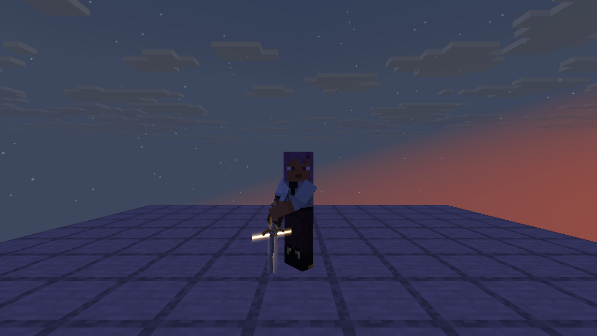 | 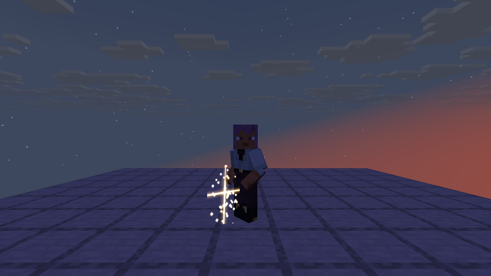 | 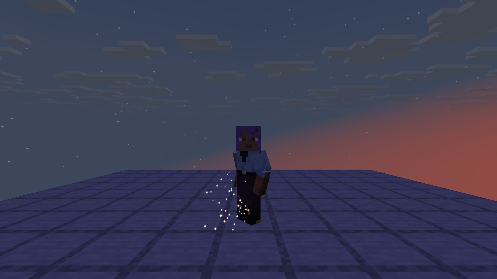 |

| 第一人称：托剑聚拢 | 剑花 | 插地散去 |
| --- | --- | --- |
|  | 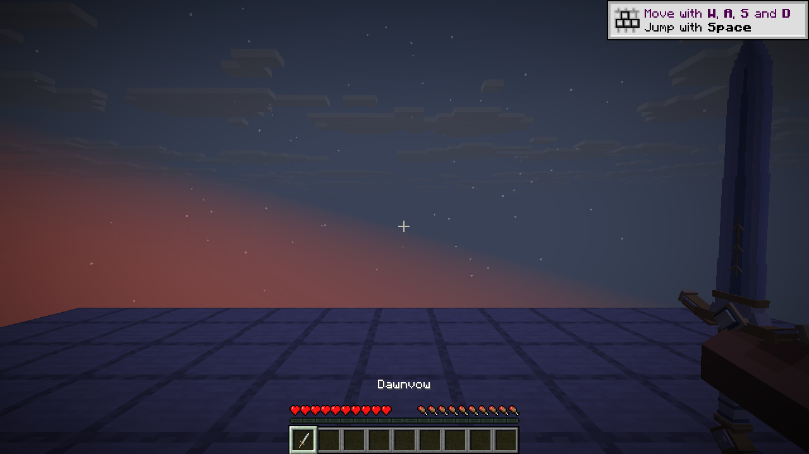 | 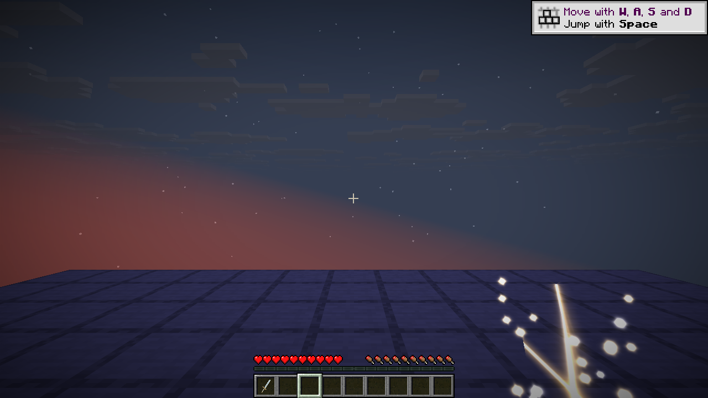 |

**素材与代码位置**

- **动作文件**：由 `tools/dawnvow_moves.py` 用 `tools/combat_author.py` 编排、IK、烘焙生成，写进 `combat/animations/dawnvow_{tp,fp}.animation.json`，片段名 `dawnvow_draw`、`dawnvow_sheathe`。拔剑的终点从长剑现有的 `idle` 第 0 帧反算（剑柄位置、剑尖与刃的朝向、躯干转角、第一人称根骨），接进待机不跳。`uv run --with numpy --with pillow python tools/dawnvow_moves.py <预览目录>` 重新生成，并出离线预览图。
- **动作加载**：长剑骨架加载动作时，若有 `<武器网格名>_<视角>.animation.json`，就叠在共用动作上，同名的以武器自己的为准。
- **招式文件**：`combat/movesets/dawnvow.json` 用 `"extends": "logos_dimension:longsword"` 继承长剑，只换 `draw`、`sheathe` 两段，连招与蓄力照搬。
- **剑鞘**：武器注册时的 `withoutSheath()` 去掉。
- **光点与光影**：在 `client/vfx/DawnvowSummon`，时刻与动作对齐，贴图复用 Logos 的 `fire_beam/dot` 与 `laser`。

双手占用期间不显示副手物品，也不执行副手使用。第一人称待机剑身靠右，中央准星区域留空；蓄力和攻击按动作需要进入中央。左手惯用设置镜像整套动作。第三人称使用玩家本人的皮肤，保留原版头部和腿部；原版胸甲的双臂分段跟随动作，收剑后恢复原版双臂。

2026-11-02 修复潜行时腰部错位：保留原版弯腰与下沉，双臂、剑、剑鞘及分段胸甲使用相同的潜行变换。Q 丢弃后立即清理持剑动作，同一物品栏槽位恢复空手，待结算攻击取消。

两把剑的自定义持剑渲染现在会调用 Logos 的公开 `SurfaceAuras.submitItem` 入口。魔力缠绕的贴附光层与世界拖尾跟随实际剑骨骼，支持第一、第三人称和左右手；解除缠绕后停止发射。没有复制或重写元素特效，也不修改符文伤害。魔力缠绕附在主手上，丢弃武器后仍可能按 Logos 原本规则显示空拳缠绕。所需接口不在 Logos 0.5.1 中，因此附属声明的 Logos 依赖下限同步提高为 0.6.0。

## 攻击判定

两把剑暂时共用钻石剑的基础属性：**7 点攻击伤害、1.6 次/秒、1561 耐久**，可使用原版剑类附魔。黑钢长剑的法杖属性替换了物品属性，剑的伤害与攻速在 `ItemAttributeModifierEvent` 里补回，数值不变。未添加蓄力增伤、制作配方或掉落来源，方便先比较模型与动作。

普通连招每段原始长度 0.625 秒，随攻击速度属性缩放；收势最后四刻可缓存下一段输入，两次出招间隔超过 1.5 秒重新从第一段开始。原版伤害结算仍会考虑攻击冷却、附魔、暴击、护甲、盾牌和耐久。0.625 秒不是整刻，连续攻击时原版冷却的取整可能造成很小的伤害差异。

攻击按剑刃接触时刻结算，而非按下鼠标时：前三段约在出招后 0.24／0.25／0.25 秒，蓄力释放约在 0.54 秒。服务端在这一刻读取当前朝向、原版近战距离和方块遮挡，调用原版玩家攻击，不接收客户端指定的目标或伤害。切槽、丢弃和死亡可取消尚未接触的攻击。

命中判定是准星前方的锥形（本附属所有近战武器相同，见 [战斗骨架规范](COMBAT_SKELETON.md) 第 1 节第 2 条）：

- 顶点在眼睛，张角 60°（准星左右各 30°），长度是原版攻击距离（`entity_interaction_range`，被属性修饰时跟着变）。两把长剑和打刀都用默认的 60°；新武器可以在注册时用 `withCone(度数)` 给自己的张角，见 [战斗骨架规范](COMBAT_SKELETON.md) 第 4 节「命中锥形」。
- 锥形里看得见的生物都挨一刀，最多 8 个。准星正对着的那个暴击（原版暴击的 1.5 倍，带暴击粒子与音效），其余照常。
- 每个目标都按出刀那一刻的攻击蓄力算，不会因为前一个目标先结算而变弱。
- 这一刀不再另触发原版横扫。每打中一个目标消耗一点耐久。

## 动作与素材维护

两种视角各使用同一套九个动作：`draw`、`idle`、`attack_1`、`attack_2`、`attack_3`、`charge_start`、`charge_hold`、`charge_release`、`sheathe`。两把剑只换几何、剑鞘和材质，不复制动作；曦誓的拔剑、收剑借用 `idle`。

运行时骨架、剑网格与动作按 [战斗骨架与兼容性规范](COMBAT_SKELETON.md) 存放在 `assets/logos_dimension/combat/`（`skeletons/player_*.json`、`weapons/*.json`、`animations/longsword_*.animation.json`），骨骼使用 TLM 名称。它们从用户审定的曦誓 v04、黑钢长剑 v01 素材导入；运行时剔除预览人偶的头、躯干和腿。`tools/import_longswords.py <本地素材目录>` 可从原始交付文件重新导入，目录中需包含 `dawnvow/v01`、`dawnvow/v04_preview_fix`、`blacksteel_longsword/v01`。保留原始采样与接触帧，只合并恒定轨道，第一人称靠右的根骨轨道也保留。

黑钢纹理中的五枚符文来自 Minecraft 26.1.2 的 `textures/particle/sga_l.png`、`sga_o.png`、`sga_g.png`、`sga_o.png`、`sga_s.png`，沿剑尖到剑根排列。不是 Logos 界面的符文，也没有参照现有石中剑设计。

## 复查

```text
./gradlew test runGameTestServer build -PdimensionTests=logos_dimension:longsword* -PlogosJar=/absolute/path/logos-0.6.0.jar
./gradlew runClient -PlogosJar=/absolute/path/logos-0.6.0.jar -PldTest=group:longsword -PldTestHeadless -PldTestWindow=1280x720
```

单元测试检查时序、循环、靠右根骨、潜行腰部和资源；世界测试检查前摇、连段、蓄力（曦誓）、取消（曦誓）、换槽、丢弃、墙体、距离、锥形，以及黑钢长剑的格挡（前摇、挡住、不掉耐久、松开放下）、施法（格挡中左键蓄力、蓄力时不格挡、施放后向前一送、缠绕属性）和光柱（施放后一直前指、光柱结束收回）。客户端四组为曦誓、黑钢右手、黑钢左手、黑钢施法，检查第一、第三人称、潜行连招、潜行胸甲、恢复站立、收剑、原版 Q 丢弃路径、奥秘／火焰缠绕，以及格挡符文圈、剑尖挂点（日志里的 `[cast point]`）、蓄力、施放与光柱。首版截图在 `screenshots/longswords/`，修复截图在 `screenshots/longsword-fixes/`。

本轮客户端为普通渲染的单人集成服务器；没有运行双客户端联机延迟测试或光影包检查。其他模组提供的特殊全身盔甲模型、饰品与玩家动作覆盖需另行适配。
