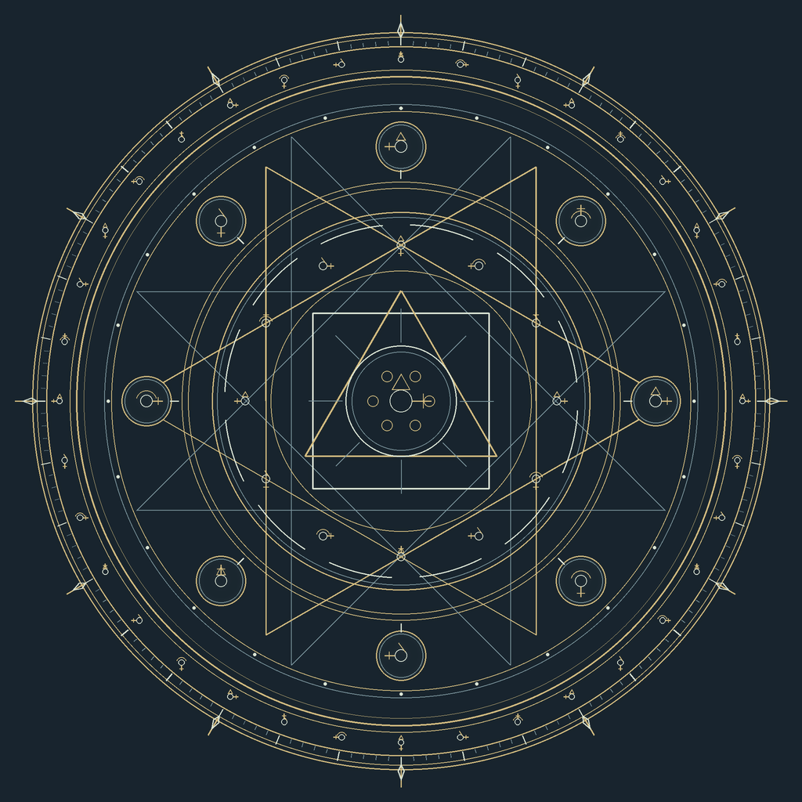
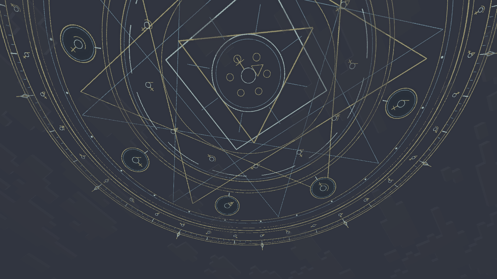
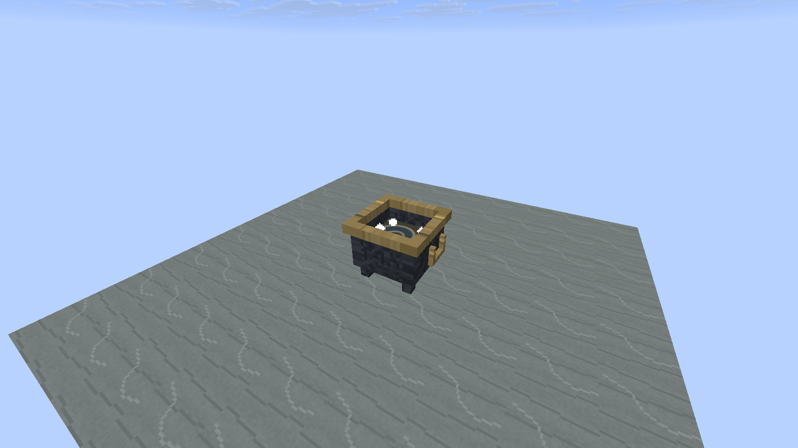
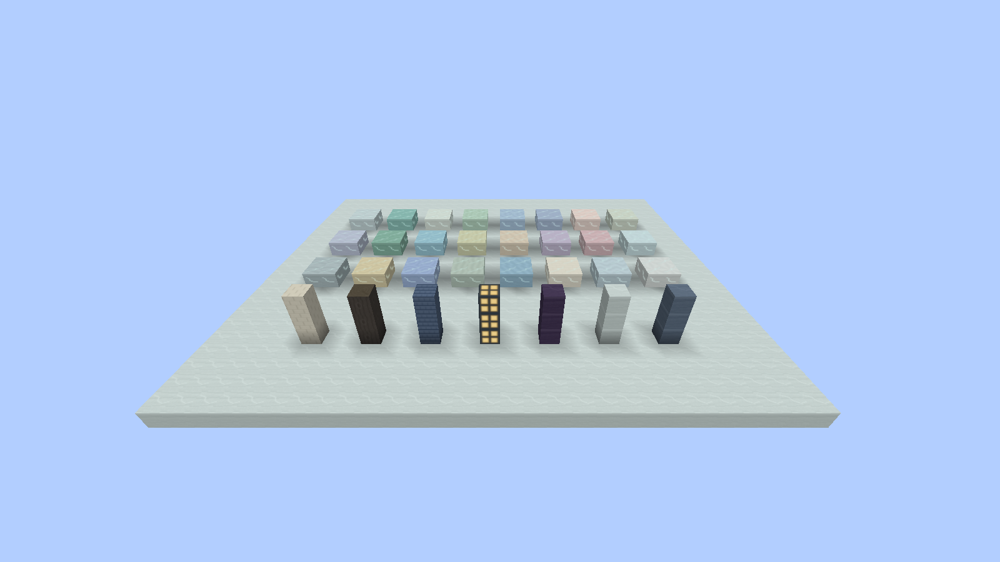
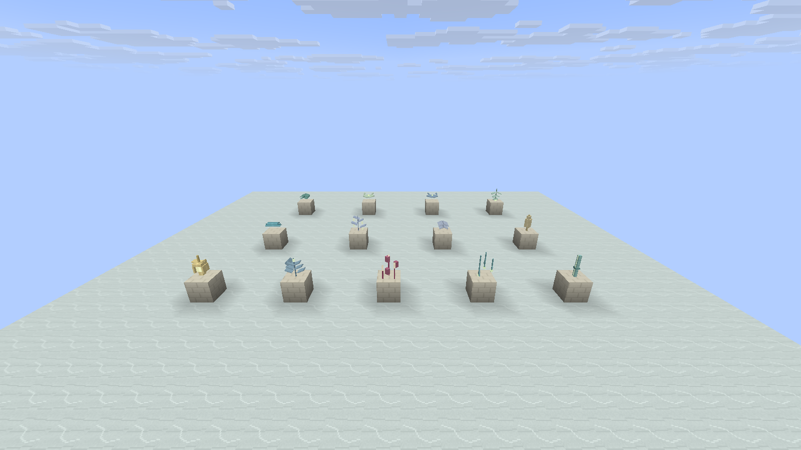

# 方块与天空法阵美术调整

保留原有注册 ID、配方、群系及世界生成坐标，已有方块在重新加载资源后使用新版模型。

## 自然材料与植物

- 天门云域的 24 种地表分别绘制顶面与侧面。卷纹、旋纹、水纹、垂纹、长带、台阶、波丘和晶脊沿用各自的形态方向；只让稀疏的镶嵌纹路呼吸发光，石材底色保持稳定。
- 24 种悬叶使用薄片、折面、叶脉、杯状花心、垂叶、铃滴和晶冠等部件。各群系保留独立色板，放置时有四个朝向。
- 灯蕊果采用开放萼片与可见发光内芯；逆生丝根有分叉与末端光珠；瞳叶蕨有对生叶和中央瞳纹；幽焰苇分成细茎、萼与发光火芯。
- 深木有纵向木纹和端面年轮，象牙砖有错缝、灰缝和边缘高光，蓝瓦有叠瓦纹理，暖光窗分为深色窗棂与发光窗格。
- 原炼金维度的层理石、草皮、焦化岩、凝汞、盐壳和朱砂补充分层材质；扇冠叶、玻璃叶、星形花、以太蕨、琥珀种穗改为立体薄片或枝条结构。叶片不再具有与模型不符的整格碰撞。
- 蒸馏玻璃使用透明底色、薄边与少量反光痕迹，仍通过原有透明方块逻辑剔除相邻内部面。盐晶保留完整块体，保证既有长柱地形连续。

这是 Minecraft 方块模型与像素材质，不依赖资源包、额外模型库、实体或方块实体。常见植物为 4–9 个元素；方块发光层单独设置 UV，避免 26.1 透明度计算因 UV 越界而烘焙失败。

## 三层天空法阵

外环包括双刻度、36 组符号与 12 个指向节点；中层包括交叠星形、八个行星纹章节点与轨道；核心包括方、三角、圆构成的炼成纹章及细小花环。金色主线、银青色辅助线和有限的柔光分层，避免用整面亮色遮挡天空。

三张独立的 2048 × 2048 透明纹样位于 `textures/environment/astrolabe_outer.png`、`astrolabe_orbits.png`、`astrolabe_seal.png`。它们在不同高度上，以正向、反向和较慢正向转动；核心透明度轻微呼吸，四个炼金阶段各有色调。每层只提交一个双面四边形，完整写入 UV、光照、法线和 overlay，并共用 Logos 的光影合成后收集器。法阵只出现在咒械原，天门云域不添加炼金内容。





## 放大的炼金釜

以底部为基点整体放大为 1.5 倍。釜沿约宽 1.5 格、高 1.22 格，把手略超出釜身；保留原有深色釜身、黄铜釜沿、把手、四脚与旋涡液面。碰撞、液面触发范围、粒子位置与安全返回高度同步调整。

它仍是单个放置方块，釜身会向相邻格伸出少量距离，建议摆放时周围留空。站釜沿与触碰外壁不会传送，跳入中间液面后才传送；保留原冷却机制。







## 生成与复现

`tools/polish_models.py` 是两套资源生成器共用的模型与材质绘制来源。可单独运行，也会在各自资源生成器末尾调用。所有纹理均为确定性绘制；不下载第三方资产。它不会写入维度类型、语言文件、配方或注册代码。

开发客户端画廊只用于实机验证，不生成到玩家世界：

```text
./gradlew runClient -PlogosJar=/absolute/path/logos.jar -PldTest=group:model_polish -PldTestHeadless -PldTestWindow=1600x900
```

画廊覆盖地表/建筑材料、植物部件、四阶段天空法阵、炼金釜实际重力落入与返回机制。截图与本次验证结果见 `VERIFICATION.md`。
