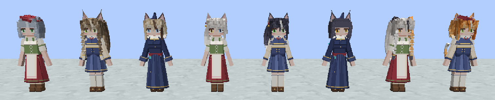
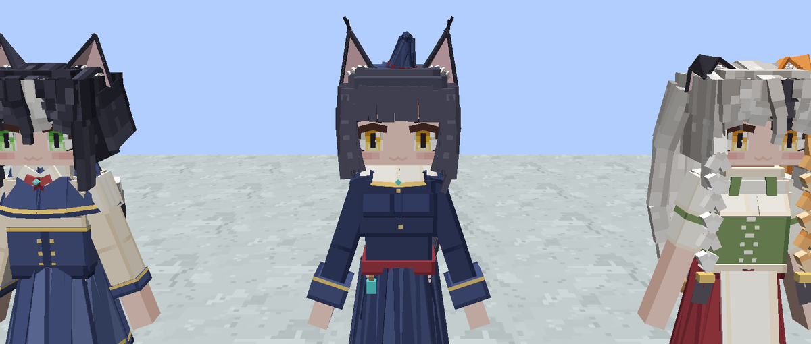
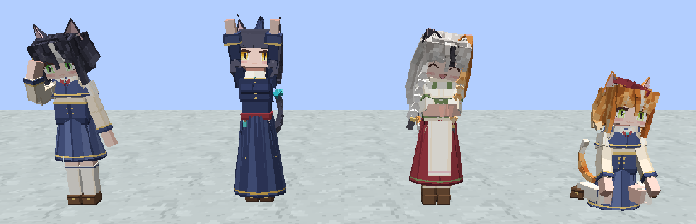
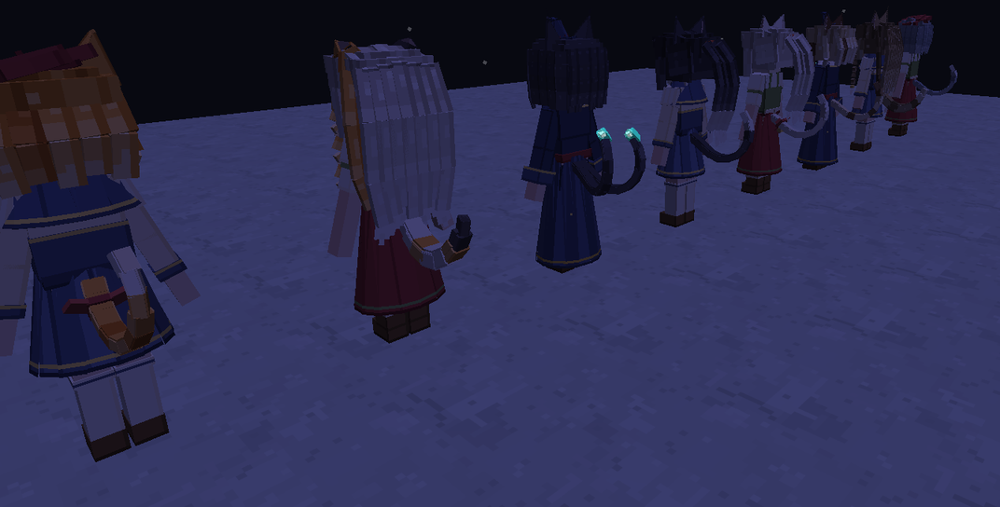

# 灵猫

魔女之森的灵猫（Mystical Cat）：猫耳、猫尾的人形，极为亲近人类，擅长咒语、炼金与星象；和法师待在一起时，她们的魔力场域让法师更容易感知、控制魔力。本页写灵猫居民这个种族；通用规则见 [NPC 随机外观方案](NPC_APPEARANCE.md)、[NPC 动画制作规范](NPC_ANIMATIONS.md)。

模型的素体与部件在仓库外的 `cat_model/mystical_cat/`（素体与骨架复制自神狐），由那里的合并脚本合并、导出，再由 `tools/mystical_cat_assets.py` 导入本模组。



## 1. 范围

- **外观**：生成时按零件表随机抽一次（`data/logos_dimension/npc_races/mystical_cat.json`），存进存档。21 个零件：四种发型、三种头饰（耳侧铃铛蝴蝶结、学院贝雷帽、迷你魔女帽，55% 的灵猫戴）、三种猫耳（立耳、折耳、猞猁簇毛耳）、四种猫尾（细长问号尾、系铃铛蝴蝶结的尾巴、蓬松尾、双尾猫又）、竖瞳圆眼、两种嘴（ω 猫猫嘴、微笑）、三套衣服（星辰花学院、古辉老街、见习魔女）。双尾的猫又少见，只占 8%（`MysticalCat.TWIN_TAIL_CHANCE`）。
- **毛色**：另一个维度，不在零件表里。同一套模型换一张贴图（`textures/entity/mystical_cat/<毛色>.png`，UV 相同），头发、眉毛、耳朵、尾巴和瞳色一起变：橘子、雪团（异瞳）、墨玉、三花（左耳橘右耳黑）、奶牛（白色前发与尾尖）、狸花、暹罗、蓝灰。生成时随机一种，存进存档。
- **行为**：第 3 节。不打架。
- **生成**：远行大陆的林隙村镇（第 4 节）；刷怪蛋也可以召唤。


- **还没有**：人形以外的猫形态、剧情与对话、语音（现在用原版小猫的叫声）、男性灵猫、死亡动画（倒下用原版的侧倒）。

## 2. 动画

动画文件 `geckolib/animations/entity/mystical_cat.animation.json` 由 `tools/mystical_cat_assets.py` 拼成：

| 动画 | 来源 |
| --- | --- |
| `idle` | 素体自带的待机 |
| `walk`、`jump`、`attacked`、`ladder_*`、`swim_stand`、`swing_hand` | 借用森林精灵文件里已换算好的车万女仆动画（[CREDITS.md](../CREDITS.md) 登记），骨架相同 |
| `greet`、`refuse` | 借用森林精灵自绘的行礼、拒绝 |
| `sit` | 坐在地上（鸭子坐）：取神狐死亡动画 0.45 秒处的下半身，上身扶正、头稍歪、双手搭在身前，头部慢慢摆动的循环 |
| `stretch` | 伸懒腰：双臂举过头顶向两侧张开，上身后仰、抬头、踮一下脚，2.4 秒 |
| `wash` | 舔爪洗脸：右手收到脸前、手背在脸颊上来回抹三下，头跟着低一点，2.0 秒 |
| `purr` | 被摸头：低头蹭两下、双手收在胸前，1.6 秒（表情由实体换成开心） |
| `pre_parallel0` | 眨眼：沿用神狐圆眼的曲线（眼睛零件是神狐圆眼改的，骨骼相同） |
| `pre_parallel1` | 抖耳：沿用神狐立耳的曲线，套到三种猫耳的根骨骼上 |
| `pre_parallel2` | 摆尾：`Tail` 左右 ±5°，每节晚 0.11 秒、幅度从尾根 1.4° 加到尾尖 3.6°，尾尖三节再带一点上下的卷动；猫又的两条尾巴错开半拍。3.2 秒一个来回 |



手写的动作在脚本里按 Blockbench 看到的角度写，写进文件时 X、Y 取反：X 为正时手臂末端向前抬、上身和头向后仰；左臂 Y 为负、右臂 Y 为正时手往身前收（对照森林精灵的行礼核对过）。

## 3. 行为

| 优先级 | 目标 | 内容 |
| --- | --- | --- |
| 0 | 浮水 | |
| 1 | 受惊逃跑 | 被打就跑 |
| 2 | 躲怪物 | 8 格内的敌对怪物，躲开 |
| 3 | 跟着鱼走 | 拿着猫粮（原版 `cat_food` 标签：鳕鱼、鲑鱼）的玩家走过，跟上去 |
| 4 | 坐下 | 随时可能在原地坐下发呆（白天平均 25 秒一次，坐 15–45 秒）；夜里很快坐下，一坐一两分钟，闭眼打盹、偶尔呼噜 |
| 5 | 来蹭蹭 | 亲近的玩家在 14 格内、离得比 3 格远时，隔一两分钟走到两格内，喵一声、行个礼 |
| 6 | 闲时小动作 | 站定时偶尔伸懒腰或洗脸 |
| 7–9 | 闲逛、看人、张望 | |

**亲近度**（每位玩家分开记，存进存档，最多 20）：空手右键摸头 +1（同一位玩家一分钟内只记一次，摸头本身随时都行），喂猫粮 +2（消耗一条）。两种都会让她眯眼开心、蹭两下、冒出爱心，摸头时呼噜。

**灵猫相伴**（`logos_dimension:mystical_company`）：亲近度到 3 以后，玩家在她 8 格内就一直有这个效果（每两秒续上 11 秒），法力回复 +50%、蓄力快一成（Logos 的 `mana_regeneration`、`channel_speed` 属性）。不时有一枚附魔符文从她身上飘到玩家身上。设定上这是灵猫的魔力场域让法师更容易感知、控制魔力。

**苦力怕躲灵猫**：和原版躲猫一样，6 格内绕开（`ElfFactions`）。

## 4. 生成

林隙村镇（`journey_hamlet`、`journey_town`）的模板里没有实体，村镇也覆盖掉了动物生成表（[JOURNEY_SETTLEMENTS.md](JOURNEY_SETTLEMENTS.md)）。灵猫像原版村庄的猫一样由 `MysticalCatResidents` 补上：

- 远行大陆里每 15 秒（300 刻）看一次每位玩家所在的村镇（整座结构的外框放宽 8 格）；
- 灵猫少于上限（小村 3、镇子 6）就补一只，落在随机一块建筑或道路的地面上（脚下实心、不是水、站得下）；
- 补出来的灵猫以村镇中心为家（半径是村镇半宽加 8 格），不会走远，也不会因为玩家走远而消失；打死的过一会儿会有新的搬来。

## 5. 渲染

`MysticalCatRenderer` 是 `NpcRenderer` 加按毛色换贴图：模型对象覆盖 `getTextureResource`，按渲染状态里的毛色编号选贴图。网格的透明判断读默认贴图（`getTextureResource(null)`），各毛色的透明像素完全一样（`MysticalCatAssetsTest` 核对），所以共用一份网格。

发光的部件在 `ysmGlow` 开头的骨骼里：猫又尾尖的青色灵火、学院与见习魔女服的领针、贝雷帽与魔女帽的帽针，夜里按满亮度画。



## 6. 资源与测试

```bash
python tools/mystical_cat_assets.py --source <cat_model/mystical_cat> --fox <fox_model/divine_fox>
```

- 单元：`MysticalCatAssetsTest`（零件组都在模型里、随机外观能存能读、猫又的比例、每种毛色的贴图与默认贴图同尺寸同透明像素、动画只用模型里的骨骼、开心表情替换眼嘴）。
- 实际客户端：`mystical_cat` 组的 `mystical_cat_lineup`、`mystical_cat_angle`、`mystical_cat_faces`、`mystical_cat_poses`（坐着、被摸头、伸懒腰、洗脸）、`mystical_cat_night`；`mystical_cat_world` 组的 `mystical_cat_town`（找一座林隙镇子，补到上限，核对数量、家与不消失）。

```bash
./gradlew --offline runClient -PlogosJar=/absolute/path/logos.jar "-PldTest=mystical_cat_lineup,mystical_cat_angle,mystical_cat_faces,mystical_cat_poses,mystical_cat_night,mystical_cat_town" -PldTestHeadless -PldTestWindow=1600x900
```
