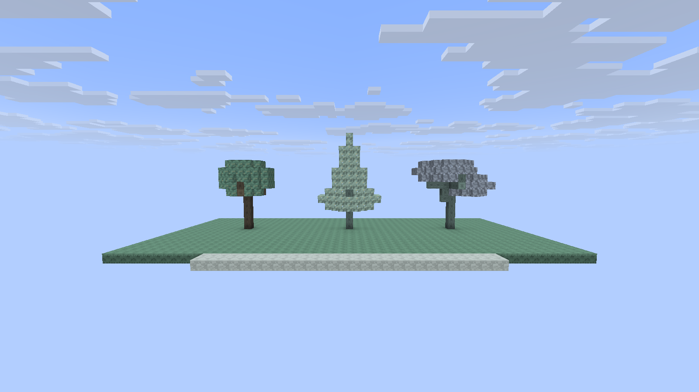
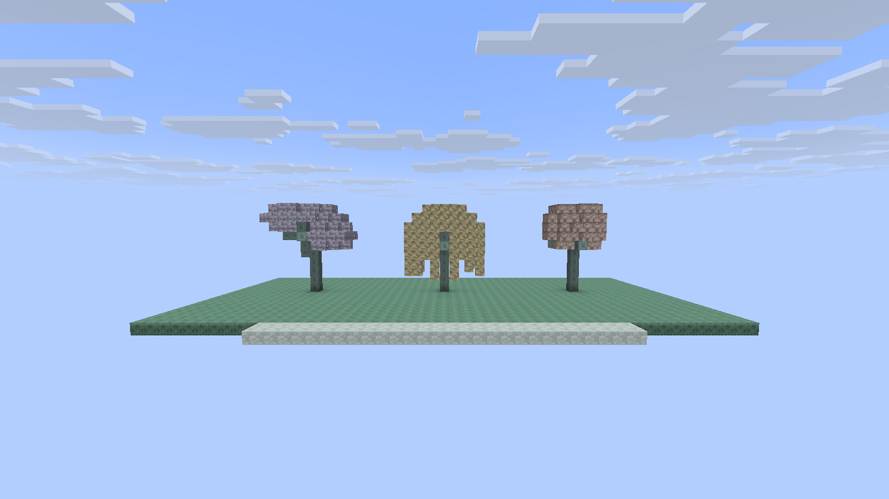
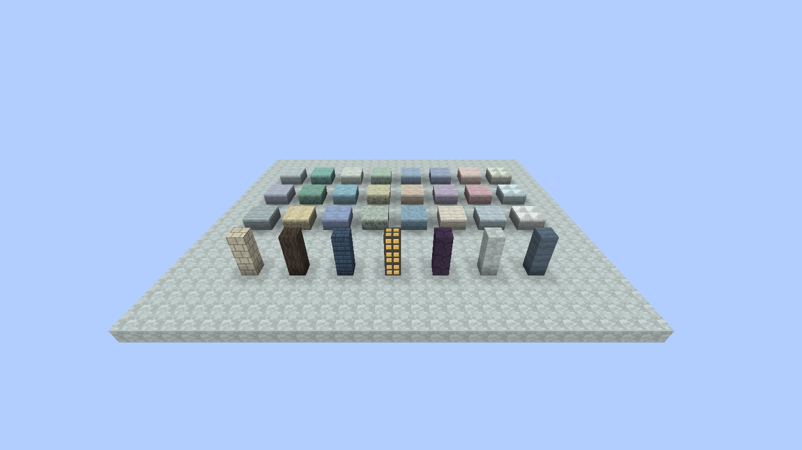

# 树与方块美术重做

树改用原版式块体结构：完整原木、端面年轮、沿枝干定向的木纹、连续叶簇。圆冠、针叶、伞冠、垂冠使用不同体积轮廓。云域原先的细茎改为可碰撞的原木，树叶从悬浮薄片改为完整镂空叶块，自动剔除相邻同种叶片的内部面。炼金维度的扇冠树同步换成分枝伞冠。

每种材料保留专用模型文件与像素绘制方案。石材按层理、黑色裂岩、云瓷、盐壳与晶面区分；建筑材料使用砌缝、深木纹、叠瓦和暖窗格。地表取消逐块贴上的几何微型浮雕与满地发光裂线，改为清晰的完整边界和低对比材质。花、蕨、垂根、灯蕊与炼金釜仍使用各自的部件。树冠和地表不再整片发光，少量灯蕊负责亮点。

性能方面，叶块由数十面减为 6 面，并支持内部面剔除。树木蓝图在生成一个区块时只创建一次，不对 256 根列重复计算。树木锚点在区块内轻微错位，最大树冠半径 5 格，不跨区块截断。

现有方块注册 ID 不变。已有区块的材质与叶片模型立即更新；新的分枝树形在新生成区块出现。不会自动拆除玩家已建造的木头与树叶。

资源入口为 `tools/individual_block_models.py`，具体材质方案在 `tools/natural_block_art.py`，目录由脚本生成。实机检查使用 `group:natural_trees`，展示完整树木；数学检查验证树枝连通、树冠体积、种子稳定与边界，世界检查验证原木方向和完整碰撞。

## 0.1.3 实机验证

0.1.3 组合验证：18/18 单元测试、14/14 GameTest；普通渲染、实际启用的 Complementary Reimagined r5.9.3 与 Photon Shader v1.3b，各通过 10/10 场景、15/15 检查，各保留 26 张实机截图。 下图来自实际客户端，不是概念图。

