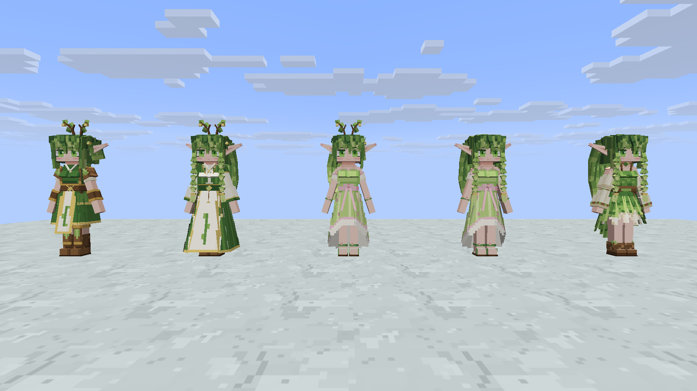

# 森林精灵第三批外观

维护者确认的三个服装和一个发型加入出生随机池，保留已有外观记录及默认部件。源文件仍在仓库外的 `forest-elf-model/forest_elf/`，本仓库只提交游戏资源、同步工具、检查与截图。

| 部件 ID | 内容 | 方块数 | 源贴图 | 游戏贴图起点 |
| --- | --- | ---: | --- | --- |
| `outfit_vine_guard` | 连续短裙甲、短髋甲、米白藤纹战裙、木色护肩与护胫 | 69 | 48×56 | (0, 240) |
| `outfit_priestess` | 米白内袍、深绿开襟外袍、宽袖、腰封和细金边 | 65 | 72×64 | (48, 240) |
| `outfit_floral_gown` | 浅翠绿与花苞粉、心形领口、连续前短后长裙身 | 100 | 56×48 | (0, 304) |
| `hair_priestess_braids` | 前方双麻花辫、后方厚长发 | 107 | 40×40 | (56, 304) |

这些是外观部件，服装与发型可独立搭配，不改职业、装备或 AI。原有兜帽必须配守林人披风、兜帽与枝冠互斥的规则保留。已有精灵继续使用存档里的外观 ID，新生成精灵从扩充后的随机池抽取。

## 导出与保留

`python tools/forest_elf_appearance.py` 读取当前素体和 19 个独立部件，给缺少的部件登记顶层骨骼及方块数。四份新贴图追加在旧图集下方，总贴图从 128×240 扩展为 128×352。

本次只增加 98 根部件骨骼、341 块，总模型为 447 根骨骼、1343 块（包含所有备选部件和动画表情，运行时只显示选中的部件）。原有 349 根骨骼逐项一致，旧图集的 128×240 像素完全一致，22 段动画文件逐字节一致。挂泪表情、39 根共用骨架、旧 ID、默认部件及搭配规则均保留。第二次导出的模型、PNG、部件表与动画字节不变。

不将美术库自带的单段待机动画覆盖到游戏里。本批没有新增发辫物理、衣摆物理或专门动画。

## 检查

Minecraft 26.1.2、NeoForge 26.1.2.112、Java 25.0.3、GeckoLib 5.5.2、Logos 0.6.0 开发 JAR。

- 单元测试 **104/104**，`test build` 成功。新增随机池抽取、外观保存回读、未选服装及发型隐藏、独立搭配检查；原有兜帽规则、素体 UV 和动画检查通过。
- GeckoLib 解析与烘焙通过：447 根骨骼、22 段动画。
- 实际客户端预览 **3/3 场景、6/6 检查**，检查外观同步与真实截图尺寸，并查看正、斜侧和背面截图。

客户端有前置限制：main 的 `wild_mandrake`、`wild_starlight_moss` 使用不存在的 `minecraft:random_patch` Feature，原始启动实际复现注册表加载失败。以上客户端结果使用本地临时 init 脚本，仅将 `build/resources/main` 中这两项换成 `minecraft:no_op` 后测得。脚本不提交，未改源配置，测试结束已恢复构建输出，并核对 JAR 中原配置完整保留。因此这个结果只验证隔离条件下的新外观，不表示原始世界注册问题已经修复。

没有运行本轮 GameTest、完整战斗/死亡动作、多人与光影检查。新部件组合的衣摆和发辫仍需在完整动作下另行评估。

## 游戏截图

正面从左到右为卫士、双辫祭服、高马尾礼裙、双辫礼裙、双辫居民服；背面顺序相反。



[斜侧面](screenshots/npc-batch-03/angle.png) · [背面](screenshots/npc-batch-03/back.png)

复现：

```text
python tools/forest_elf_appearance.py
./gradlew --offline test build -PlogosJar=/absolute/path/logos.jar
# 此命令使用上文说明的本地临时注册隔离脚本，不代表原始配置启动通过。
./gradlew --offline -I build/preview-registry-compat.init.gradle runClient -PlogosJar=/absolute/path/logos.jar -PldTest=group:npc_batch_03_preview -PldTestHeadless -PldTestWindow=1600x900
```
