# 银元彩蛋：超电磁炮

致敬《某科学的超电磁炮》的御坂美琴。代码在 `dev.logos.dimension.economy.Railgun`（服务端）和
`dev.logos.dimension.client.vfx.Railgun*`（客户端特效）。

## 玩法

- 条件：身上缠着**雷霆**的魔力缠绕（Logos 的 `imbue` 形符文，`ManaWrap.of(玩家).element() == LIGHTNING`），手持**银元**（帝国币的 `imperial_silver`）。没缠雷电时银元仍是普通钱币，右键没反应。
- 长按右键：先付 **200 魔力**（不够时动作栏提示、不扣），拇指把一枚硬币弹起，开始蓄力。
- 第 28 刻（1.4 秒）硬币翻转着落回拳前，自动发射，打出去的那枚硬币消耗掉（创造模式不扣），冷却 1 秒。按住不放会在冷却后接着蓄下一发。
- 中途松手作罢：硬币落空，魔力不退，硬币不扣。

## 射击

| 项 | 值 |
| --- | --- |
| 射程 | 96 格，从眼睛沿准星方向 |
| 伤害 | 离射线 1.5 格内的每个生物 100 点物理伤害（`Effects.followUp`，和魔力缠绕的追加伤害一样走施法者的元素强度和目标抗性），附带击退；不打自己、同乘的和自己的宠物 |
| 拆方块 | 射线四周硬度 ≤ 3 的方块（泥土、石头、木头、玻璃、深板岩、矿石……）直接消失、不掉落；含水方块留下水 |
| 拆的范围 | 半径从拳前 0.5 格起，每格加 0.5，7 格外张满 4 格；射手自己身边不拆，免得把脚下挖空 |
| 挡得住 | 硬度 > 3（铁块、黑曜石……）、不可破坏、带方块实体（箱子、熔炉等，保护玩家的东西）、出生点保护或领地内、冒险模式不能改的方块，以及未加载的区块：射线停在它面前，后面的生物不受伤 |
| 后坐力 | 射手被往后推一点 |

伤害在发射那一刻结算；方块在之后 4 刻里每刻往前拆 24 格，跟在冲击波后面，免得一刻拆几千个方块卡服。每刻最多放 40 个方块碎裂的粒子和声音。

## 特效

服务端在蓄力、发射、作罢三个时刻发 `RailgunPayload`（只给协商过本附属频道的玩家），客户端自己画。材质直接引用 Logos 物理射线、雷霆射线的 shader 和贴图（`logos:core/physical_ray_fx`、`logos:core/lightning_ray_line`、`logos:textures/vfx/physical_ray/*`、`lightning_ray/line`），没有复制素材；硬币就用银元的物品贴图。

**蓄力**（`RailgunCharge`）

- 硬币从拇指弹起，翻转着升到 1.5 格高，第 28 刻落到拳前；正面朝镜头时闪一下。
- 雷电往身上和手上聚：身上爬着细电弧（第一人称不画自己身上的）；拳头和前臂外绕着一到三圈不规则的电流环（参考图一）；四周的电火花往拳头收拢；拳头的蓝光越蓄越亮；硬币落回来时拳头和硬币之间连上电弧。
- 第三人称持币的手臂伸直指向准星，第一人称把手抬到画面中间（`enumextensions.json` 加了一个手臂姿势）。

**发射**（`RailgunShot`）：照 Logos 物理射线的结构做，换成橙色、放大约两倍半，补上雷电和角色身上的气浪。

- 射线：橙色的鞘、黄白的芯、最中间一根白线，边缘每刻抖动像被撕开；9 刻后收细成断续闪烁的橙色余线，约三秒闪完。
- 雷电：发射瞬间三股电弧螺旋缠着射线往前 40 格，岔出几道；余线上残留的电弧明灭；命中处电弧乱爬。
- 出口：一圈很大的白色冲击环套住手臂，前面跟一圈小的（参考图二、三）；两层音爆锥；十字闪光和横向的淡紫镜头光（参考图四）。
- 沿线：每 3.5 格一圈被推开的气浪环；四周一道道往前飞的橙色熔流；电火花和云气；贴地掠过时掀起地皮。
- 角色身上的气浪：从胸口往后掠的音爆锥、两圈往后推的压力环、往后吹过身体的风线；脚下两圈贴地扩散的尘环（按地面方块染色）。
- 身后的冲击（参考动画发射时人物身后）：从出口前方起顺着身子四周往后呈锥形张开的白色气浪线；一团团往身后喷、边滚大边往两侧散开的尘土（悬空开炮时没有，靠近镜头的淡出，第三人称背面不糊住画面）；被掀飞到身后的地面碎块。
- 命中（被挡住时）：大的气浪环、音爆锥、闪光、爆炸烟和往回溅的碎块。
- 后期（见 [SCREEN_EFFECTS.md](SCREEN_EFFECTS.md)）：
  - **泛光**：亮芯、出口和命中的闪光、出口冲击环的白边、螺旋电弧交给 `GlowBloom`，射线收成余线后就不交了；蓄力时拳头的蓝光和硬币也泛光（自己第一人称时不交）。泛光的小图只按顶点颜色插值、不采样贴图，四个角同色的四边形（比如较大的 `GlowBloom.sprite`）模糊后会留下一块方形亮斑，所以交的都是软边形状：带子中线最亮、两边透明，光团是中心亮、边缘透明的一圈扇形。
  - **周围变暗**：`RailgunScreen` 的全屏调色，发射时稍微压暗（最重约两成）、偏冷一点、四角更暗一点，射线在画面上经过的一条走廊（两侧约 1.8 格，画面上最宽一成画面高）保持原样，还被射线的暖光照亮一点；第 9 刻起慢慢回来，第 26 刻恢复。只给第三人称的射手和附近的人：离射线 10 格内最重，32 格外没有；射手自己第一人称时不压暗，只有泛光。排在泛光和爆裂魔法的通道之前，射线和泛光不跟着变暗。只读最终画面的颜色，没人需要时不跑。
- 镜头：射手镜头震一下，附近的人轻一点。第一人称看自己开炮时，出口的闪光、环和音爆锥都往前推、收小，不糊住画面。

## 测试

- 世界测试 `RailgunGameTests`：`railgun_needs_lightning_and_mana`（没缠雷电、缠火焰、魔力不够都不行；够了扣 200；松手不扣硬币），`railgun_pierces_soft_blocks`（第 27 刻不发射、第 28 刻发射；石墙和射线下方的地面被拆；射手脚下、黑曜石和它后面的方块、箱子、半径外的方块都不动；射线上的僵尸死、黑曜石后的不伤；扣一枚硬币、有冷却）。

  ```text
  ./gradlew runGameTestServer -PdimensionTests=logos_dimension:railgun* -PlogosJar=...
  ```

- 客户端场景 `railgun`（`RailgunView`）：实际按住右键蓄力到发射，第一人称、侧面机位（仿动画人物在右、射线朝左）、第三人称背面（白天）和正面各截蓄力与发射的阶段图，靶场是三十格外一面带窗的楼。

  ```text
  ./gradlew runClient -PldTest=railgun -PldTestHeadless -PldTestWindow=1280x720 -PlogosJar=...
  ```

- 光影包下未测。

## 截图

| 蓄力（侧面，夜） | 发射（侧面，夜） | 身后喷出的尘土 | 余线与残留电弧 |
| --- | --- | --- | --- |
| 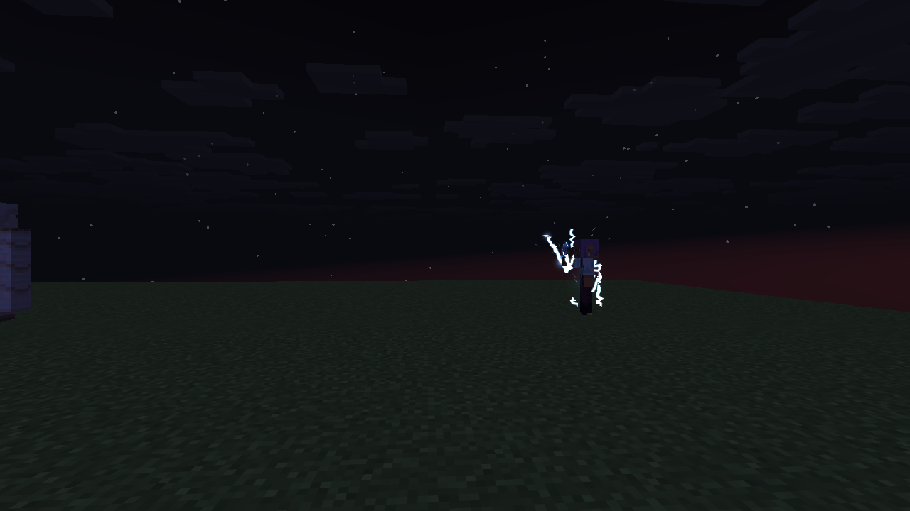 | 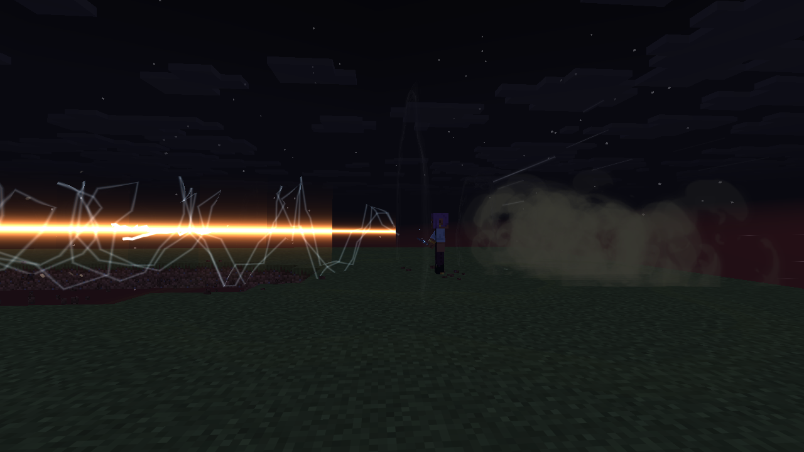 | 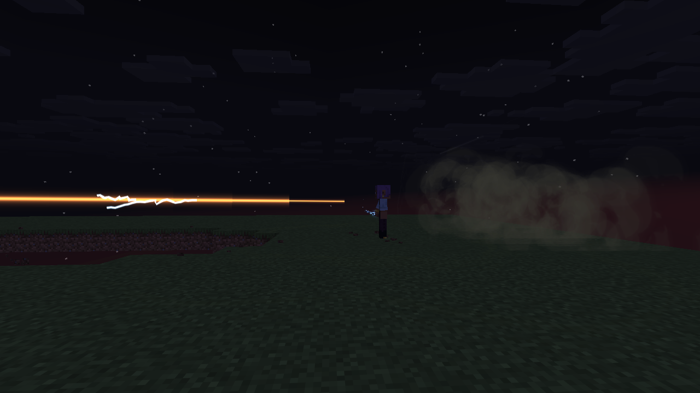 | 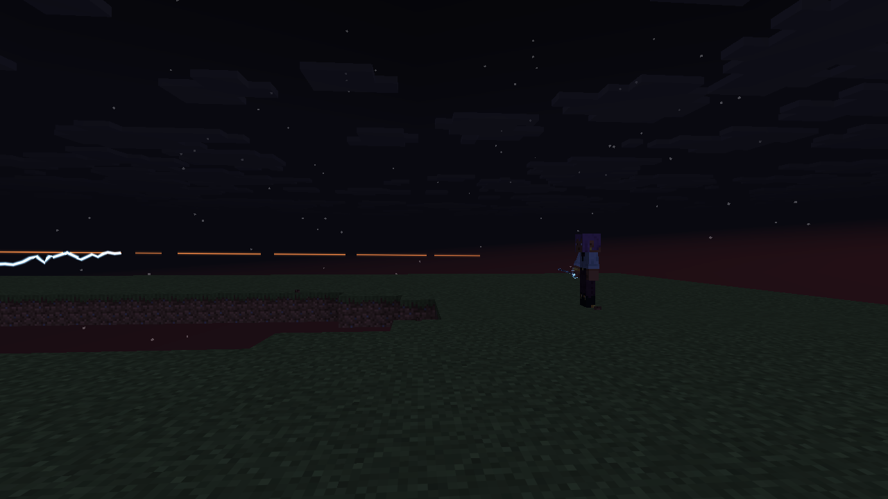 |

| 发射时稍暗、泛光（侧面，夜） | 第一人称：只有泛光 | 第三人称背面，白天 | 蓄力时拳头的软光 |
| --- | --- | --- | --- |
| 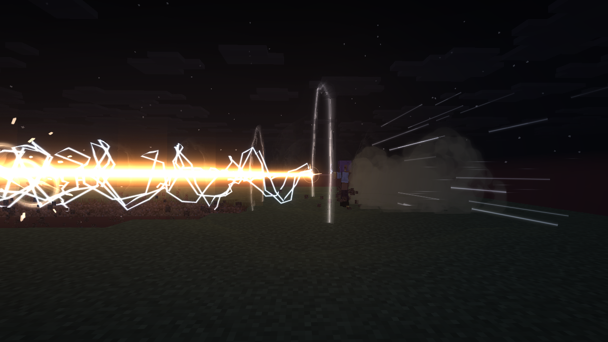 | 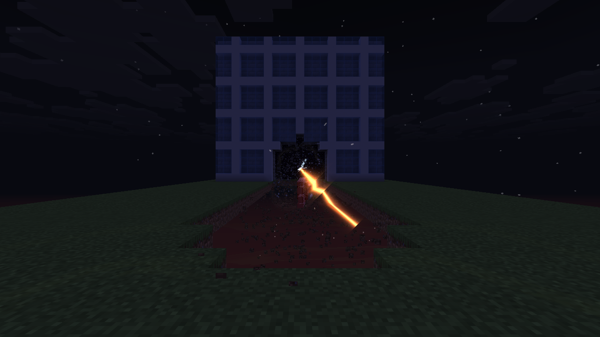 | 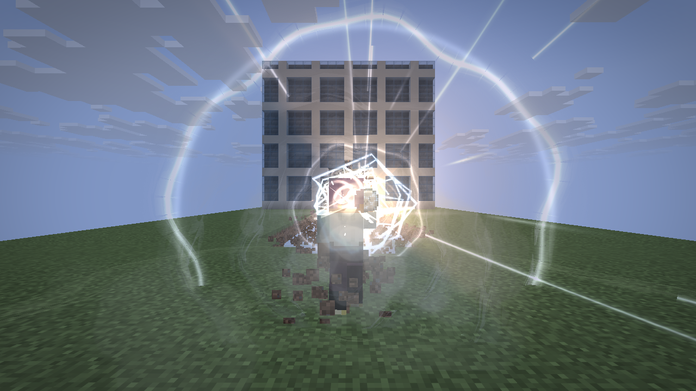 | 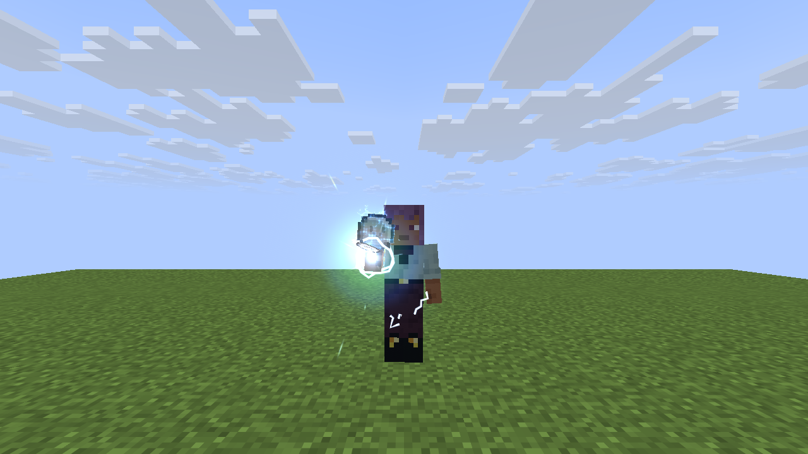 |

| 蓄力（第一人称） | 打穿的楼和地沟 | 冲击环（第三人称背面，白天） |
| --- | --- | --- |
| 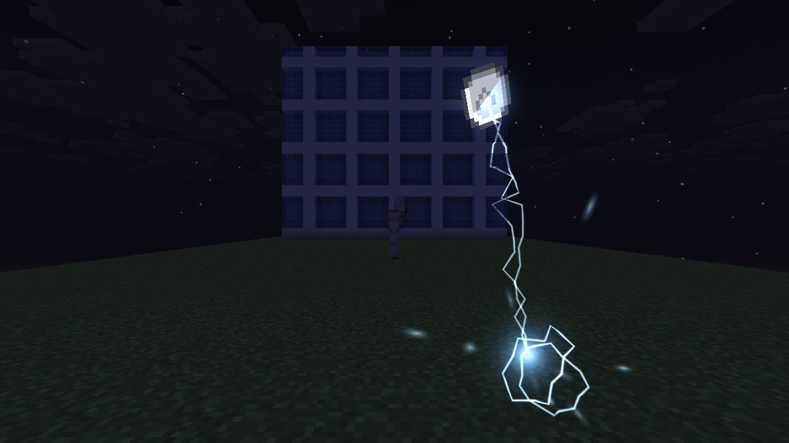 | 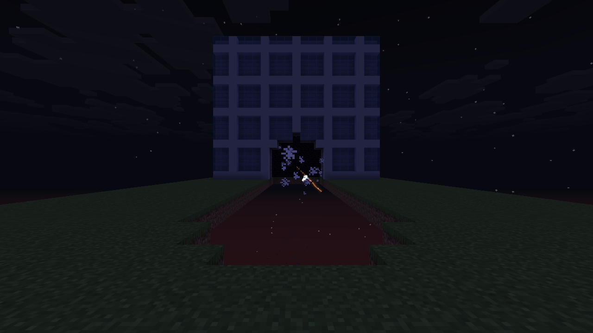 | 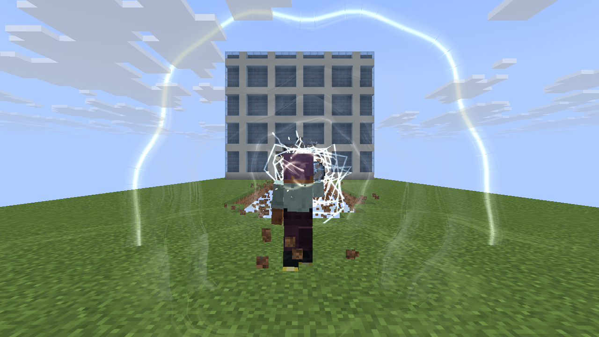 |
