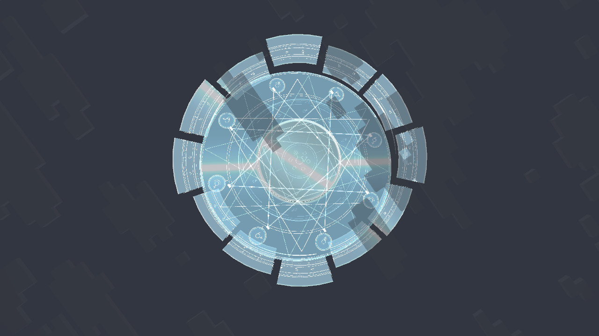

# 法阵连续过渡

0.1.4 将星形连线的整组瞬间替换改为五次缓动的交叠；八个节点间的两套连线渐隐交接。光点在位置循环前后先淡出再淡入，光波使用零端点斜率的透明度，避免亮点从终点瞬移回起点。玻璃扫光和薄边根据屏幕像素导数扩展滤波宽度，减少移动时细线闪烁。

能量线与整图四边形改为直接提交顶点，去掉每条线每帧构造的多层小数组。仍使用维度时钟与帧内插值，不改服务端时间或炼金周期。

之前展示的动图每秒仅一张截图，不能表现正常游戏中的连续运动。本次普通画面连续采集 237 帧、约 12 秒，平均采集约 19.73 帧/秒。MP4 根据实际采集时间戳播放；输出为 30 fps 容器，必要时重复源帧，没有光流补帧，也不是游戏 FPS 基准。片段重播的接头不代表游戏动画跳转。

[连续实机视频](screenshots/smooth-array/continuous-preview.mp4)

0.1.4 组合单元测试 20/20，通过连线混合连续性、循环端点透明度与负时间等检查。普通画面使用 `group:smooth_array` 连续录制，1/1 场景、3/3 检查通过；实际启用的 Complementary Reimagined r5.9.3、Photon Shader v1.3b 使用不含连续录屏的 `group:glass_array`，分别 1/1 场景、3/3 检查通过。普通录制最初使用版本号 0.1.3，后续只将元数据升级到 0.1.4，渲染代码相同。

高频帧缓冲读回在光影下会增加额外开销：首次在光影下录制未达到普通画面设定的写帧门槛，故录制与光影渲染检查分开，没有把读回帧率视为游戏性能。录制器只有开发场景显式启动后才创建图像和写文件。此轮未重跑 GameTest，服务端与世界生成没有修改。树木与删除云层的 0.1.3 改动保留。
