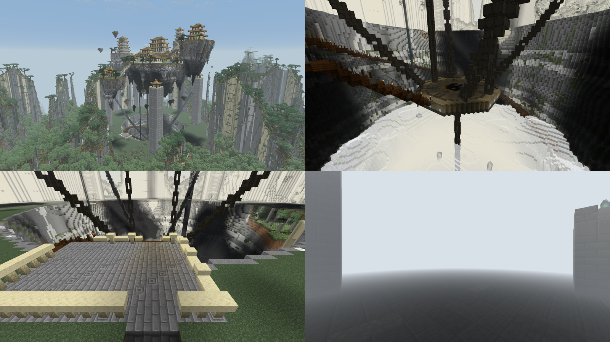

# 太玄灵境：浮空宗门与深渊

太玄灵境只生成在云岫峰林（`logos_dimension:cloudsea_cloud_peaks`）里。上面是浮空宗门：主岛和四座侧峰，殿阁用黄铜筒瓦。主岛正下方是一口深渊，往下依次是：

- 深渊口观景台；
- 一道吊桥，斜下到铁链吊着的链台；
- 一层看不见底的白雾；
- 雾底场地。

四根镇渊柱立在深渊四角，柱身上部各有一根铁链拉住链台。链台和雾底各留一场 Boss 战的场地，Boss 还没做。原来的地面城池「太玄城」和 `taixuan_vale` 群系已经删掉。宗门名称暂未固定。

以下为实际开发客户端截图，无光影包：



## 布局与高度

画布 252×308×252 格，拆成 891 个 28³ 原版 NBT 模板，用原版拼接拼回。起点锚在画布 (126, 144, 126)，落在世界 y=120，所以 **世界 y = 画布 y − 24**。原版拼接会按起点部件的地面差把它往下挪一格，所以结构文件里的起始高度写的是 121。

| 层 | 世界 y | 内容 |
| --- | --- | --- |
| 雾底场地 | −16 | 两级石台（玄铁心）、八根断柱和魂灯，第二场 Boss 的场地 |
| 雾层 | 14～34 | 渊雾，顶面起伏 ±3 格 |
| 链台 | 62 | 八角石台，地面是太极、黄铜圈和八卦，第一场 Boss 的场地。六根铁桩：四角各接一根镇渊柱的铁链，东西两角接主岛垂下的铁链 |
| 深渊石壁 | −18～76 | 三格厚的层理石壁，封住地下水 |
| 深渊口 | 92 | 云岫峰林台地的高度 |
| 镇渊柱 | 70～178 | 十三格见方，柱顶有黄铜顶亭子；铁链挂在 150 的高度 |
| 主岛顶面 | 约 205 | 主殿、前殿、两侧楼阁、庭院 |
| 侧峰 | 约 187～270 | 山门峰（南）、藏经峰（西）、东殿峰、后山藏经阁（北）、东侧卫峰 |

深渊半径在雾底约 50 格，往上慢慢放宽到深渊口约 60 格，边缘有起伏，不是正圆。

## 路线与入口

所有路线都记在 `taixuan_manifest.json` 的 `routes` 里，记的是每一步脚下那一格。模板审计和世界测试都按同一条规则检查：脚下有碰撞，头顶两格没有。渊雾和垂藤都算没有碰撞。

- **去深渊**
  - 深渊口南边是一座观景台。从观景台下去有两条路：
    - 铁链扶手的木吊桥，斜下到链台南口；
    - 一道贴着石壁的木栈道，转一圈多一直到雾底，穿过雾层的那一段就是在云里走。
  - 栈道内沿有栏杆、灯和托木，每格最多高半格，上下都走得动。
- **去宗门**
  - 镇渊柱的门朝深渊中心，出门就是深渊口外的空地。
  - 柱里一道回旋石阶 85 级，最后一级做在顶面那层里，和顶面齐平。
  - 西南那根柱顶有一道石拱桥通到山门峰，再过桥上主岛。
  - 宗门在空中，也可以用凌霄仙剑御剑过去。
- **自适应石阶**：观景台南口和四根镇渊柱的门外各接一段下行石阶，下到深渊口以下 12 格。石阶头顶不写空气：原地面高的地方台阶埋在地里，低的地方露出来、底下接地。从哪一级的高度走过来都能踩上去。选址要求深渊口一圈的地面不低于这段石阶的底（世界 y=80）。
- **宗门内**：浮峰之间的石桥在高差大的地方折成「匚」字形延长行程，两个拐角各留一块同高的平台。第一版折桥的拐角两段桥面上下叠在一起，一段的栏板正好压在另一段的桥面上，走不过去。

## 深渊口外的空地

云岫峰林的台地约在 y=92。石柱占一半左右的面积，柱顶 y≈130～260，和浮空宗门在同一个高度带里。

第一次实际放下去时，四根镇渊柱都埋在天然石柱里，只露出柱顶的亭子。东殿峰底下顶着一根被削平的石柱，看着像岛坐在柱子上。深渊口外一圈也比口沿高出几十格，观景台的机位直接落在石头里。

现在离中心约 104 格以内（边缘起伏 ±8 格），深渊口高度以上、y=264 以下的原地形全部写成显式空气：

- 镇渊柱和侧峰都立在一片空地里，空地外面一圈是峰林的石柱。
- 深渊口以下保留原来的台地，空地的地面就是原地面；高出口沿的部分削平到口沿。
- 削平的地方原本会露出一大片光秃秃的石头。模板在口沿下一格那一层写一种记号方块（死角珊瑚块，别处不用）。结构处理器里的原版规则处理器在放的时候看那一格原来是什么：
  - 原来是空的（原地面更低）就不放；
  - 原来是水就放水；
  - 原来是土石（被削平的地方）就换成原版草方块。

  原版草方块在 `no_tree_roots` 里，空地里削平的那一圈草坪不会长树；比口沿低的原地面照样长林子。

代价是模板里多了约 350 万格空气。显式空气共 645 万格，整个 `structure/taixuan` 从 12 MB 涨到约 20 MB。

## 生成方式

沿用仓库的 Python 局部画布工作流。每个建筑在自己的画布里搭好，布局脚本用 `Canvas.paste` 平移、旋转，方块朝向一并变化。

| 脚本 | 内容 |
| --- | --- |
| `tools/taixuan_kit.py` | 台基、栏杆、柱廊、四坡屋顶、翘角、宽阶与石桥（折桥带拐角平台，桥面可以记进路线） |
| `tools/taixuan_buildings.py` | 殿阁、藏经塔、山门 |
| `tools/taixuan_art.py` | 代码绘制的花窗、云纹砖雕、黄铜筒瓦、玄铁和渊雾的贴图、模型、配方、掉落与语言条目 |
| `tools/taixuan_terrain.py` | 浮峰岩体：偏斜、侧向岩脊、风化断层与错位岩根，起伏的水平层理 |
| `tools/taixuan_landscape.py` | 崖松、竹丛、灌木、垂藤和水潭（就近找一块放得下的草地，现在在藏经峰上；原来卫峰上的位置被演武殿占了） |
| `tools/taixuan_abyss.py` | 深渊竖井和石壁、雾层、雾底场地、链台、铁链、镇渊柱、观景台、吊桥、栈道、瀑布、空地范围、自适应石阶 |
| `tools/taixuan_details.py` | 岛腹倒垂的悬岩（尖上挂钟乳石）、岛间浮石、崖边松、草地上的山花和散石；离路线、铁链、瀑布、镇渊柱和殿阁都留出几格 |
| `tools/taixuan.py` | 宗门布局、各桥、深渊组装、导出、结构与选址参数 |
| `tools/audit_taixuan.py` | 导出 NBT 的接线、路线、房间、瀑布、渊雾范围、依附方块与禁止实体审计 |

### 选址（Java）

原版只看起点一个点的群系，整座 252 格见方的地标常常一半伸出群系。`TaixuanStructure` 包住原版拼接结构，只做选址检查，条件都满足才交给里面那一份原版拼接（维护者 2026-11-11 同意，见 AGENTS.md）：

- **群系**：区块中心和半径 56 格上 8 个方向都要是云岫峰林。半径 112 格（地标实际只到空地边上）的 16 个方向里，最多 2 个可以不是。
- **地面**：半径 72 格上 16 个方向的地面（`OCEAN_FLOOR_WG`）最多 3 个低于 y=80（峰林里的溪流常常横穿一两处），其余都要自适应石阶能接到。
- **一片只留一处**：600 格以内另有候选点也能放的话，只留一处。比较的顺序是：
  1. 深处那一圈（半径 176 格）落在群系里的点多的；
  2. 缺的点少的；
  3. 按区块坐标定。

  每处都按同样的规则看邻居，结果只由种子和噪声决定，和区块生成的顺序无关。

检查只读群系源和噪声高度图，不看已生成的方块，不改地形。群系判断用生成上下文里的那一份（自然生成时就是本结构的群系列表），世界测试可以像原版一样传「全部接受」来跳过。

第一版要求半径 128 格的 16 个点、深渊口一圈 16 个点一个都不许缺。31104 格见方里 6561 个候选点，只有 4 处通过，最近两处的间距中位约 14400 格，几乎碰不到。单放宽地面那一条，数量涨到 16 处，可是十处挨着另一处，只隔三四百格：一大片峰林里相邻格点的候选点都通过了。所以放宽的同时加了「一片只留一处」。现在同样范围里是 **11** 处，最近两处间距 p10 约 700、中位约 1150 格，没有两处在 600 格以内（`taixuan_site_stats`）。

### 方块

| 方块 | 说明 |
| --- | --- |
| 黄铜筒瓦 `taixuan_brass_tiles` | 中国铜顶那种筒瓦，颜色比原版铜黄（原版铜太红）。按轴放，瓦垄顺坡 |
| 黄铜筒瓦楼梯、黄铜脊瓦台阶 | 屋面、屋脊和翘角 |
| 黄铜块 | 宝顶、香炉、链台的黄铜圈 |
| 玄铁块 `taixuan_dark_iron` | 铁链、铁桩、链台的八卦、雾底石台的心。底色是偏蓝的铁灰，微微发光（7 级）。深渊在浮岛底下照不到天光，第一版近黑、不发光，铁链只剩一团黑影，链台也是黑的 |
| 渊雾 `taixuan_abyss_mist` | 半透明的白，穿得过、点不中、不挡光，不掉落。按全亮画，不发光、不改光照：深渊底下照不到天光，按实际亮度画是一片灰石头 |

配方：

- 黄铜块：铜锭 + 金粒，一次出 4 块。用切石机从黄铜块切出筒瓦（×2）、楼梯（×2）、脊瓦台阶（×4）。
- 玄铁块：铁锭 + 煤，一次出 4 块。

花窗和云纹砖雕沿用上一版。

### 雾

`client/TaixuanMistFog` 只改原版雾的远近和颜色，开光影时光影包可能用自己的雾：

- 镜头在渊雾里时，雾远平面 7 格。
- 镜头正上方 48 格内有渊雾（在雾层下面）时，雾远平面 24 格。
- 雾色是偏冷的灰白，明暗跟着原版雾色走，进出时平滑过渡。

### 瀑布和水

结构在区块生成阶段放下的水不会被更新，所以落水柱整条画在模板里。主岛腰上两处泉眼，除了朝外那面都用石头封住，旁边一格横流，然后一整条水柱一直落到雾层里一只封住的接水池。泉眼的位置由脚本自动挑选，要满足：

- 分在深渊两边，隔开至少 100°；
- 整条水柱都在深渊竖井里，不碰别的方块；
- 离吊链和吊桥都留几格。

### 自然生成时的树

自然生成时结构先放、树后长。远行大陆的树、高树、倒木、林地石堆和云岫峰林的松树：

- 改用原版的 `OCEAN_FLOOR` 高度图；
- 加了一道「落点下方不是 `logos_dimension:no_tree_roots`」的过滤。

这个标签里是结构用的砌筑材料、黄铜、玄铁、渊雾、原版草方块、台阶、树叶等。第一版标签里写的是 `minecraft:chain`，26.1 的铁链叫 `iron_chain`，已改。

云岫峰林的崖壁松和崖壁灌丛不按高度图找落点。它们在半空中随便取一点，只要脚下悬空、旁边有实心方块就长。所以第一次自然生成勘察时，它们长进了镇渊柱的楼梯井，还贴着山门桥、东殿桥长出来挡路。「落点下方」那一道对它们没用（下面本来就是空的）。

把天然崖壁的材料也算进去也不行：天然崖壁就是砂岩、安山岩、凝灰岩、方解石的竖条纹，峰林里的崖壁松会全部消失。所以另加了一个只有建筑才用的材料标签 `logos_dimension:built_surfaces`（石砖、磨制石材、楼梯、半砖、栅栏、灯、铁链、太玄的方块等）：

- 崖壁松周围四格、头顶六格有这些就不长；
- 崖壁灌丛、崖壁藤蔓紧挨着有这些就不长。藤蔓原来会爬满镇渊柱外墙和铁链，在白雾前面是一片黑斑。

天然崖壁和浮岛的岩壁上照样长。

**已知问题**：区块交界处，这边区块装饰时隔壁区块的结构可能还没放下，这一道看不到那边的墙，还是会漏进去。自然生成勘察的两处里，一处干净，另一处有两格树叶：一格在镇渊柱楼梯井里，一格在柱顶桥连到山门峰那一头。树叶可以直接砍掉。纯数据生成里没有办法让装饰等隔壁区块的结构放完。

## 定位

在远行大陆运行：

```text
/locate biome logos_dimension:cloudsea_cloud_peaks
/locate structure logos_dimension:taixuan_sanctuary
```

旧存档需要探索新区块才会自然生成新地标；定位到已生成区域不会自动补建。

## 重生成与检查

```text
python tools/taixuan.py
python tools/audit_taixuan.py
```

使用仓库现有的 Gradle、GameTest 与 LDLib2 客户端测试入口：

```text
./gradlew test --tests dev.logos.dimension.TaixuanDataTest -PlogosJar=/absolute/path/logos.jar
./gradlew runGameTestServer -PlogosJar=/absolute/path/logos.jar "-PdimensionTests=logos_dimension:taixuan_*"
./gradlew runClient -PlogosJar=/absolute/path/logos.jar -PldTest=group:taixuan -PldTestHeadless -PldTestWindow=1600x900
```

世界测试：

- `taixuan_native_assembly`：跳过选址，原版拼接接齐 891 个模板和全部接地石基，锚在设计高度。
- `taixuan_template_blocks`：所有模板里的方块 ID（含拼接块的最终方块）都在 26.1 的方块注册表里。不认识的 ID 读进来会悄悄变成空气。
- `taixuan_natural_habitat`：找一处通过选址的真实候选点。整座地标里每 8 格采样，云岫峰林至少九成。不在群系里的候选点必须被拒绝。
- `taixuan_abyss_and_sect`：在这处候选点实际放下，检查所有路线、瀑布、雾层、链台和雾底石台、房间、台基、崖松，以及深渊竖井里没有残留地形。

客户端组 `group:taixuan` 有八处机位：宗门全景、深渊口、链台、雾层、镇渊柱与铁链、雾底场地、栈道、浮岛底下。这些机位是把整座地标一次性摆进已经生成好的区块，和正常探索时的自然生成不一样，所以另有两组：

```text
./gradlew runClient -PlogosJar=/absolute/path/logos.jar -PldTest=group:taixuan_survey -PldTestHeadless -PldTestWindow=1600x900
./gradlew runClient -PlogosJar=/absolute/path/logos.jar -PldTest=taixuan_site_stats -PldTestHeadless
```

- `group:taixuan_survey`：在全新世界里找四处候选点，只把玩家送过去，让区块按正常流程生成。
  - 拍全景、深渊口、镇渊柱门外、浮岛底下和瀑布。
  - 检查地标确实自然生成、路线走得通、瀑布没断、深渊里没有残留地形、结构上没有长出外来的树。
  - 粗略对比同样大小一片区块有无地标时的生成耗时。
  - uitest 新建的世界关掉了结构生成，这个场景用反射打开。运行前要删掉 `runs/uiTest/saves`。
- `taixuan_site_stats`：不生成区块，只统计一大片格点上有多少候选点落在群系里、多少通过选址、彼此隔多远，以及深渊口一圈和镇渊柱门口的地面高度。

报告与截图在 `build/ldlib2-uitest/`，每次运行会清空旧报告。

自然生成的耗时：地标所在的 256 个区块服务端生成约 84 秒，同样大小的对照区（同在峰林里）27～43 秒。多出来的主要是约 645 万格显式空气和 1 万格方块的摆放、深渊口外空地削平以后的光照更新。

测试结果及未验证范围见 `VERIFICATION.md`。
